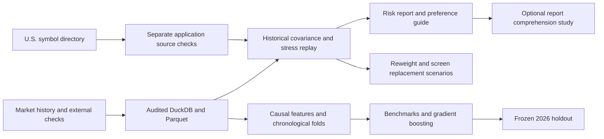

# riskitnot

**Status:** Version 1 is released. Version 2 checkpoint 1 is ready for participant sessions. [Version 2 action plan](docs/V2_ACTION_PLAN.md) · [Version 1 release](https://github.com/alisaayz/portfolio-risk/tree/v1.0.0)

## 1. Executive summary

riskitnot helps a self-directed investor understand what drives portfolio risk and compare hypothetical changes. The local dashboard measures volatility, drawdown, and holding-level risk contributions from audited historical data. It can suggest reweighting within user constraints, describe what a substitute would need to contribute, and screen an audited list on the same dates. The user can load a scenario into the comparison without changing the current portfolio.

The research track asks whether machine learning improves next-20-session volatility estimates. In a retrospective 2026 holdout, the trained model had the lowest average error. The portfolio uncertainty intervals crossed zero, so the project kept forecast output in research under its predeclared decision rule. The dashboard uses historical estimates. [2026 holdout report](docs/FINAL_EVALUATION_REPORT.md)


## 2. Work completed

| Workstream | Implemented and verified |
| --- | --- |
| Data and source quality | Built a Python acquisition and audit pipeline, then promoted **27,504 adjusted price observations** across **16 instruments** into the versioned DS-002 warehouse. Each instrument has 1,719 expected sessions through November 3, 2026. Eighty selected close pairs and four issuer checks passed. Three unresolved benchmark discrepancies remain quarantined. [Audit and source checks](docs/UNIVERSE_VALIDATION.md) |
| SQL and historical risk | Built DuckDB views and Parquet exports with explicit dataset versions and exchange-session alignment. Independently reconciled 27,488 returns and 27,184 historical volatility windows. The dashboard compares fixed-weight portfolios with volatility, drawdown, risk contributions, correlations, and three historical stress windows. [Warehouse](docs/SQL_LAYER.md) · [Risk methodology](docs/BASELINE_PORTFOLIO_REPORT.md) |
| Forecast development and evaluation | Built twelve causal price features, chronological training folds, benchmark comparisons, and a pooled gradient boosting model. Refit the selected model on **19,776 pre-2026 labels** and evaluated ten non-overlapping market windows under a frozen protocol. [Feature pipeline](docs/MODELING_DATASET.md) · [Development results](docs/MODEL_DEVELOPMENT_REPORT.md) · [Frozen protocol](docs/FINAL_EVALUATION_PROTOCOL.md) |
| Local application and decisions | Built a five-question risk preference guide, constrained reweighting, portfolio-specific replacement criteria, and an audited candidate screen. The wider U.S. directory supports manual ticker discovery and separately audited on-demand histories. [Application](docs/APPLICATION.md) · [U.S. coverage](docs/US_MARKET_EXPANSION.md) |
| Product evaluation | Defined a product decision about the default report chart, instrumented an opt-in local comprehension pilot, and built sample-size and confirmatory analysis tools. The facilitated pilot materials are ready. Participant outcomes are pending. [Experiment brief](docs/REPORT_EXPERIMENT.md) · [Facilitator guide](docs/USABILITY_PILOT.md) |

The standard demo starts at **11.29%** annualized historical volatility. With a 10% move budget, constrained reweighting produces **9.58%**. With a 10% volatility target and a 10% swap out of AAPL, six of thirteen screened candidates qualify on the 252-session window. The IEF demonstration comparison yields **9.59%**. The screen matched 39 independent portfolio recalculations. [Reweighting evaluation](docs/PORTFOLIO_REWEIGHTING.md) · [Candidate screen](docs/PORTFOLIO_CANDIDATE_SCREEN.md)

A fresh checkout with independently installed pinned dependencies passed all **159 tests**. Using the preserved source evidence, it rebuilt the same warehouse dataset and reproduced the dashboard's demo assessment, reweighting, candidate screen, and practice study. [Reproduction guide](docs/REPRODUCE.md)

## 3. Composition and methodology



### Historical analysis and adjustments

The app aligns returns to expected exchange sessions and estimates annualized sample covariance using 63, 126, or 252 returns. It calculates portfolio volatility from the covariance matrix and attributes risk to each holding. Historical wealth and stress replay assume fixed weights rebalanced daily. The preference questions provide context about willingness to accept losses and access to funds. A separate manual reference sets the optional volatility target. [Risk preference guide](docs/RISK_PREFERENCES.md)

Reweighting minimizes historical variance while respecting locked positions, weight bounds, and a cap on the share of value moved. A 36-date development replay found that a simple shift from the highest to the lowest standalone volatility matched the optimizer's mean result at 252 sessions for both demos. The optimizer adds the ability to respect user constraints. [Reweighting report](docs/PORTFOLIO_REWEIGHTING.md)

For replacement, the selected weight moves from one holding into one new instrument. The guide solves for feasible standalone volatility at several assumed correlations with what remains. The screen checks actual matched returns for unheld instruments in the 16-instrument research list, reports the resulting portfolio estimate, and lets the user load a qualifying scenario. [Replacement criteria](docs/PORTFOLIO_REPLACEMENT_CRITERIA.md) · [Screening method](docs/PORTFOLIO_CANDIDATE_SCREEN.md)

### Retrospective model holdout

The trained model estimates realized volatility over the next 20 sessions. The portfolio forecasts combine holding-level variance forecasts with 60 sessions of observed co-movement. The comparison uses the same windows for the trained forecast, an exponentially weighted baseline, and a trailing baseline.

| Forecast | Holding MAE | Demo portfolio MAE |
| --- | ---: | ---: |
| Trained model | **4.43** | **1.63** |
| Exponentially weighted baseline | 4.80 | 2.23 |
| Trailing 20-session baseline | 4.76 | 2.20 |

Errors are percentage points of annualized volatility. The portfolio comparisons use two fixed demos on ten shared market dates. Resampling dates in blocks accounts for shared market shocks. Both nominal portfolio intervals include zero. The full report includes holding-level errors, overlapping daily diagnostics, and independent SQL reconciliation of 10,854 score rows. [Holdout results and uncertainty](docs/FINAL_EVALUATION_REPORT.md)


### Run the project

In the original project folder, start the dashboard with the existing local warehouse.

```bash
.venv/bin/python -m scripts.serve_portfolio_app
```

Open [the local dashboard](http://127.0.0.1:8765/). A fresh checkout can install dependencies and run the software tests from tracked files. The exact historical demo requires the saved data captures, which are kept outside Git. The reproduction guide lists the input folders and offline rebuild commands. [Reproduction guide](docs/REPRODUCE.md)

### Limitations and follow-up

The source snapshot ends November 3, 2026. The reference universe contains 16 current survivors, and price histories can be revised. The historical scenarios exclude transaction costs and taxes. Candidate ranking measures volatility on matched dates. Exposure, liquidity, fees, and investment objectives require separate review. Portfolio inputs stay local. [Source policy](docs/DATA_SOURCE_POLICY.md) · [Application guide](docs/APPLICATION.md)

The usability pilot needs real participants. A later forecast study could record predictions before new outcomes arrive. The news work established bounded metadata feasibility and documents what continuous coverage would require. [Facilitator guide](docs/USABILITY_PILOT.md) · [News audit](docs/NEWS_FEASIBILITY.md)

Additional build details and experiment evidence are indexed in the [project plan](docs/PROJECT_PLAN.md) and [implementation checklist](docs/ACTION_PLAN.md).
