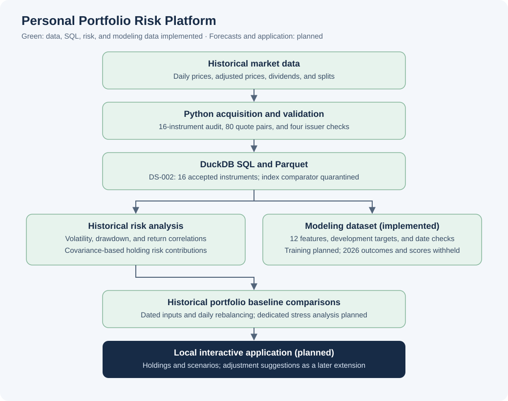
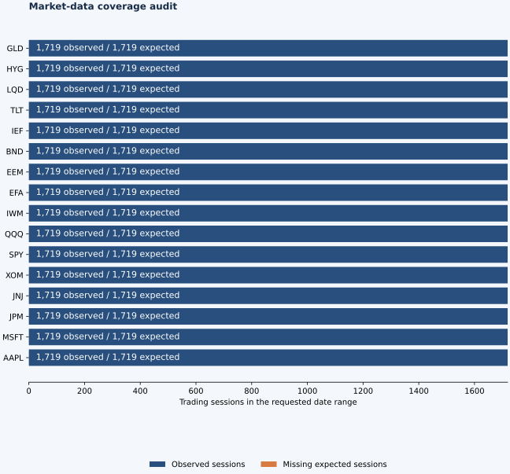
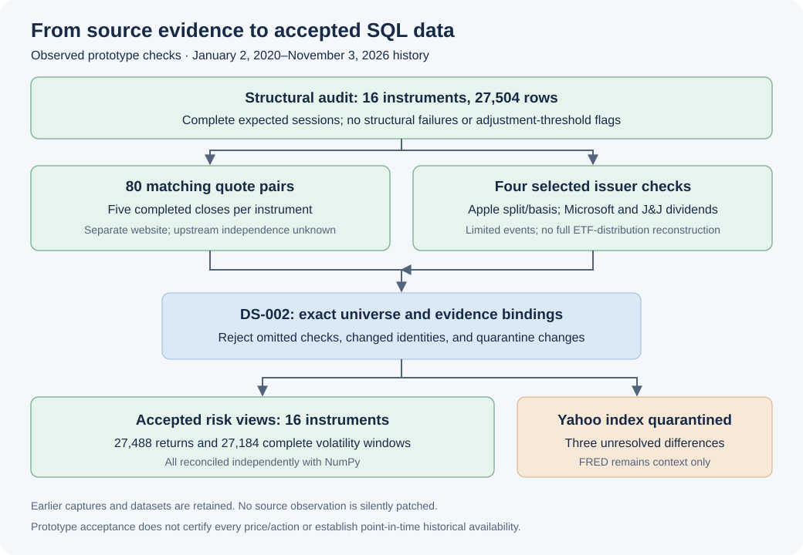
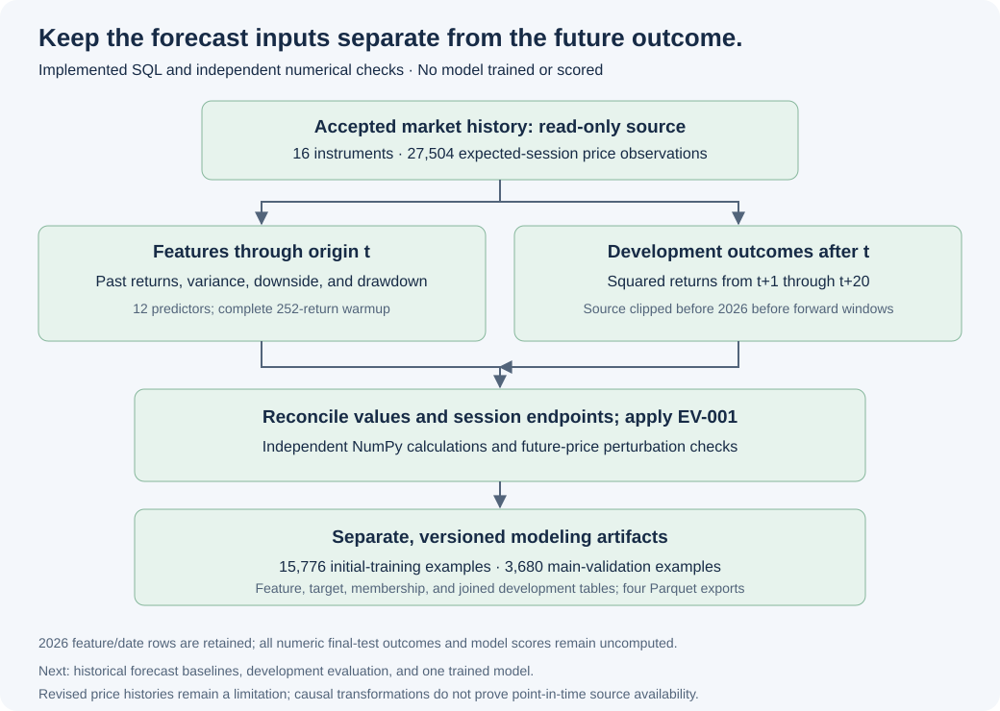
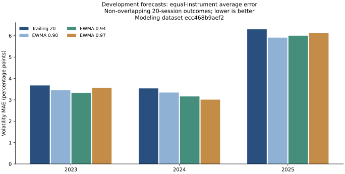
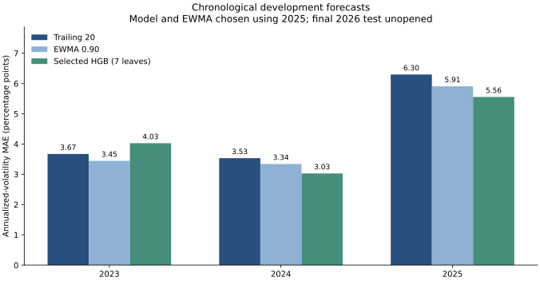
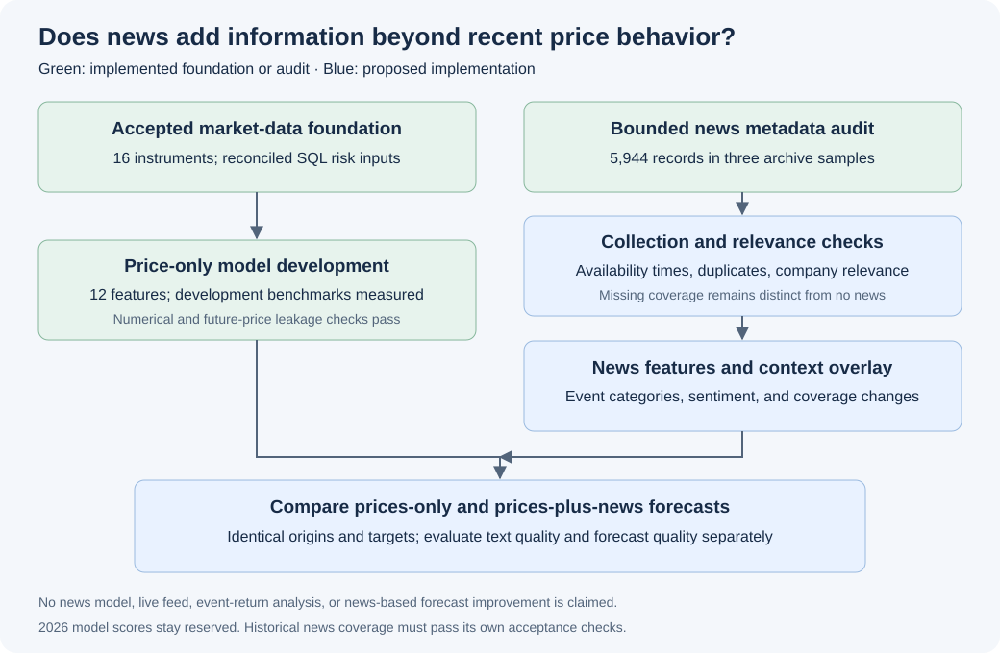

# Personal Portfolio Risk Platform

**Status:** SQL foundation, portfolio analysis, and chronological machine-learning development experiments implemented; final testing and application planned.
**Last updated:** November 4, 2026.

## 1. Executive summary

The Personal Portfolio Risk Platform is a financial analytics project for evaluating existing investments and comparing hypothetical portfolios. Its intended application will explain portfolio volatility, identify major sources of risk, and examine exposure to historical market stress. A later suggestion layer will propose weight changes or replacement criteria relative to user-defined risk preferences, with optional candidate screening.

The central research question is whether a trained model can forecast volatility over the next 20 trading days more accurately than historical estimates. The implemented foundation downloads and audits real market history, preserves evidence, and loads versioned observations into DuckDB and Parquet. SQL views enforce source-selection rules and calculate calendar-aligned returns and historical volatility inputs. A separate versioned modeling layer builds causal features and pre-2026 targets under the chronological evaluation contract. The baseline report compares dated portfolios using historical covariance, volatility, drawdown, and holding risk contributions. Historical benchmarks and pooled gradient-boosted models are evaluated on development years; final testing and the application are subsequent milestones.

## 2. Work completed

The implementation includes an isolated Python environment, pinned dependencies, reproducible market-data acquisition, structural audits, cross-source comparisons, versioned SQL/Parquet storage, and an explainable historical portfolio report. The accepted research capture contains **27,504 daily observations across 16 instruments**, covering January 2, 2020–November 3, 2026. Each instrument has all **1,719 expected sessions**, with no structural failures or adjustment-threshold review flags. Provider action records include 645 dividends and one split.

**Eighty selected closing-price pairs match** a separate finance website. Four narrowly scoped issuer checks cover Apple's split and dividend amount basis and selected Microsoft and Johnson & Johnson dividends. These checks do not certify every price or action. FRED SP500 versus Yahoo ^GSPC retains **three unresolved benchmark discrepancies**; original observations are preserved, FRED remains context-only, and the Yahoo comparator stays quarantined.

Under versioned policy **DS-002**, the warehouse retains **37,818 price rows across three captures** and selects **27,504 observations** for analytical use. Seven source runs, two dataset versions, and five Parquet exports are retained. Repeated loading preserves the dataset, counts, and export hashes. All **27,488 daily returns** and **27,184 complete 20-return volatility windows** reconcile with independent NumPy calculations.

The historical portfolio engine accepts validated weights or latest-close quantities, aligns common history, and independently reconciles SQL and Python calculations. Two explicitly labeled AAPL/SPY/BND demonstrations have annualized sample volatility of **11.29%** and **7.24%** over the 252 returns ending November 3, 2026. Their maximum drawdowns are **−26.94%** and **−19.46%** over the full 2020–2026 replay. These assume daily rebalancing without costs or taxes. Small adjusted-price differences across captures change unrounded metrics slightly; displayed results are unchanged and report versions remain distinct.

The [evaluation protocol](docs/EVALUATION_PROTOCOL.md) reserves **2026 for final historical model testing**, with main validation in 2025 and earlier development folds. A date-only pipeline enforces warmup, target boundaries, incomplete-outcome exclusions, and non-overlapping primary origins. It computes no model scores. The [Qlib walkthrough](docs/01_QLIB_WALKTHROUGH.md) documents the workflow reference; Qlib has not been executed.

The [modeling dataset](docs/MODELING_DATASET.md) implements **12 price-based predictors**, separate future-target and date-membership tables, and explicit development views. All **330,048 feature cells** and **24,128 pre-2026 target rows** reconcile with independent NumPy calculations, including null positions and incomplete horizons. The current sample supplies **15,776 initial-training examples** and **3,680 main-validation examples**. Future-value perturbation and target-boundary checks pass; **zero numerical 2026 targets** are computed. The market database remains read-only, and repeated modeling builds verify the stored database and four Parquet exports.

A bounded [news feasibility audit](docs/NEWS_FEASIBILITY.md) inspects **5,944 records** from three historical GDELT archive batches. Titles appear in 5,942 records; precise publication fields appear in 2,778, with 90 later-than-batch timestamps flagged for review. This demonstrates sample metadata access, not continuous news coverage or forecast usefulness. An offline auditor verifies saved hashes and reports schema, timing, duplicates, and candidate company mentions. No news model, live collector, or event-return calculation is implemented.

The [forecast benchmark experiment](docs/BASELINE_FORECAST_REPORT.md) compares trailing-20-session variance with EWMA decays 0.90, 0.94, and 0.97 on identical 2023–2025 development dates. Each primary year has **192 matched pairs per method**: twelve non-overlapping target windows per instrument. In 2025, the development-selected EWMA 0.90 has annualized-volatility MAE of **5.91 percentage points**, versus **6.30** for trailing variance. Trailing variance has lower QLIKE in that year, and the best EWMA decay varies across earlier years. All candidates, origins, errors, parameters, code/data versions, and output hashes are saved locally. These are development results, not final-test or portfolio-forecast accuracy claims.

The [trained-model experiment](docs/MODEL_DEVELOPMENT_REPORT.md) fits three fixed histogram gradient-boosting candidates on earlier outcomes for each 2023–2025 validation year. The selected seven-leaf model has 2025 primary volatility MAE of **5.56 percentage points**, versus **5.91** for selected EWMA and **6.30** for trailing variance, with lower QLIKE in that year. It performs worse than both selected benchmarks on 2023 MAE; this is mixed development evidence. All nine candidate/fold models reproduce their predictions on repeat fitting and after serialization. A separate verifier reconciles **81,536 per-origin errors** and **42 aggregate comparisons** without loading model files or calling the training evaluator. No final refitting or 2026 prediction, numeric outcome, or score is produced.

**One hundred and six regression tests pass locally**, covering data integrity, source acceptance, policy scope, rollback, exports, portfolio calculations, numerical reconciliation, and chronological boundaries. The [Python application workflow](.github/workflows/python-app.yml) runs fixture-based checks on pushes and pull requests. Final model testing and the interactive application remain subsequent milestones; development results do not establish final-test or live performance. A [future adjustment roadmap](docs/PORTFOLIO_ADJUSTMENT_ROADMAP.md) records requested reweighting, replacement criteria, and optional candidate suggestions; none is implemented.

## 3. Project composition and methodology

### Architecture and implementation status



*Green components are implemented for the initial sample. Remaining components describe the planned platform.*

| Component | Method | Current state |
| --- | --- | --- |
| Acquisition | Yahoo Finance history through yfinance, with explicit adjustment settings and corporate actions | Accepted for prototype work on 16 instruments under DS-002 |
| Evidence | Timestamped CSV snapshots, structured metadata, request settings, package versions, and SHA-256 hashes | Implemented; downloaded prices remain local |
| Quality control | Exchange-session coverage, duplicates, missing/invalid values, OHLC consistency, volume, and adjustment diagnostics | Implemented; see the [expanded audit](docs/UNIVERSE_AUDIT.md) |
| Verification | Regression tests, issuer cross-check, separate website spot checks, FRED benchmark reconciliation, and offline replay | 80 quote pairs and four issuer checks pass; three benchmark exceptions remain quarantined |
| SQL foundation | Transactional loading, explicit dataset versions, normalized Parquet, and policy-controlled views | Implemented; see the [SQL report](docs/SQL_LAYER.md) |
| Historical inputs | Calendar-aligned daily returns and complete trailing 20-return volatility windows | Returns used in portfolio analysis; trailing variance used in development forecasts |
| Portfolio baseline | Sample covariance, annualized volatility, full-history drawdown, correlations, and Euler holding contributions | Implemented; see the [demonstration report](docs/BASELINE_PORTFOLIO_REPORT.md) |
| Evaluation membership | Versioned chronological folds, horizon-end exclusions, warmup, and a reserved 2026 primary grid | Implemented; [eligibility counts](docs/EVALUATION_SPLITS.md) |
| News feasibility | Bounded historical metadata probes and offline schema/timestamp/relevance diagnostics | Audit implemented; [findings](docs/NEWS_FEASIBILITY.md); production collection/NLP planned |
| Modeling dataset | Twelve causal features, development-only 20-session targets, separate membership, and numerical/leakage checks | Implemented; [report](docs/MODELING_DATASET.md) and [feature dictionary](docs/06_MODELING_DATASET_WALKTHROUGH.md) |
| Forecast benchmarks | Trailing variance and three EWMA candidates, matched primary/daily samples, per-instrument/group metrics, and versioned experiments | Implemented on development years; [results](docs/BASELINE_FORECAST_REPORT.md) |
| Machine learning | Pooled positive-variance gradient boosting, purged chronological folds, fixed candidate grid, and independent score verification | Implemented on development years; [results](docs/MODEL_DEVELOPMENT_REPORT.md); final refit/test reserved |
| Application | Dated holdings, portfolio comparisons, historical scenarios, and visible assumptions | Planned |

### Data quality findings



The audit compares observed dates with configured exchange-session calendars, retains missing observations, and does not repair prices or fill gaps. It records dividend and split events and checks changes in the adjusted-close/close ratio. Threshold breaches produce review flags rather than automatic corrections.

A material finding is that the provider's Close field must not be assumed to be split-unadjusted. Around Apple's August 2020 split, applying the split ratio again would introduce an artificial return exceeding 300%. The [audit report](docs/DATA_AUDIT.md) documents this diagnostic, its issuer reference, and the limits of the verification.

The [cross-source report](docs/CROSS_SOURCE_VALIDATION.md) separates individual-instrument spot checks from same-index benchmark reconciliation. Yahoo ^GSPC remains excluded from model features and benchmark calculations until its source exceptions are resolved or formally dispositioned. No observed value is silently replaced.

yfinance is an unofficial interface to Yahoo Finance. The downloaded snapshots preserve library output rather than original HTTP payloads. Current adjusted histories can be revised and do not establish what was known at each historical forecast date. Downloaded prices, credentials, personal holdings, caches, and model artifacts remain outside version control.

### Run the implemented milestone

Tested with **Python 3.13.7**. Direct dependencies are listed in [requirements.in](requirements.in); exact installed versions are recorded in [requirements.txt](requirements.txt).

```bash
python3 -m venv .venv
.venv/bin/python -m pip install -r requirements.txt
.venv/bin/python scripts/audit_market_data.py --start 2020-01-01 --end 2026-11-04
.venv/bin/python -m unittest discover -s tests -v
```

The end date is exclusive. Each download creates a new local snapshot. To reproduce the audit from existing evidence without a new request:

```bash
.venv/bin/python scripts/audit_market_data.py --snapshot data/audit/<run-id>
```

The audit script generates `docs/DATA_AUDIT.md`, a coverage figure, and detailed local audit JSON. A structural failure produces a nonzero exit status. Unit tests use small synthetic fixtures to test failures; reported project findings come from downloaded market data.

To acquire external references and check a saved baseline:

```bash
.venv/bin/python -m scripts.cross_validate_sources --snapshot data/audit/<run-id>
```

This comparison generates `docs/CROSS_SOURCE_VALIDATION.md` and returns exit status 2 while unresolved comparisons remain. That is a data-quality finding, not a failed regression test. Offline replay instructions are in the report.

### Build and inspect the SQL warehouse

```bash
.venv/bin/python -m scripts.build_warehouse --snapshot data/audit/<selected-run-id> --historical-snapshot data/audit/<earlier-run-id> --external-snapshot data/validation/<external-run-id> --policy config/expanded_source_policy.json
.venv/bin/python -m scripts.verify_warehouse
```

The earlier capture is optional and may contain a supported subset of the primary universe. DS-002 requires exact universe/reference bindings, all sixteen quote checks, and the selected issuer checks. DS-001 remains available for its original three-instrument scope. The command verifies saved inputs, loads DuckDB, selects the explicit dataset, exports Parquet, and generates `docs/SQL_LAYER.md`. Repeat the same command to check idempotence. Dataset identity includes source manifests, policy, transformation code, SQL definitions, and the DuckDB version. Queries are in [sql/diagnostics.sql](sql/diagnostics.sql); the [SQL walkthrough](docs/03_SQL_WALKTHROUGH.md) explains their purpose.

The Python application workflow installs the pinned environment and runs the regression suite on pushes and pull requests. It uses test fixtures rather than private/local market-data files. This project is not distributed as a PyPI package.

### Historical portfolio risk methodology

The [demonstration report](docs/BASELINE_PORTFOLIO_REPORT.md) compares the allocations in [demo_portfolios.json](config/demo_portfolios.json). SQL computes weighted daily returns and sample covariance; NumPy independently reconciles both. Covariance uses the most recent 252 common returns, denominator N−1, and annualization by 252. Portfolio volatility is `sqrt(wᵀΣw)`. Euler contributions allocate that volatility to holdings and sum to the total; negative contributions are preserved.


In the equity-heavy demonstration, AAPL represents **30% of capital but 52.91% of estimated volatility risk**. Capital weights alone do not explain portfolio risk. This is an instrument-level result; it does not measure underlying ETF holdings overlap.

Drawdown uses all common closing history, including initial capital. Both portfolios assume fixed weights rebalanced daily; today's allocation is replayed retrospectively. Risk estimates and drawdowns therefore cover different periods and are historical measurements rather than forecasts. The demeaned sample-covariance estimator is distinct from the existing squared-return/RMS historical input and implemented development forward-variance target.

After building the warehouse, reproduce the public demonstration with:

```bash
.venv/bin/python -m scripts.portfolio_baseline --input config/demo_portfolios.json --publish-demo
```

Reports record the dataset, configuration, input hash, and calculation-code hashes. Downloaded histories and detailed replay outputs remain local. Personal inputs should be saved in `private/`; configurations labeled `is_demo: false` produce only private outputs and cannot use `--publish-demo`. Quantity valuation uses provider Close and supports only the latest common close. The [baseline walkthrough](docs/04_PORTFOLIO_BASELINE_WALKTHROUGH.md) explains validation, formulas, and limitations.

### Research universe and evaluation design

The [reference configuration](config/reference_universe.json) contains five individual stocks, five equity ETFs, five bond ETFs, and one gold trust. Selection targets varied exposures, not 2026 model performance. All observations pass structural checks, 80 quote pairs match, and four selected issuer checks pass. DS-002 now promotes the expanded capture to accepted SQL inputs. Earlier three-instrument captures and the original dataset remain retained. The [promotion walkthrough](docs/05_EXPANDED_SQL_WALKTHROUGH.md) explains source gates, a maintenance-page failure, cross-capture differences, and independent reconciliation.




[EV-001](config/evaluation_protocol.json) declares initial training on eligible 2020–2024 origins, main validation in 2025, and final testing in 2026. After recipe selection, final refitting can use eligible pre-2026 labels. The 252-return warmup means the first eligible training origin is December 31, 2020. Outcomes reaching a later partition are excluded; the newest 20 origins lack completed labels. As of November 3, each instrument has only ten completed non-overlapping primary test windows. Correlated instruments do not multiply the number of independent market episodes.

The original split manifest uses dates only. The separate modeling layer now computes features and development target values, verifies every endpoint, and checks feature readiness against that date contract. Final 2026 outcome values, final refitting, and final-test scores remain uncomputed. Development machine-learning runs are now recorded separately. Descriptive inspection of 2026 has already occurred, so final results will be labeled retrospective historical tests. The [testing plan](docs/EVALUATION_PROTOCOL.md) documents implemented numerical and feature-perturbation checks and planned walk-forward model evaluation, robustness slices, and forward-recorded predictions.

```bash
.venv/bin/python -m scripts.audit_market_data --universe config/reference_universe.json --start 2020-01-01 --end 2026-11-04
.venv/bin/python -m scripts.audit_market_data --snapshot data/audit/<expanded-run-id>
.venv/bin/python -m scripts.evaluation_splits --snapshot data/audit/<expanded-run-id>
```

### Modeling dataset and verified timing



SQL derives past returns, realized variance, downside variation, negative-return frequency, current drawdown, and extreme daily moves. A 252-return warmup determines feature readiness. Forward targets cover exactly t+1 through t+20; their source is clipped before 2026 before the future window is calculated. Target values crossing into the reserved year remain null, while feature and date rows are retained.

The [walkthrough and dictionary](docs/06_MODELING_DATASET_WALKTHROUGH.md) explain all twelve columns, examples around a stock split and year boundaries, and the distinction between inputs and outcomes. Future-price changes leave earlier features unchanged. Dedicated training/validation views enforce membership, and training code must select the predictor whitelist rather than infer inputs from all numeric columns.

```bash
.venv/bin/python -m scripts.build_modeling_dataset
```

This command writes a separate local DuckDB dataset, four Parquet tables, a versioned manifest, and a public aggregate report. It reconciles SQL against independent NumPy calculations and verifies existing artifacts on rerun. It performs no preprocessing fitting, model training, or scoring.

### Development forecast benchmarks

The baseline comparison uses the same future-twenty-session variance target as the trained model. Trailing variance assumes recent twenty-session risk persists. EWMA recursively gives newer squared returns more weight; three decays are recorded under [BL-001](config/forecast_baselines.json). The selected EWMA minimizes the declared primary 2025 validation MAE, with deterministic ties. Earlier years and the secondary QLIKE metric remain visible.



MAE is measured in annualized-volatility percentage points, not investment returns. Scores average each instrument first, then instruments equally. Primary target windows do not overlap within an instrument; the sixteen instruments still share market events. Daily overlapping results are secondary. Missing predictions fail the comparison rather than changing a method's sample. The [walkthrough](docs/07_FORECAST_BASELINES_WALKTHROUGH.md) explains recurrence, metrics, development selection, and uncertainty.

```bash
.venv/bin/python -m scripts.evaluate_baselines --modeling-dataset data/modeling/ecc468b9aef284824e22c7c1cb47f0f89517ff583061cc72ef0eff4d37d23d83
```

This experiment uses file-based tracking; MLflow is not installed. Source/modeling artifacts are verified, every candidate and output is preserved, and repeated runs must match saved hashes. No machine-learning model or 2026 forecast/target/score is produced.

### Trained-model development evaluation



[ML-001](config/model_training.json) fixes three histogram gradient-boosted candidates before their first real-data fit. Poisson deviance with a log link produces positive variance estimates for the continuous nonnegative target. Models use only the explicit twelve price features, equal total training weight per instrument, and no fitted preprocessing. Early stopping is disabled to prevent an automatic random internal validation split. Each model stays fixed throughout its validation year.

The [report](docs/MODEL_DEVELOPMENT_REPORT.md) contains all candidate scores, secondary daily comparisons, instrument-level errors, and realized-volatility diagnostics. The [walkthrough](docs/08_MODEL_TRAINING_WALKTHROUGH.md) explains feature isolation, target purging, positive outputs, repeat fitting, and artifact verification. Selection uses 2025 primary MAE, so the selected score is development evidence. No final-refit or 2026 predictions are generated. This estimates instrument variance; portfolio forecasts require a separate correlation estimator and evaluation.

```bash
.venv/bin/python -m scripts.train_risk_model --modeling-dataset data/modeling/<modeling-dataset-id>
.venv/bin/python -m scripts.verify_training_experiment --experiment data/experiments/trained_models/<experiment-id>
```

All candidate/fold model files, predictions, parameters, failures, hashes, and package versions remain in local experiment records. Tracking is file based; MLflow is not installed. Repeated successful runs must preserve experiment identity and every saved output hash. Raw market observations and models remain outside Git.

### Proposed news extension

The intended question is whether news adds information about risk beyond recent price behavior. The [feasibility report](docs/NEWS_FEASIBILITY.md) compares archived metadata, filing sources, financial-news datasets, and a candidate sentiment model. It records successful archive samples and unavailable API probes. Later market reactions are evaluation outcomes and must not become inputs to earlier forecasts. Historical availability, relevance, feed gaps, and duplicated stories require separate checks.



The proposed first application is an after-close company-news context layer. A future prediction comparison would use identical origins for prices-only and prices-plus-news models after compatible historical coverage is established. Current samples do not justify filling missing feeds with zero sentiment, claiming exact historical availability, or inferring ETF holdings exposure from a company mention. The price-only feature/target pipeline is now implemented. Historical forecast benchmarks and development evaluation are now implemented. Price-only trained-model development evaluation is implemented; news collection and NLP remain proposed extensions.

### Trained-model development and planned application

Each modeling row represents an instrument at a forecast date, with price inputs through that day's close. The implemented development target is realized variance over the following 20 trading sessions, annualized using a 252-session convention. Displayed volatility is the square root of variance; final-test numerical targets remain withheld.

Training, validation, and final testing follow the declared 2020–2024 / 2025 / 2026 chronological contract, with earlier development folds. Training labels whose future windows reach the next evaluation period are excluded. The implemented benchmark report evaluates trailing and exponentially weighted variance forecasts using annualized-volatility mean absolute error and variance QLIKE. Trained candidates use the same development origins and benchmark definitions. Final model scores remain unopened until the complete modeling recipe is frozen.

The initial application will support daily, USD-denominated stocks and ETFs in long-only, unleveraged portfolios. Fixed-weight historical scenarios will explicitly assume daily rebalancing; they will represent hypothetical exposures rather than actual past investment performance. Portfolio forecasting will require a separate correlation estimate and separate evaluation. ETF look-through holdings, taxes, derivatives, and automated trading are outside the initial scope.

### Later phase: explainable portfolio adjustments

If a portfolio exceeds the user's chosen risk tolerance, the planned suggestion layer will first explore changes to existing holding weights. It can later describe replacement characteristics or screen a defined candidate universe. Alternatives will show before/after estimated risk, concentration, risk contributions, allocation changes, and assumptions. If the requested target is infeasible, the system will report that result explicitly. Lower standalone volatility alone is insufficient; the candidate's co-movement with the remaining portfolio matters.

The [adjustment roadmap](docs/PORTFOLIO_ADJUSTMENT_ROADMAP.md) defines proposed inputs, stages, visual workflow, and evaluation requirements. This is a later extension after the core risk system is validated. It provides options for the user to consider; it does not guarantee future risk limits, forecast returns, or execute trades.

### Documentation and next milestone

- [Reference universe](docs/REFERENCE_UNIVERSE.md), [expanded audit](docs/UNIVERSE_AUDIT.md), and [source validation](docs/UNIVERSE_VALIDATION.md): selection, evidence, and acceptance limits.
- [Expanded SQL walkthrough](docs/05_EXPANDED_SQL_WALKTHROUGH.md): policy gates, archived failures, numerical checks, and capture differences.
- [Portfolio adjustment roadmap](docs/PORTFOLIO_ADJUSTMENT_ROADMAP.md): future weight suggestions, replacement criteria, and candidate screening.
- [Forecast benchmark report](docs/BASELINE_FORECAST_REPORT.md) and [walkthrough](docs/07_FORECAST_BASELINES_WALKTHROUGH.md): measured development errors, method tradeoffs, and experiment records.
- [Modeling dataset](docs/MODELING_DATASET.md) and [walkthrough/dictionary](docs/06_MODELING_DATASET_WALKTHROUGH.md): features, development outcomes, timing checks, and reproducible artifacts.
- [News feasibility](docs/NEWS_FEASIBILITY.md): observed archive metadata, timing limitations, candidate sources, and proposed implementation sequence.
- [Evaluation protocol](docs/EVALUATION_PROTOCOL.md) and [date eligibility](docs/EVALUATION_SPLITS.md): testing contract, implemented boundaries, and planned model checks.
- [Data audit](docs/DATA_AUDIT.md): observed findings, provenance, methods, and limitations.
- [Cross-source validation](docs/CROSS_SOURCE_VALIDATION.md): website quote checks and unresolved FRED/Yahoo benchmark differences.
- [SQL milestone report](docs/SQL_LAYER.md) and [walkthrough](docs/03_SQL_WALKTHROUGH.md): database composition, observed counts, and SQL interpretation.
- [Portfolio baseline report](docs/BASELINE_PORTFOLIO_REPORT.md) and [walkthrough](docs/04_PORTFOLIO_BASELINE_WALKTHROUGH.md): measured comparisons, assumptions, and calculation checks.
- [Data-audit walkthrough](docs/02_DATA_AUDIT_WALKTHROUGH.md): how to read and explain the implementation.
- [Action checklist](docs/ACTION_PLAN.md): tasks and completion criteria.
- [Project plan](docs/PROJECT_PLAN.md): the broader technical specifications.

The [source policy](docs/DATA_SOURCE_POLICY.md) accepts RU-001 under DS-002 for prototype work, selects FRED as the preferred price-index context source, and quarantines Yahoo ^GSPC. The underlying three discrepancies remain unresolved.

The SQL views now enforce this source policy. Next: train and chronologically evaluate one documented positive-variance model against the completed trailing-variance and development-selected EWMA benchmarks. Freeze the full procedure before deriving final-test outcomes or opening 2026 model scores.

### References

- [yfinance source and usage notes](https://github.com/ranaroussi/yfinance)
- [Exchange calendars](https://github.com/gerrymanoim/exchange_calendars)
- [Apple issuer announcement](https://www.apple.com/newsroom/2020/07/apple-reports-third-quarter-results/)
- [Microsoft Qlib workflow](https://qlib.readthedocs.io/en/latest/component/workflow.html)
- [FRED API and historical vintages](https://fred.stlouisfed.org/docs/api/fred/realtime_period.html)
- [MLflow experiment tracking](https://mlflow.org/docs/latest/ml/tracking/)
