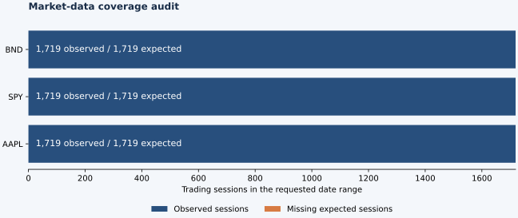
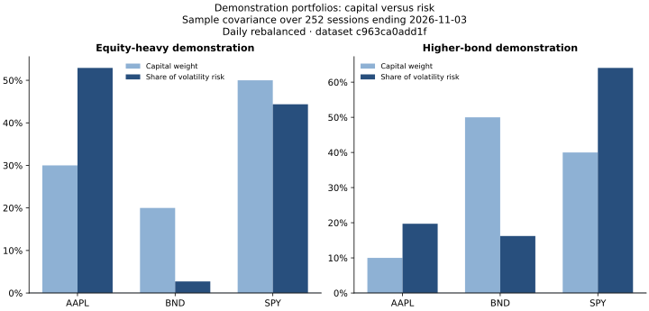
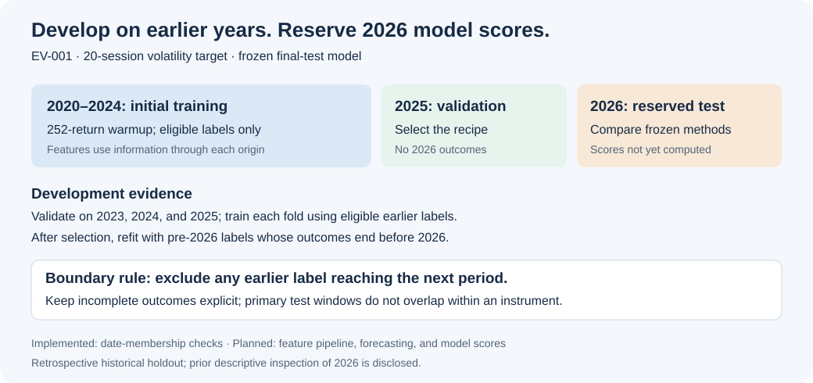

# Personal Portfolio Risk Platform

**Status:** Portfolio baseline, 16-instrument structural audit, and chronological split checks implemented; expanded SQL acceptance and forecasting planned.
**Last updated:** November 4, 2026.

## 1. Executive summary

The Personal Portfolio Risk Platform is a financial analytics project for evaluating existing investments and comparing hypothetical portfolios. Its intended application will explain portfolio volatility, identify major sources of risk, and examine exposure to historical market stress.

The central research question is whether a trained model can forecast volatility over the next 20 trading days more accurately than historical estimates. The implemented foundation downloads and audits real market history, preserves evidence, and loads versioned observations into DuckDB and Parquet. SQL views enforce source-selection rules and calculate calendar-aligned returns and historical volatility inputs. The baseline report compares dated portfolios using historical covariance, volatility, drawdown, and holding risk contributions. Model training and the application are subsequent milestones.

## 2. Work completed

The current implementation includes an isolated Python environment, pinned dependencies, a market-data acquisition and audit script, versioned local snapshots, and a generated quality report. The audit retrieved **5,157 daily observations** across AAPL, SPY, and BND, covering January 2, 2020 through November 3, 2026. Each instrument contained all **1,719 expected trading sessions**, with no duplicate dates, nonpositive prices, or inconsistent OHLC rows detected.

Corporate-action diagnostics cover **134 dividend events and one split**. A selected Apple split and dividend amount were checked against an issuer announcement. Fifteen selected closes match a separate finance website. A full-window comparison of FRED SP500 with Yahoo ^GSPC identified **three unresolved benchmark discrepancies** after accounting for published precision. Original source values are retained; benchmark acceptance is on hold.

The SQL warehouse retains **10,314 price rows across two captures** while selecting **5,157 observations** for analytical use. Five Parquet tables preserve normalized data and source rules. The repeated build leaves counts, dataset ID, and export hashes unchanged. All SQL daily returns and complete trailing-volatility windows match an independent NumPy calculation.

The historical risk engine accepts validated weights or latest-close quantities, aligns common history, and independently reconciles SQL aggregation and covariance against NumPy. Two explicitly labeled demonstrations use real market history. Over the 252 returns ending November 3, 2026, annualized sample volatility is **11.29%** for the equity-heavy demonstration and **7.24%** for the higher-bond demonstration. Full-history maximum drawdowns are **−26.94%** and **−19.46%**, respectively, over January 2, 2020–November 3, 2026. These are daily-rebalanced hypothetical allocations, without costs or taxes.

An expanded research capture contains **27,504 rows across 16 instruments**, spanning the same 1,719 sessions, with no structural failures or adjustment-threshold review flags. The [selection report](docs/REFERENCE_UNIVERSE.md) explains exposures, survivorship limits, and source-acceptance requirements. This capture is not yet the active SQL dataset; the verified portfolio report still uses the original three-instrument version.

The [evaluation protocol](docs/EVALUATION_PROTOCOL.md) reserves **2026 for final historical model testing**, uses 2025 for main validation, and adds development folds for 2023 and 2024. A date-only pipeline enforces 252-return warmup, 20-session target boundaries, incomplete-outcome exclusions, and non-overlapping primary test origins. It computes no model scores.

Forty-six regression tests cover data integrity, source alignment, transactional loading, export integrity, portfolio calculations, universe configuration, and chronological leakage boundaries. The [Python application workflow](.github/workflows/python-app.yml) runs fixture-based checks on pushes and pull requests. The three benchmark discrepancies remain unresolved and quarantined under the source policy. No model-performance claim is made.

The research scope, SQL schema, forecast target, evaluation design, and delivery checklist are also documented. A [Qlib source walkthrough](docs/01_QLIB_WALKTHROUGH.md) explains the adaptations required for volatility forecasting. No risk model has been trained.

## 3. Project composition and methodology

### Architecture and implementation status


*Green components are implemented for the initial sample. Remaining components describe the planned platform.*

| Component | Method | Current state |
| --- | --- | --- |
| Acquisition | Yahoo Finance history through yfinance, with explicit adjustment settings and corporate actions | Structurally audited for 16; SQL acceptance remains three instruments |
| Evidence | Timestamped CSV snapshots, structured metadata, request settings, package versions, and SHA-256 hashes | Implemented; downloaded prices remain local |
| Quality control | Exchange-session coverage, duplicates, missing/invalid values, OHLC consistency, volume, and adjustment diagnostics | Implemented; see the [audit report](docs/DATA_AUDIT.md) |
| Verification | Regression tests, issuer cross-check, separate website spot checks, FRED benchmark reconciliation, and offline replay | Implemented; three benchmark exceptions remain open |
| SQL foundation | Transactional loading, explicit dataset versions, normalized Parquet, and policy-controlled views | Implemented; see the [SQL report](docs/SQL_LAYER.md) |
| Historical inputs | Calendar-aligned daily returns and complete trailing 20-return volatility windows | Returns used in baseline; trailing volatility reserved for forecasting |
| Portfolio baseline | Sample covariance, annualized volatility, full-history drawdown, correlations, and Euler holding contributions | Implemented; see the [demonstration report](docs/BASELINE_PORTFOLIO_REPORT.md) |
| Evaluation membership | Versioned chronological folds, horizon-end exclusions, warmup, and a reserved 2026 primary grid | Implemented; [eligibility counts](docs/EVALUATION_SPLITS.md) |
| Modeling | Next-20-session variance forecasts compared with historical baselines | Planned |
| Application | Dated holdings, portfolio comparisons, historical scenarios, and visible assumptions | Planned |

### Data quality findings



The audit compares observed dates with configured exchange-session calendars, retains missing observations, and does not repair prices or fill gaps. It records dividend and split events and checks changes in the adjusted-close/close ratio. Threshold breaches produce review flags rather than automatic corrections.

A material finding is that the provider's Close field must not be assumed to be split-unadjusted. Around Apple's August 2020 split, applying the split ratio again would introduce an artificial return exceeding 300%. The [audit report](docs/DATA_AUDIT.md) documents this diagnostic, its issuer reference, and the limits of the verification.

The [cross-source report](docs/CROSS_SOURCE_VALIDATION.md) separates individual-instrument spot checks from same-index benchmark reconciliation. Yahoo ^GSPC remains excluded from model features and benchmark calculations until its source exceptions are resolved or formally dispositioned. No observed value is silently replaced.

yfinance is an unofficial interface to Yahoo Finance. The downloaded snapshots preserve library output rather than original HTTP payloads. Current adjusted histories can be revised and do not establish what was known at each historical forecast date. Downloaded prices, credentials, personal holdings, caches, and model artifacts remain outside version control.

### Run the implemented milestone

Tested with **Python 3.13.7**. Direct dependencies are listed in [requirements.in](requirements.in); exact installed versions are recorded in [requirements.txt](requirements.txt).

```bash
python3 -m venv .venv
.venv/bin/python -m pip install -r requirements.txt
.venv/bin/python scripts/audit_market_data.py --start 2020-01-01 --end 2026-11-04
.venv/bin/python -m unittest discover -s tests -v
```

The end date is exclusive. Each download creates a new local snapshot. To reproduce the audit from existing evidence without a new request:

```bash
.venv/bin/python scripts/audit_market_data.py --snapshot data/audit/<run-id>
```

The audit script generates `docs/DATA_AUDIT.md`, a coverage figure, and detailed local audit JSON. A structural failure produces a nonzero exit status. Unit tests use small synthetic fixtures to test failures; reported project findings come from downloaded market data.

To acquire external references and check a saved baseline:

```bash
.venv/bin/python -m scripts.cross_validate_sources --snapshot data/audit/<run-id>
```

This comparison generates `docs/CROSS_SOURCE_VALIDATION.md` and returns exit status 2 while unresolved comparisons remain. That is a data-quality finding, not a failed regression test. Offline replay instructions are in the report.

### Build and inspect the SQL warehouse

```bash
.venv/bin/python -m scripts.build_warehouse --snapshot data/audit/<selected-run-id> --historical-snapshot data/audit/<earlier-run-id> --external-snapshot data/validation/<external-run-id>
```

The earlier capture is optional. The command verifies saved inputs, loads DuckDB, selects the explicit dataset, exports Parquet, and generates `docs/SQL_LAYER.md`. Repeat the same command to check idempotence. Dataset identity includes source manifests, policy, transformation code, SQL definitions, and the DuckDB version. Queries are in [sql/diagnostics.sql](sql/diagnostics.sql); the [SQL walkthrough](docs/03_SQL_WALKTHROUGH.md) explains their purpose.

The Python application workflow installs the pinned environment and runs the regression suite on pushes and pull requests. It uses test fixtures rather than private/local market-data files. This project is not distributed as a PyPI package.

### Historical portfolio risk methodology

The [demonstration report](docs/BASELINE_PORTFOLIO_REPORT.md) compares the allocations in [demo_portfolios.json](config/demo_portfolios.json). SQL computes weighted daily returns and sample covariance; NumPy independently reconciles both. Covariance uses the most recent 252 common returns, denominator N−1, and annualization by 252. Portfolio volatility is `sqrt(wᵀΣw)`. Euler contributions allocate that volatility to holdings and sum to the total; negative contributions are preserved.



In the equity-heavy demonstration, AAPL represents **30% of capital but 52.91% of estimated volatility risk**. Capital weights alone do not explain portfolio risk. This is an instrument-level result; it does not measure underlying ETF holdings overlap.

Drawdown uses all common closing history, including initial capital. Both portfolios assume fixed weights rebalanced daily; today's allocation is replayed retrospectively. Risk estimates and drawdowns therefore cover different periods and are historical measurements rather than forecasts. The demeaned sample-covariance estimator is distinct from the existing squared-return/RMS historical input and planned forward variance target.

After building the warehouse, reproduce the public demonstration with:

```bash
.venv/bin/python -m scripts.portfolio_baseline --input config/demo_portfolios.json --publish-demo
```

Reports record the dataset, configuration, input hash, and calculation-code hashes. Downloaded histories and detailed replay outputs remain local. Personal inputs should be saved in `private/`; configurations labeled `is_demo: false` produce only private outputs and cannot use `--publish-demo`. Quantity valuation uses provider Close and supports only the latest common close. The [baseline walkthrough](docs/04_PORTFOLIO_BASELINE_WALKTHROUGH.md) explains validation, formulas, and limitations.

### Research universe and evaluation design

The [reference configuration](config/reference_universe.json) contains five individual stocks, five equity ETFs, five bond ETFs, and one gold trust. Selection targets varied exposures, not 2026 model performance. All returned observations pass structural checks; independent quote/action review and tested acceptance-policy/loader changes are required before expanded SQL promotion. The existing three-instrument dataset and portfolio report remain preserved.



[EV-001](config/evaluation_protocol.json) declares initial training on eligible 2020–2024 origins, main validation in 2025, and final testing in 2026. After recipe selection, final refitting can use eligible pre-2026 labels. The 252-return warmup means the first eligible training origin is December 31, 2020. Outcomes reaching a later partition are excluded; the newest 20 origins lack completed labels. As of November 3, each instrument has only ten completed non-overlapping primary test windows. Correlated instruments do not multiply the number of independent market episodes.

The implemented split manifest uses dates only. Features, target values, model runs, and scores remain subsequent work. Descriptive inspection of 2026 has already occurred, so final results will be labeled retrospective historical tests. The [testing plan](docs/EVALUATION_PROTOCOL.md) distinguishes implemented checks from planned feature perturbation, walk-forward model evaluation, robustness slices, and forward-recorded predictions.

```bash
.venv/bin/python -m scripts.audit_market_data --universe config/reference_universe.json --start 2020-01-01 --end 2026-11-04
.venv/bin/python -m scripts.audit_market_data --snapshot data/audit/<expanded-run-id>
.venv/bin/python -m scripts.evaluation_splits --snapshot data/audit/<expanded-run-id>
```

### Planned forecasting and application methodology

Each modeling row will represent an instrument at a forecast date, with inputs available by that day's close. The target will be realized variance over the following 20 trading sessions, annualized using a 252-session convention. Displayed volatility will be the square root of variance.

Training, validation, and final testing follow the declared 2020–2024 / 2025 / 2026 chronological contract, with earlier development folds. Training labels whose future windows reach the next evaluation period will be excluded. A trained model will be compared with trailing and exponentially weighted variance forecasts using annualized-volatility mean absolute error and variance QLIKE. Final model scores remain unopened until the complete modeling recipe is frozen.

The initial application will support daily, USD-denominated stocks and ETFs in long-only, unleveraged portfolios. Fixed-weight historical scenarios will explicitly assume daily rebalancing; they will represent hypothetical exposures rather than actual past investment performance. Portfolio forecasting will require a separate correlation estimate and separate evaluation. ETF look-through holdings, taxes, derivatives, and automated trading are outside the initial scope.

### Documentation and next milestone

- [Reference universe](docs/REFERENCE_UNIVERSE.md) and [expanded structural audit](docs/UNIVERSE_AUDIT.md): selection, evidence, and acceptance limits.
- [Evaluation protocol](docs/EVALUATION_PROTOCOL.md) and [date eligibility](docs/EVALUATION_SPLITS.md): testing contract, implemented boundaries, and planned model checks.
- [Data audit](docs/DATA_AUDIT.md): observed findings, provenance, methods, and limitations.
- [Cross-source validation](docs/CROSS_SOURCE_VALIDATION.md): website quote checks and unresolved FRED/Yahoo benchmark differences.
- [SQL milestone report](docs/SQL_LAYER.md) and [walkthrough](docs/03_SQL_WALKTHROUGH.md): database composition, observed counts, and SQL interpretation.
- [Portfolio baseline report](docs/BASELINE_PORTFOLIO_REPORT.md) and [walkthrough](docs/04_PORTFOLIO_BASELINE_WALKTHROUGH.md): measured comparisons, assumptions, and calculation checks.
- [Data-audit walkthrough](docs/02_DATA_AUDIT_WALKTHROUGH.md): how to read and explain the implementation.
- [Action checklist](docs/ACTION_PLAN.md): tasks and completion criteria.
- [Project plan](docs/PROJECT_PLAN.md): the broader technical specifications.

The [source policy](docs/DATA_SOURCE_POLICY.md) accepts the audited stock/ETF sample for prototype work, selects FRED as the preferred price-index context source, and quarantines Yahoo ^GSPC. The underlying three discrepancies remain unresolved.

The SQL views now enforce this source policy. Next: independently review expanded quote/action evidence and extend the tested SQL acceptance policy/loader to the 16-instrument sample. Then implement and reconcile SQL features and forward targets under EV-001 before training or opening 2026 model scores.

### References

- [yfinance source and usage notes](https://github.com/ranaroussi/yfinance)
- [Exchange calendars](https://github.com/gerrymanoim/exchange_calendars)
- [Apple issuer announcement](https://www.apple.com/newsroom/2020/07/apple-reports-third-quarter-results/)
- [Microsoft Qlib workflow](https://qlib.readthedocs.io/en/latest/component/workflow.html)
- [FRED API and historical vintages](https://fred.stlouisfed.org/docs/api/fred/realtime_period.html)
- [MLflow experiment tracking](https://mlflow.org/docs/latest/ml/tracking/)
