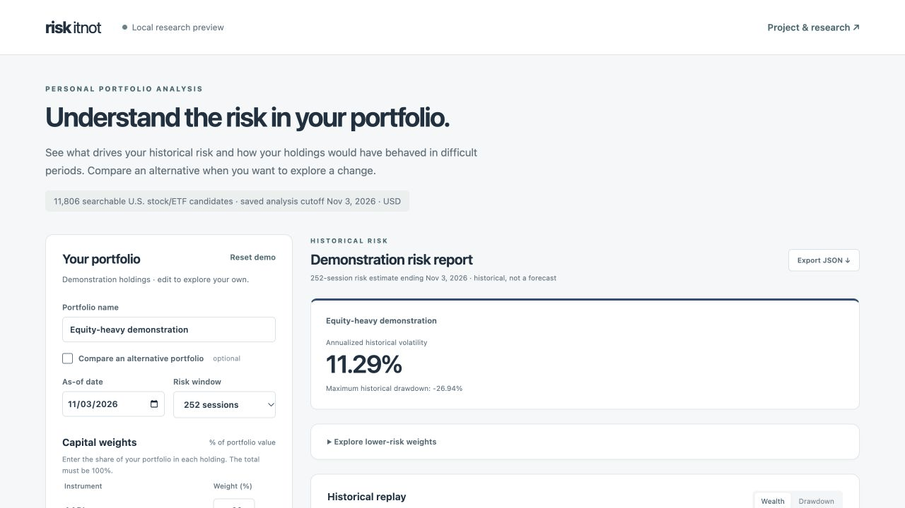
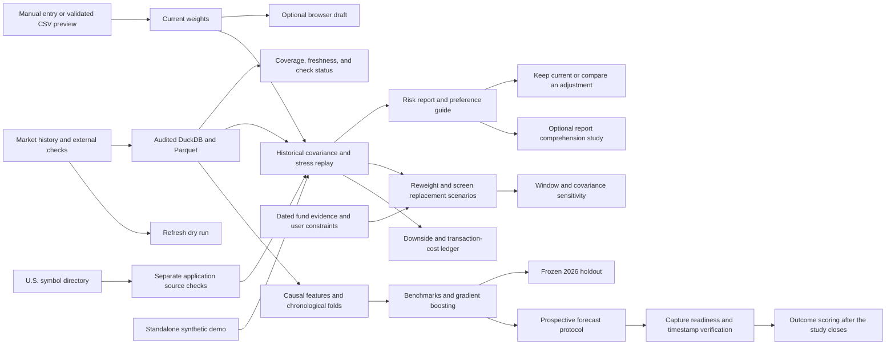
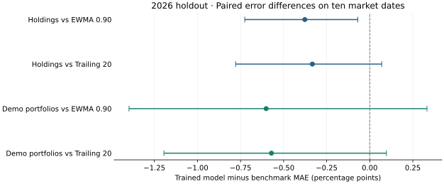

# riskitnot

**Status:** Version 2 technical preview published November 5, 2026. [Release readout](docs/V2_RELEASE_READOUT.md) · [Data and release manifest](docs/V2_DATA_AND_RELEASE_MANIFEST.md) · Version 1 is preserved. [Checkpoint 3 evidence](docs/V2_RISK_EVIDENCE.md) Participant results are pending. [Guided workflow](docs/V2_GUIDED_WORKFLOW.md) · [Technical baseline](docs/V1_SCRIPTED_REHEARSAL.md) [Version 2 action plan](docs/V2_ACTION_PLAN.md) · [Version 1 release](https://github.com/alisaayz/portfolio-risk/tree/v1.0.0)

## 1. Executive summary

riskitnot helps a self-directed investor understand what drives portfolio risk and compare hypothetical changes. The local dashboard measures volatility, drawdown, and holding-level risk contributions from audited historical data. It can suggest reweighting within user constraints, describe what a substitute would need to contribute, and screen an audited list on the same dates. The Version 2 workflow starts with one portfolio entered manually or imported from CSV. The user can save a local weight draft, compare a hypothetical allocation, or keep the current one. The comparison shows historical downside, simulated trading costs, and whether a replacement meets a volatility target across multiple windows and estimators.

The research track asks whether machine learning improves next-20-session volatility estimates. In a retrospective 2026 holdout, the trained model had the lowest average error. The portfolio uncertainty intervals crossed zero, so the project kept forecast output in research under its predeclared decision rule. The dashboard uses historical estimates. The prospective protocol fixes the comparison before new forecasts and outcomes arrive. A local preflight checks the candidate data, and an independent timestamp receipt verifies when each enrolled forecast existed. [2026 holdout report](docs/FINAL_EVALUATION_REPORT.md) · [Prospective protocol](docs/PROSPECTIVE_FORECAST_PROTOCOL.md)

**Version 1 dashboard**



## 2. Work completed

| Workstream | Implemented and verified |
| --- | --- |
| Data and source quality | Built a Python acquisition and audit pipeline, then promoted **27,504 adjusted price observations** across **16 instruments** into the versioned DS-002 warehouse. Each instrument has 1,719 expected sessions through November 3, 2026. Eighty selected close pairs and four issuer checks passed. Three unresolved benchmark discrepancies remain quarantined. [Audit and source checks](docs/UNIVERSE_VALIDATION.md) |
| SQL and historical risk | Built DuckDB views and Parquet exports with explicit dataset versions and exchange-session alignment. Independently reconciled 27,488 returns and 27,184 historical volatility windows. The dashboard compares fixed-weight portfolios with volatility, drawdown, risk contributions, correlations, and three historical stress windows. [Warehouse](docs/SQL_LAYER.md) · [Risk methodology](docs/BASELINE_PORTFOLIO_REPORT.md) |
| Forecast development and evaluation | Built twelve causal price features, chronological training folds, benchmark comparisons, and a pooled gradient boosting model. Refit the selected model on **19,776 pre-2026 labels** and evaluated ten non-overlapping market windows under a frozen protocol. [Feature pipeline](docs/MODELING_DATASET.md) · [Development results](docs/MODEL_DEVELOPMENT_REPORT.md) · [Frozen protocol](docs/FINAL_EVALUATION_PROTOCOL.md) |
| Local application and decisions | Built a five-question risk preference guide, constrained reweighting, portfolio-specific replacement criteria, and an audited candidate screen. The wider U.S. directory supports manual ticker discovery and separately audited on-demand histories. [Application](docs/APPLICATION.md) · [U.S. coverage](docs/US_MARKET_EXPANSION.md) |
| Version 2 guided workflow | Added a local CSV preview for weights and USD market values, a browser-local weight draft, a keep-current decision, and a visible summary of the risk window, manual target, move cap, and locks. Built a standalone synthetic demo. Verified 30 matching real-data API decisions and exercised the guided flow in the browser. [Implementation and verification](docs/V2_GUIDED_WORKFLOW.md) |
| Version 2 risk and decision evidence | Built a self-financing cost ledger for daily and monthly schedules, downside measures, dated exposure and fee evidence, and a six-setting replacement screen. Evaluated three adjustment policies on four portfolios and 36 shared dates. The simple shift is the default under the predeclared decision rule. [Risk evidence](docs/V2_RISK_EVIDENCE.md) |
| Version 2 provenance and release | Added price coverage and check details, a snapshot age indicator, and a refresh preview that stages changes outside the active warehouse. Verified the public synthetic demo from a fresh clone and prepared a write-once forward forecast recorder. [Release checks](docs/V2_RELEASE_READOUT.md) |
| Prospective enrollment | Added a local readiness check and RFC 3161 receipt verification. Tested signature and digest verification with an independent timestamp on a generated fixture. Added an outcome scorer that enforces the study end date and evidence requirements. Live enrollment awaits an eligible market snapshot. [Forecast and receipt workflow](docs/PROSPECTIVE_FORECAST_PROTOCOL.md) |
| Product evaluation | Defined a product decision about the default report chart, instrumented an opt-in local comprehension pilot, and built sample-size and confirmatory analysis tools. Prepared matching decision tasks and separate facilitator guides for the Version 1 and Version 2 pilots. Participant outcomes are pending. [Experiment brief](docs/REPORT_EXPERIMENT.md) · [Version 2 decision pilot](docs/V2_DECISION_PILOT.md) |

The Version 1 market-data demo starts at **11.29%** annualized historical volatility. With a 10% move budget, constrained reweighting produces **9.58%**. With a 10% volatility target and a 10% swap out of AAPL, six of thirteen screened candidates qualify on the 252-session window. The IEF demonstration comparison yields **9.59%**. The screen matched 39 independent portfolio recalculations. [Reweighting evaluation](docs/PORTFOLIO_REWEIGHTING.md) · [Candidate screen](docs/PORTFOLIO_CANDIDATE_SCREEN.md)

The Version 1 release passed **159 tests** in a fresh checkout with independently installed pinned dependencies. The published Version 2 preview passed **173 tests**. The prospective workflow branch passes **183 tests**. Using the preserved source evidence, it rebuilt the same warehouse dataset and reproduced the dashboard's demo assessment, reweighting, candidate screen, and practice study. [Reproduction guide](docs/REPRODUCE.md)

## 3. Composition and methodology



### Historical analysis and adjustments

CSV parsing runs in the browser. Weights must sum to 100%, while positive market values are converted into weights. Applying an import replaces current weights and preserves a prepared alternative. A saved draft stores only current tickers and weights in the browser. [CSV and draft specification](docs/V2_GUIDED_WORKFLOW.md)

The app aligns returns to expected exchange sessions and estimates annualized sample covariance using 63, 126, or 252 returns. It calculates portfolio volatility from the covariance matrix and attributes risk to each holding. Historical wealth and stress replay assume fixed weights rebalanced daily. The preference questions provide context about willingness to accept losses and access to funds. A separate manual reference sets the optional volatility target. [Risk preference guide](docs/RISK_PREFERENCES.md)

Reweighting minimizes historical variance while respecting locked positions, weight bounds, and a cap on the share of value moved. A 36-date development replay found that a simple shift from the highest to the lowest standalone volatility matched the optimizer's mean result at 252 sessions for both demos. The optimizer adds the ability to respect user constraints. [Reweighting report](docs/PORTFOLIO_REWEIGHTING.md)

Version 2 reports downside deviation and a dated worst session. Its trade ledger compares zero cost, 5 basis points per buy or sell dollar, and a 25 basis point wider-spread scenario. The simple shift remained the default after the optimizer improved mean annualized downside deviation by 0.034 percentage points against a 0.25-point threshold. [Risk evidence and policy replay](docs/V2_RISK_EVIDENCE.md)

For replacement, the selected weight moves from one holding into one new instrument. The guide solves for feasible standalone volatility at several assumed correlations with what remains. The screen checks actual matched returns for unheld instruments in the 16-instrument research list, reports the resulting portfolio estimate, and compares the candidate across three windows with sample and shrinkage covariance. Optional eligibility filters cover instrument role, the largest resulting weight, dollar volume, and available dated annual fund fees. Only a stable result that passes the filters can populate an alternative. [Replacement criteria](docs/PORTFOLIO_REPLACEMENT_CRITERIA.md) · [Screening method](docs/PORTFOLIO_CANDIDATE_SCREEN.md)

### Price provenance

The dashboard reports directory discovery, accepted prices, screening membership, and the age of the saved data separately. The detailed report identifies the primary capture and the five selected quote checks per audited instrument, with source dates and issuer checks. A refresh can be replayed against a disposable warehouse copy. [Release readout and dry run](docs/V2_RELEASE_READOUT.md)

### Retrospective model holdout

The trained model estimates realized volatility over the next 20 sessions. The portfolio forecasts combine holding-level variance forecasts with 60 sessions of observed co-movement. The comparison uses the same windows for the trained forecast, an exponentially weighted baseline, and a trailing baseline.

| Forecast | Holding MAE | Demo portfolio MAE |
| --- | ---: | ---: |
| Trained model | **4.43** | **1.63** |
| Exponentially weighted baseline | 4.80 | 2.23 |
| Trailing 20-session baseline | 4.76 | 2.20 |

Errors are percentage points of annualized volatility. The portfolio comparisons use two fixed demos on ten shared market dates. Resampling dates in blocks accounts for shared market shocks. Both nominal portfolio intervals include zero. The full report includes holding-level errors, overlapping daily diagnostics, and independent SQL reconciliation of 10,854 score rows. [Holdout results and uncertainty](docs/FINAL_EVALUATION_REPORT.md)



### Run the project

On the Version 2 branch, run the standalone demo from the repository root with Python 3.13 installed.

```bash
./scripts/run_demo.sh
```

Open [the synthetic demo](http://127.0.0.1:8766/). The launcher installs pinned dependencies and generates prices for three fictional tickers. The demo exercises risk assessment and comparison.

To run market analysis from the saved warehouse in the project folder:

```bash
.venv/bin/python -m scripts.serve_portfolio_app
```

Open [the local dashboard](http://127.0.0.1:8765/). A fresh checkout can install dependencies and run the software tests from tracked files. Rebuilding the exact market-data demo requires the saved data captures, which are kept outside Git. The reproduction guide lists the input folders and offline rebuild commands. [Reproduction guide](docs/REPRODUCE.md)

### Limitations and follow-up

The source snapshot ends November 3, 2026. The reference universe contains 16 current survivors, and price histories can be revised. The original stress replay excludes transaction costs and taxes. The Version 2 cost ledger uses explicitly assumed per-trade charges. Issuer-level overlap is unknown, and the screen uses limited dated fund evidence and a dollar-volume proxy. Optional weight drafts are stored in the current browser profile and local address. [Source policy](docs/DATA_SOURCE_POLICY.md) · [Application guide](docs/APPLICATION.md)

The technical preview has no participant outcomes. The prospective workflow has a verified receipt path. Live enrollment requires an authorized audit capture that reaches the scheduled close. The release manifest records the local data and permission boundaries. The news work established bounded metadata feasibility and documents what continuous coverage would require. [Facilitator guide](docs/USABILITY_PILOT.md) · [News audit](docs/NEWS_FEASIBILITY.md)

Additional build details and experiment evidence are indexed in the [project plan](docs/PROJECT_PLAN.md) and [implementation checklist](docs/ACTION_PLAN.md).
