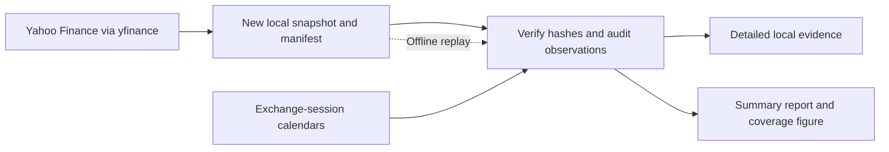

# Step 2: understand the implemented data audit

Completed November 4, 2026. This walkthrough accompanies the [generated audit report](DATA_AUDIT.md) and [Python script](../scripts/audit_market_data.py).

## Purpose

Before calculating portfolio risk, establish whether the input history has usable coverage, valid prices, and understandable corporate-action adjustments. The first sample uses real Yahoo Finance history for AAPL, SPY, and BND. It does not contain simulated project observations.

## Follow the script in this order

| Function | Responsibility | Why it matters |
| --- | --- | --- |
| `download_snapshot` | Request history with explicit settings and save a new run folder | Prevents invisible changes in request assumptions and preserves the acquired evidence |
| `materialize_metadata` | Convert the library's metadata wrapper into a JSON-compatible mapping | Keeps metadata structured without triggering an unrelated lazy intraday request |
| `expected_sessions` | Obtain configured exchange-calendar dates | Distinguishes closures and weekends from missing expected observations |
| `audit_frame` | Check rows, values, price relationships, and corporate actions | Identifies defects before they affect returns and forecasts |
| `inspect_snapshot` | Verify saved hashes and environment versions, then run checks | Detects altered evidence and supports offline replay |
| `write_report` and `write_figure` | Present observed findings and limitations | Connects implementation to a reviewable decision |

The workflow is:



## What is stored

Each local `data/audit/<run-id>/` folder contains three provider-output CSVs, metadata files, a request/environment manifest, and detailed audit results. The manifest records SHA-256 hashes: fingerprints that allow replay to detect changes to saved files. The snapshots are library outputs, not untouched HTTP responses. New downloads create new run folders; offline replay can regenerate derived audit results without modifying the acquired CSVs or manifest.

The public report contains aggregate findings and methods. Downloaded histories remain local and are ignored by Git.

## Read three findings carefully

1. **Coverage:** each instrument has 1,719 expected sessions and 1,719 observed rows. January 1, 2020 is not treated as a missing trading day. The date range ends on November 3, 2026 because the request's end date is exclusive.
2. **Adjustments:** Apple's provider history records a four-for-one split on August 31, 2020. The returned Close series already behaves on a split-adjusted basis. Applying that split again would create an artificial return above 300%. The [issuer announcement](https://www.apple.com/newsroom/2020/07/apple-reports-third-quarter-results/) confirms the ratio and first split-adjusted trading date.
3. **Meaning of a pass:** no implemented structural checks failed, and no thresholds raised review flags. This supports proceeding to a prototype. It does not prove every quote is correct, independently verify every ETF distribution, or establish production reliability.

## Reproduce and inspect

Run these commands from the project folder:

```bash
# Fresh acquisition; creates a new snapshot.
.venv/bin/python scripts/audit_market_data.py --start 2020-01-01 --end 2026-11-04

# Reuse the run identifier printed by the script.
.venv/bin/python scripts/audit_market_data.py --snapshot data/audit/<run-id>

# Test failure detection independently of the live provider.
.venv/bin/python -m unittest discover -s tests -v
```

Open one downloaded CSV and find `Close`, `Adj Close`, `Dividends`, and `Stock Splits`. Then match an action date to the corresponding event record in the local `audit.json`. The report identifies the exact snapshot used for its findings.

The eight tests use small, clearly synthetic fixtures to check exchange closures, gaps, duplicates, invalid values, dividend adjustments, split double-adjustment, altered snapshots, and lazy metadata. They are separate from the real observations supporting the audit report.

## External checks and open findings

The additional [source-validation script](../scripts/cross_validate_sources.py) compares the latest five completed-session closes for each instrument with Stock Analysis. All 15 quotes match at the published two-decimal precision. It separately compares FRED SP500 with Yahoo ^GSPC over 1,719 sessions; FRED is a same-index benchmark check, not an individual stock/ETF quote source.

Three benchmark differences remain above the 0.02-index-point tolerance. A fourth native-float boundary flag falls exactly at the allowed tolerance when represented at the sources' published precision. The raw differences remain in local evidence. A targeted Yahoo request reproduced the largest discrepancy, so the original capture was retained rather than corrected.

Four additional regression tests cover precision boundaries, missing reference dates, duplicate joins, and excluding the next day's live quote. The complete test suite contains 12 tests. Read [CROSS_SOURCE_VALIDATION.md](CROSS_SOURCE_VALIDATION.md) before treating any benchmark as accepted. The validator intentionally exits with status 2 while discrepancies remain.

## Explain the result in an interview

The project now has a reproducible acquisition and validation workflow, rather than a one-time CSV download. It preserves source settings and versions, detects missing expected sessions, checks financial-data conventions, and supports replay from saved evidence. A specific engineering issue was the provider library's lazy metadata wrapper: serializing it directly produced a string rather than structured JSON. The implementation now converts its mapping explicitly and excludes an unrelated lazy field.

The [source-selection decision](DATA_SOURCE_POLICY.md) is documented. The next stage is SQL storage with canonical views and a data-quality issue ledger that enforce it. No portfolio risk report or machine-learning forecast is implemented yet.
