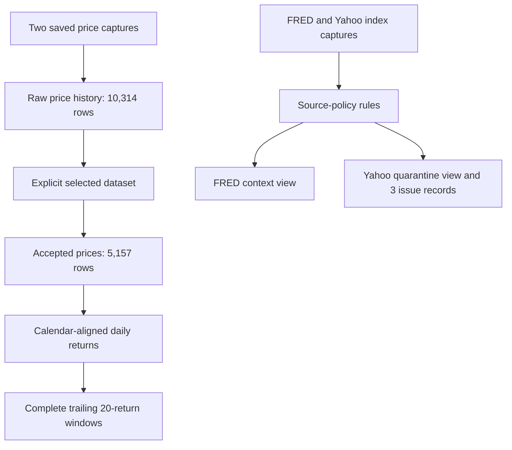

# Step 3: understand the SQL warehouse

Implemented November 4, 2026. Read the [generated SQL milestone report](SQL_LAYER.md) for observed counts and the [loader](../scripts/build_warehouse.py) for execution.

## What changed

The project now converts saved, audited files into a queryable database with explicit source and dataset versions. The earlier and selected price captures remain separate. An active-dataset pointer determines which capture feeds analytical views; the pipeline does not choose a version based on whichever file happens to be newest.



## The SQL concepts this demonstrates

| Concept | Concrete implementation |
| --- | --- |
| Data grain | A price row is an instrument, session, and source capture—not just a ticker/date |
| Primary and foreign keys | Prevent duplicate observation keys and require referenced source/dataset identities |
| Transactions | Insert observations and select a dataset together; roll back a failed database load |
| Idempotence | Reloading the same inputs leaves row counts and analytical results unchanged |
| Policy views | Select accepted sources through explicit rules; keep the comparator queryable in quarantine |
| Window functions | `LAG` calculates one-session returns; a bounded window calculates historical volatility |
| Calendar joins | Missing sessions remain visible and cannot silently become longer-period returns |
| Parquet | Store versioned normalized tables with hashes and verify their agreement with SQL rows |

Schema: [schema.sql](../sql/schema.sql). Analytical definitions: [views.sql](../sql/views.sql). Inspection queries: [diagnostics.sql](../sql/diagnostics.sql). Machine-readable source rules: [source_policy.json](../config/source_policy.json).

## Read three queries

Run queries from Python without changing the database:

```python
import duckdb

with duckdb.connect("data/warehouse/portfolio-risk.duckdb", read_only=True) as con:
    print(con.execute("""
        SELECT instrument_id, count(*) AS observations
        FROM accepted_prices_daily
        GROUP BY instrument_id ORDER BY instrument_id
    """).fetchall())

    print(con.execute("""
        SELECT source_id, series_id, count(*) AS observations
        FROM benchmark_context_daily
        GROUP BY source_id, series_id
    """).fetchall())

    print(con.execute("""
        SELECT observation_date, absolute_difference, tolerance, status
        FROM active_quality_issues ORDER BY observation_date
    """).fetchall())
```

The first query returns 1,719 observations per instrument. The second returns only FRED SP500 context. The third exposes the three unresolved differences without substituting one source's values for another's.

## Interpret the historical inputs

Each instrument has 1,718 usable one-session returns because the first observation lacks a prior price. It has 1,699 complete 20-return windows. The annualization convention is `sqrt(252 * mean(return²))`. This is a historical estimate using information through each session; it is not an ML forecast.

All SQL returns and complete volatility windows were reconciled against an independent NumPy calculation on the saved real-data sample. The repeated real-data load preserved row counts, dataset ID, and all five Parquet hashes. Regression fixtures additionally check rollback, version selection, duplicate prevention, source quarantine, gap handling, changed manifests, policy rejection, and export corruption.

## Database versus file publication

DuckDB changes are transactional. Parquet is a separate cache: write into a new staging directory, publish the complete directory, and verify existing files on rerun. A cache failure after database commit can be retried; the system does not claim atomic commitment across both storage systems.

DuckDB 2.0 requires results to be consumed before some other connection operations. The loader explicitly fetches results, including statement results, before registering incoming tables or writing relations. This behavior was checked in the repeated-load tests.

## Automated checks and next stage

The Python application workflow runs the regression suite on pushes and pull requests using self-contained fixtures. It installs the pinned dependencies and needs neither downloaded histories nor account secrets. Its result must be verified on GitHub before claiming the remote checks passed. It does not publish a Python package.

The subsequent [portfolio baseline](BASELINE_PORTFOLIO_REPORT.md) now uses these SQL returns and adds independently reconciled sample covariance, holding risk contributions, and drawdown. Its [walkthrough](04_PORTFOLIO_BASELINE_WALKTHROUGH.md) explains the different volatility estimator. Dedicated stress scenarios and trained forecasts remain planned. Next: expand the reference universe and construct versioned features, forward targets, and chronological splits.
