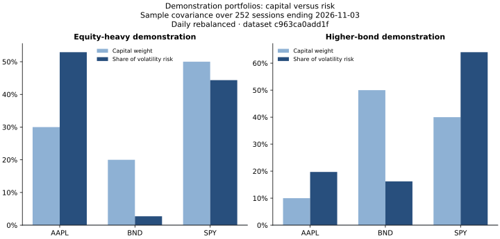

# Portfolio baseline walkthrough

Updated November 4, 2026. This milestone turns the accepted SQL history into an explainable historical risk report. It does not train a model.

## 1. Define the question and input

The question is: **How does my capital allocation translate into historical portfolio risk, and what changes under another allocation?** The [public configuration](../config/demo_portfolios.json) declares two illustrative allocations. Their prices are real; their allocations are demonstration inputs rather than actual personal holdings.

Each report declares a holdings date, USD reporting currency, risk window, and fixed-weight daily-rebalanced convention. Positive weights must sum to one; invalid values and duplicate instruments fail rather than being repaired. Quantities are converted to capital weights using provider Close at the latest common close. Dividend-adjusted historical prices must not be used to value current shares. Historical quantity valuation is rejected because share/split reconstruction is not implemented.

## 2. Align history before calculating

[scripts/portfolio_baseline.py](../scripts/portfolio_baseline.py) reads accepted prices, calendar-aligned returns, and the explicit active dataset from DuckDB. It does not download prices or include quarantined benchmark observations.

All compared portfolios share one panel across the union of their holdings. History starts at the latest first available date and is restricted to the requested as-of date. The report counts observations excluded before that common start. Missing internal prices or returns, unsupported symbols, unavailable dates, and insufficient risk-window history produce errors. No forward filling or silent reduction of the risk window is allowed. For the initial three instruments, no leading history is excluded.

## 3. Estimate volatility and explain its sources

For the latest 252 common daily returns, calculate sample covariance with denominator N−1, then multiply by 252 to express variance on an annual scale. For a capital-weight vector w and annual covariance matrix Σ:

```text
portfolio variance = wᵀ Σ w
portfolio volatility σ = sqrt(wᵀ Σ w)
holding i contribution = w_i × (Σw)_i / σ
holding i risk share = contribution_i / σ
```

The contributions sum to portfolio volatility. They measure how each instrument contributes through its own variability and co-movement with the other holdings. A diversifying instrument can have a negative contribution; the implementation preserves that value. Zero-volatility portfolios have undefined risk shares, saved as null rather than misleading percentages.

This estimator subtracts the sample mean. The warehouse's historical 20-return input and the planned forward target instead use squared-return/RMS variance. Those definitions are deliberately separate and must be identified in comparisons.



In the equity-heavy example, AAPL has a 30% capital weight and a 52.91% risk share. That difference answers the report's practical question: allocation size alone does not identify the dominant source of risk. These are ticker-level contributions; ETF holdings overlap requires separate data.

## 4. Replay drawdown under explicit assumptions

[sql/portfolio_returns.sql](../sql/portfolio_returns.sql) aggregates daily portfolio return as the weighted sum of instrument returns. The caller checks that every expected date and holding is present, then compares SQL output with NumPy matrix multiplication.

The replay starts with wealth of one at the first common close, compounds daily portfolio returns, and compares each value with its running high-water mark. Maximum drawdown is the largest decline from a preceding peak. The report records the peak, trough, and first recovery date, where observed.

The replay uses **all common closing history**, while covariance and risk contributions use the **latest 252 returns**. Their periods are printed separately. Fixed weights imply daily rebalancing throughout the past replay. This is a retrospective hypothetical scenario, without costs, taxes, or slippage, rather than actual brokerage performance.

## 5. Verify calculations through separate paths

| Calculation | Independent comparison |
| --- | --- |
| Weighted daily portfolio returns | DuckDB aggregation versus NumPy matrix multiplication |
| Annual sample covariance | DuckDB `covar_samp` versus NumPy covariance |
| Portfolio volatility | Covariance formula versus weighted-series sample standard deviation |
| Holding contributions | Sum of Euler contributions versus portfolio volatility |
| Maximum drawdown | Vectorized wealth/high-water marks versus a separate scalar replay including initial capital |

Ten additional regression tests exercise invalid inputs, date filtering, gaps, quantity valuation, contribution identities, hedging contributions, zero-risk handling, drawdown dates, insufficient history, and private publication controls. The complete suite contains 30 tests. Synthetic fixtures are used only for tests; measured project results use the downloaded histories.

## 6. Reproduce and preserve evidence

With the existing warehouse available:

```bash
.venv/bin/python -m scripts.portfolio_baseline --input config/demo_portfolios.json --publish-demo
.venv/bin/python -m unittest discover -s tests -v
```

The report identity hashes the dataset ID, configuration, actual calculation inputs, script, and aggregation SQL. Detailed metrics, the recipe, daily replay, and figures are saved under the local report identity. Explicit demo publication copies only the summary and aggregate SVG figures into documentation. Source histories remain outside Git.

For personal use, save an input under `private/`, set `is_demo` to false, and omit `--publish-demo`. Personal reports are saved under ignored `private/portfolio_reports/`; the demo publication flag rejects personal configurations. Never relabel personal inputs as a demo to publish them.

## 7. Interpret the limits and next step

The report uses revised adjusted-price histories as return proxies. It does not reconstruct brokerage cash flows, point-in-time prices, or historical share counts. Cash, leverage, currency conversion, underlying ETF exposure, and dedicated stress-period selection are outside this milestone. The three index-source discrepancies remain quarantined and do not enter these calculations.

The next step is to select and audit a broader reference universe, then implement features, future targets, and chronological splits. The historical baseline provides a verified calculation standard before adding trained forecasts. See the [report](BASELINE_PORTFOLIO_REPORT.md) for measured results and the [action plan](ACTION_PLAN.md) for outstanding work.
