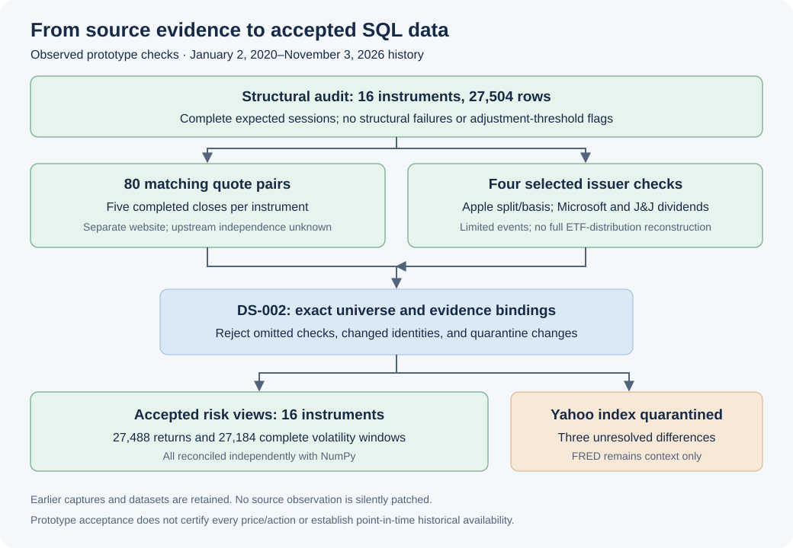

# Expanded source acceptance and SQL walkthrough

Updated November 4, 2026. This milestone promotes the 16-instrument research capture to accepted prototype SQL inputs while preserving previous versions and unresolved source evidence.

## Problem and evidence

A larger download is not automatically an accepted analytical dataset. The pipeline must establish what was checked, which source is permitted for each purpose, and whether changing the accepted capture alters previous results.



The [expanded comparison](UNIVERSE_VALIDATION.md) matches five completed daily closes per instrument against a separate website: 80 quote pairs. It also replays four narrowly scoped issuer references: Apple's split and dividend amount basis, Microsoft's selected dividend, and Johnson & Johnson's selected dividend. The registry records which dates and amounts are supported; Apple's dividend announcement does not independently verify its provider ex-date. ETF distributions are not independently reconstructed.

The first Johnson & Johnson URL returned HTTP 200 with maintenance-page content. The check correctly rejected it for missing evidence. A separate public investor-relations announcement supplied the required issuer facts in a new capture. The earlier response and failed comparison remain preserved locally. An HTTP success status alone does not establish usable evidence.

## Versioned policy and loading

[DS-002](../config/expanded_source_policy.json) admits exactly RU-001's sixteen instruments for risk-price use. It binds the universe content and selected issuer-reference registry by hash. FRED SP500 remains context-only; Yahoo ^GSPC remains quarantined. Unknown or duplicate rules, missing quote checks, failed issuer checks, changed instrument identities, and insufficient benchmark evidence block activation.

The loader retains earlier three-instrument captures even though they contain a subset of the active universe. Historical captures must use supported symbols and the same instrument/calendar identities. One database transaction inserts observations and selects the active dataset. The original DS-001 configuration remains available for its original scope.

The warehouse now retains 37,818 price rows across three captures and selects 27,504 observations for analytical views. Seven source runs and two dataset versions are retained at this checkpoint. The selected dataset contains 1,719 FRED context observations, 1,719 quarantined Yahoo index observations, and three active issue records. The [generated SQL report](SQL_LAYER.md) records the dataset identity and reproduction command.

Parquet remains a separate recoverable cache. Five complete exports are published by dataset identity, then hash- and content-checked on rerun. Repeating the real-data build preserved the dataset, counts, and all five export hashes.

## Independent numerical reconciliation

[verify_warehouse.py](../scripts/verify_warehouse.py) reads accepted adjusted prices and independently reconstructs every one-session return and complete 20-return RMS window using NumPy. It compares them with SQL using absolute tolerance 1e-12 and identical null handling.

All **27,488 returns** and **27,184 complete volatility windows** reconcile across sixteen instruments. Tests also remove a price to check the missing-session barrier and deliberately change the SQL volatility scale to demonstrate that reconciliation detects incorrect calculations. These checks concern historical inputs, not model forecasts or 2026 model scores.

## Capture differences and baseline refresh

Comparing the initial accepted capture with the expanded capture for AAPL, SPY, and BND shows identical Close, dividend, and split fields but small differences in adjusted close. Changed adjusted-close row counts are 1,080, 1,095, and 1,349 respectively. The largest absolute difference is below $0.00025 and the largest relative difference is below 0.0001%. The underlying source/library cause is not established; both versions remain intact.

The descriptive portfolio baseline was regenerated on the accepted expanded dataset. Independent calculation checks pass. Its unrounded metrics differ slightly across captures, so exact equality is not claimed; the displayed two-decimal volatility and drawdown results are unchanged. The report carries a distinct dataset and report identity. A local pre-promotion database checkpoint also preserves the previous active selection.

## Testing and next step

The complete suite contains **62 software tests**. New checks exercise scope bindings, every-instrument quote coverage, issuer-content failures, changed instrument identities, quarantine rules, rollback, and independent numerical reconciliation. These are software/data checks; feature leakage tests and chronological forecast evaluation remain subsequent work.

The subsequent [modeling dataset](MODELING_DATASET.md) now implements separate SQL features/development targets, independent reconciliation, and future-value perturbation under [EV-001](EVALUATION_PROTOCOL.md). Next: forecast baselines and development evaluation. Keep final 2026 model scores unopened until the complete modeling recipe is frozen.

```bash
.venv/bin/python -m scripts.verify_warehouse
.venv/bin/python -m scripts.portfolio_baseline --input config/demo_portfolios.json --publish-demo
.venv/bin/python -m unittest discover -s tests -v
```

All downloaded source files, local databases, full comparison results, and replay series remain outside Git. Public documentation presents methods, aggregate findings, and evidence links.
