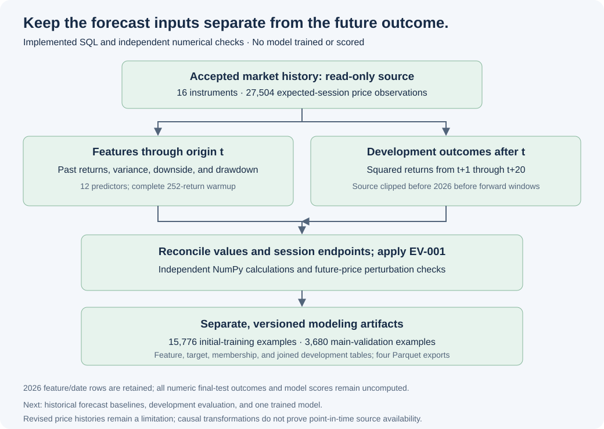

# Modeling dataset walkthrough and feature dictionary

Updated November 4, 2026. This milestone converts accepted price history into traceable model inputs and development-only outcomes. It implements data preparation, not model training or forecast evaluation. [Observed counts and checks](MODELING_DATASET.md).

## 1. Forecast origin and target

A prediction will be made after the close at origin t. Every predictor uses prices through t only. The outcome is the squared-return realized variance over the next twenty exchange sessions, annualized by 252; its square root is the displayed volatility target.

```text
r[t] = adjusted_close[t] / adjusted_close[t-1] - 1
RV_n[t] = (252/n) × sum(r[s]^2, s=t-n+1..t)
target_variance[t] = (252/20) × sum(r[s]^2, s=t+1..t+20)
target_volatility[t] = sqrt(target_variance[t])
```

This convention does not subtract the sample mean. It is distinct from the N−1 sample covariance used by the descriptive portfolio report. Twenty future sessions exclude the origin return. Missing sessions must not compress that horizon.



## 2. Predictor whitelist

The following twelve columns are the complete numeric predictor whitelist for this feature version. All returns and drawdowns are decimal fractions; annualized variances are squared annualized-volatility units. Names, dates, split flags, future target dates, and labels are metadata or outcomes, not additional predictors.

| Feature | Definition at t | Completeness requirement |
| --- | --- | --- |
| return_1 | One-session adjusted-price return | Current and previous expected-session prices |
| return_5 | Compounded return across the last five sessions | Five consecutive valid returns |
| return_20 | Compounded return across the last twenty sessions | Twenty consecutive valid returns |
| return_60 | Compounded return across the last sixty sessions | Sixty consecutive valid returns |
| variance_5 | RV over the latest five returns | Five valid returns |
| variance_20 | RV over the latest twenty returns | Twenty valid returns |
| variance_60 | RV over the latest sixty returns | Sixty valid returns |
| variance_252 | RV over the latest 252 returns | 252 valid returns |
| downside_variance_20 | `252 × mean(min(r,0)²)` across twenty returns | Positive returns contribute zero; missing returns remain missing |
| negative_fraction_20 | Fraction of the latest twenty returns below zero | Twenty valid returns |
| drawdown_60 | Current adjusted price divided by the highest of the latest 61 closes, minus one | Sixty-one valid prices spanning sixty returns; this is current drawdown, not maximum drawdown in that interval |
| max_abs_return_20 | Largest absolute daily return in the latest twenty returns | Twenty valid returns |

Warmup rows are retained with null features where required history is unavailable. A modeling row becomes feature-ready after 252 consecutive valid returns. On the current accepted dataset, that first occurs December 31, 2020. The initial 2020 shock therefore does not have eligible forecasts under this feature contract; pre-2020 context would require a separately reviewed data/protocol version.

Volume, news, economic series, fundamentals, instrument-ID encodings, and expected-return predictions are not features in this version. Adding a predictor requires updating the whitelist, dictionary, provenance, and evaluation procedure.

## 3. Separate features from future outcomes

[modeling_features.sql](../sql/modeling_features.sql) uses backward-looking windows partitioned by dataset and instrument. Returns are derived from the full expected-session price index. Window counts prevent a missing price from being silently dropped or converted into a longer-horizon return. The production builder stops on incomplete accepted price history; synthetic gap fixtures test the transformation's null behavior separately.

[modeling_targets.sql](../sql/modeling_targets.sql) first clips source prices to dates before 2026, then computes future windows. This order prevents 2026 outcomes from entering a development target. Origins with fewer than twenty valid development returns receive no numeric target. The independent NumPy reference applies the same pre-2026 source restriction before its own calculations.

The target table includes dated metadata for all origins, with one of four statuses: development complete, incomplete development, crossing the test boundary, or reserved test. All reserved-test and boundary-crossing numeric outcomes are null. That is deliberate withholding, distinct from a zero-volatility outcome.

## 4. Apply EV-001 membership

The builder reuses the existing session-based membership rules and requires the calculated feature readiness to agree with the date-only warmup. It verifies that each complete target's actual twentieth future session equals the declared target endpoint.

Initial training is restricted to eligible 2020–2024 origins whose labels end before 2025. Main validation uses eligible 2025 origins whose labels end before 2026. Earlier development folds remain available. After recipe selection, a final refit can use all eligible pre-2026 labels, including twenty late-2024 origins per instrument that were excluded from initial training because their targets reached validation.

Across sixteen instruments, initial training has 15,776 rows and main validation has 3,680. The 19,776 final-refit-eligible rows are a later refit pool, not additional independent validation evidence. Feature-ready rows include 2026 observations, but no numerical 2026 labels, model forecasts, or scores are computed. Shared dates and exposures make cross-instrument examples dependent.

## 5. Independent verification and real-data boundary examples

The SQL implementation is compared with scalar slices and NumPy for all 330,048 feature cells, including matching null positions. The reference computes cumulative returns by multiplying one-session returns, independently of SQL's lagged-price ratios. Every pre-2026 target row is also compared, including incomplete tails. Absolute tolerance is 1e-12 with zero relative tolerance.

The [generated report](MODELING_DATASET.md) records explicit AAPL examples around the August 2020 split and the training/validation/test boundaries. The split-date check uses the provider's adjusted-price convention without reapplying the split; independent issuer/source checks remain documented upstream. These examples establish calculation alignment, not a point-in-time archive of what the provider previously published.

Future-value perturbation changes prices after a fixed development cutoff and requires earlier feature values to remain exactly identical. Regression fixtures separately test append-only stability, isolation between instruments, source gaps, zero-return paths, wrong forward endpoints, corrupted features, and the inability of 2026 price changes to alter development labels. These are numerical and leakage checks, not evidence of model accuracy.

## 6. Versioned artifacts and access pattern

[build_modeling_dataset.py](../scripts/build_modeling_dataset.py) opens the market warehouse read-only and writes a separate modeling directory:

```text
data/modeling/<modeling-dataset-id>/
  manifest.json
  modeling.duckdb
  features_daily.parquet
  targets_development.parquet
  split_membership.parquet
  development_examples.parquet
```

The local DuckDB file contains those four tables and three development views: `training_examples`, `validation_examples`, and `final_refit_examples`. The joined examples are diagnostic/training-source tables that include labels and metadata. Future training code must explicitly select `FEATURE_COLUMNS` for X and `target_variance` for y; never infer predictors from all numeric columns.

For example, to inspect the initial-training count:

```sql
SELECT instrument_id, count(*)
FROM training_examples
GROUP BY instrument_id
ORDER BY instrument_id;
```

Identity binds the accepted market dataset and recipe, actual price-input hash, protocol, SQL, transformation code, split helper, feature list, and package versions. All files are staged together before directory publication. Reruns check the stored recipe, database hash, Parquet hashes, and restored row contents. A changed recipe creates a distinct directory. No distributed transaction with the market warehouse is claimed because it is not modified.

## 7. Limitations and next step

Revised adjusted histories remain return proxies rather than point-in-time observations or exact brokerage cash flows. The historical dataset is a current-survivor research sample. No preprocessing, hyperparameter selection, model fitting, forecast scoring, news ingestion, or portfolio recommendation is performed by this builder.

Next: implement trailing-variance and exponentially weighted forecast baselines, evaluate development folds on identical eligible origins, then train one documented model. Any preprocessing is fitted within the corresponding training partition. Freeze the full procedure before opening reserved 2026 model scores or deriving its evaluation targets.

```bash
.venv/bin/python -m scripts.build_modeling_dataset
.venv/bin/python -m unittest discover -s tests -v
```

Implementation references: [DuckDB window functions](https://duckdb.org/docs/stable/sql/functions/window_functions) and [NumPy numerical comparison](https://numpy.org/doc/stable/reference/generated/numpy.testing.assert_allclose.html). These describe tools used for the calculation and checks; observed results are recorded in this project's generated report.
