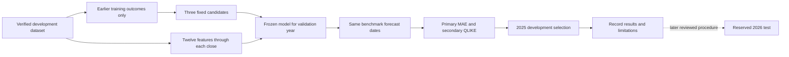

# Chronological model-training walkthrough

Specification ML-001, established November 4, 2026 before its first real-data fit. This milestone asks whether a trained, price-only model adds predictive value over the existing historical variance forecasts. It does not predict stock prices or recommend investments.

## 1. Fix the experiment before seeing its scores

The [machine-readable recipe](../config/model_training.json) declares three histogram gradient-boosted tree candidates with maximum leaf counts of 7, 15, and 31. Other parameters remain fixed: 150 iterations, learning rate 0.05, minimum 100 training rows per leaf, L2 regularization 1, seed 42, and one computational thread. This is a bounded first experiment, not an exhaustive search.

The model uses Poisson deviance with a log link to produce positive variance estimates. The target is continuous annualized realized variance; the choice does not mean that risk is a Poisson count. It avoids interpreting the exponential of a fitted log target as an automatically unbiased variance forecast. Selection uses volatility MAE even though the training objective is a variance loss; their preferences can differ.

Choose the candidate with lowest equal-instrument primary 2025 volatility MAE. Break exact ties by ascending method ID. All candidates and 2023/2024 results remain visible. The selection year is development data, so the selected 2025 score is optimistic and cannot serve as independent final-test evidence. Do not add candidates in response to a disappointing result without separately versioning and recording the extension.

## 2. Separate predictors from outcomes and metadata

The modeling dataset contains features, targets, dates, instrument identifiers, and eligibility flags. Its tables are a convenient research record, but that full record must never be passed to an estimator. `predictor_matrix` selects the twelve explicit [feature columns](06_MODELING_DATASET_WALKTHROUGH.md) in a fixed order and rejects missing or nonfinite values. Added numeric metadata cannot silently become a predictor.

No scaling, imputation, feature selection, instrument encoding, or fitted target transform is used. Each training instrument receives the same total sample weight, normalized to mean row weight one. This prevents a longer history from automatically dominating another instrument. The current universe has equal-length histories, so its weights are all one.

## 3. Fit chronologically and purge future windows

For each validation year, use eligible training origins and outcomes entirely before January 1 of that year. The twenty-session forward window must finish before validation starts. The fold checks independently reject wrong readiness, invalid targets, duplicates, and boundary violations, even if a membership flag has been incorrectly set.



Early stopping is disabled explicitly. Its automatic setting can otherwise reserve a random internal validation subset on larger datasets, conflicting with the declared chronological experiment. Models stay fixed throughout their validation year. Updating input features after each close is allowed; updating model parameters using that year's outcomes is not part of ML-001.

## 4. Use identical forecast dates and honest diagnostics

Reuse BL-001's exact primary and daily origins. Every method must provide a valid prediction on every selected date; a missing prediction blocks scoring rather than reducing that method's sample. Primary targets are non-overlapping within an instrument. Daily overlapping results are secondary. Different instruments still share shocks, and training labels overlap, so row counts do not measure independent market episodes.

The [generated report](MODEL_DEVELOPMENT_REPORT.md) includes all primary candidate scores and selected-model prediction diagnostics. Local records retain daily results, per-instrument scores, exposure groups, and realized-volatility regimes. Regime thresholds are medians from the relevant training instrument's targets. Assignment to a realized regime uses a later outcome and is diagnostic only; it must not become a prediction input. Such slices explain failures but do not establish causal effects.

## 5. Preserve models, failures, and reproducibility evidence

An append-only local attempt log records the recipe, fit starts, completions, and failures. Successful experiments preserve all nine candidate/fold models, training dates, parameters, feature order, code/data/package versions, predictions, matched origins, errors, and hashes. Refit each candidate twice and require identical predictions in the same environment. Reload only model files generated in the current run, and reconcile their predictions on every actual validation row.

The complete artifact folder is staged before publication. Repeating the experiment must preserve its identity and all output hashes. Public GitHub outputs contain aggregate scores and figures; raw market history and trained model files remain local. Tracking is file based; MLflow is not installed or represented as completed.

The separate `verify_training_experiment` command checks artifact identity and hashes and independently recalculates every saved per-origin error and aggregate score using NumPy. It does not call the training evaluator or load model files. For the current experiment it reconciles 81,536 error records and 42 aggregate comparisons.

```bash
.venv/bin/python -m scripts.train_risk_model --modeling-dataset data/modeling/<modeling-dataset-id>
.venv/bin/python -m scripts.verify_training_experiment --experiment data/experiments/trained_models/<experiment-id>
```

## 6. What remains reserved

ML-001 does not refit a final model on all eligible pre-2026 labels, generate 2026 forecasts, derive 2026 numeric outcomes, or open final-test scores. Those require a complete, frozen procedure under EV-001. Instrument forecasts do not establish portfolio-risk accuracy: correlation estimation, portfolio-level evaluation, and user risk preferences are separate tasks. News integration and portfolio adjustment suggestions remain later phases.

References: [scikit-learn estimator](https://scikit-learn.org/stable/modules/generated/sklearn.ensemble.HistGradientBoostingRegressor.html) and [model persistence](https://scikit-learn.org/stable/model_persistence.html).
