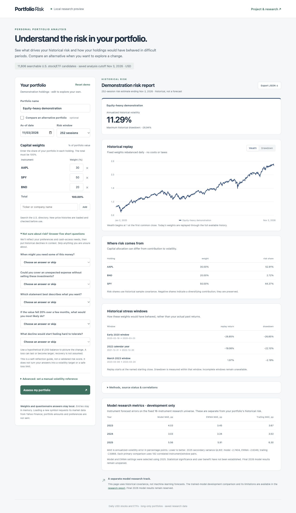
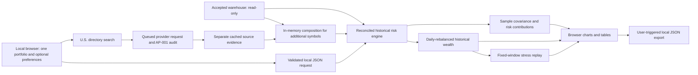

# Local portfolio comparison application

Updated November 4, 2026. The local application connects the accepted SQL warehouse to the independently reconciled historical risk engine. It supports side-by-side portfolio analysis while keeping weights and portfolio amounts local. Requested new symbols are sent to the market-data provider for their history. It offers a constrained historical reweighting preview for existing holdings.



## Run the application

Build the accepted market warehouse using the README instructions, then run from the repository root:

```bash
.venv/bin/python -m scripts.market_catalog
.venv/bin/python -m scripts.serve_portfolio_app
```

Open [the local application](http://127.0.0.1:8765). Stop the process with Ctrl+C. The application uses Python's local HTTP server and the existing pinned environment; no frontend package installation or external hosting is required. Bind address is restricted to `127.0.0.1`. This is a local research preview, not a publicly hosted production service.

## What is implemented

Enter one long-only USD portfolio as percentages, select an as-of date and a 63-, 126-, or 252-session estimation window, and assess its historical risk. Enable the optional alternative only when exploring a comparison; it starts with copied current weights. The interface searches the versioned U.S. directory by ticker or company name. New histories are loaded and audited in a single-worker queue before use. Searchable listing candidates are broader than loaded/validated price histories; failures remain visible. See [the expansion report](US_MARKET_EXPANSION.md). The starting AAPL/SPY/BND holdings are demonstrations. “Weight (%)” is the share of the current portfolio allocated to a holding. Comparison mode adds an independently editable alternative column; each portfolio must total 100%. Up to 100 positive positions per portfolio are supported. Zero positions are omitted; positive weights must sum to 100% without automatic rescaling. Invalid inputs produce a visible error. Editing inputs marks previous results stale and disables export until recalculation.

Results include annualized sample volatility, full-history maximum drawdown, wealth/drawdown charts, capital weights versus Euler volatility-risk shares, pairwise correlations, and three fixed historical windows. An optional five-question guide reflects self-reported preferences and compares explicitly stated loss comfort with historical drawdown. A manual annualized-volatility reference remains under Advanced for deliberate use. It does not guarantee a future risk limit and does not generate suggestions.

The demonstration matches the existing portfolio baseline: 11.29% versus 7.24% annualized volatility over 252 returns ending November 3, 2026; full-history maximum drawdowns are −26.94% and −19.46%. AAPL's 30% capital allocation contributes 52.91% of the first demonstration's estimated volatility. These are labeled hypothetical allocations, not personal holdings or actual investment performance.

## Calculation and data flow



One portfolio is assessed on its complete available history. When comparison is enabled, both scenarios use the same complete common history. Sample covariance uses N−1, annualization by 252, and the selected estimation window. Portfolio variance is `wᵀΣw`; Euler contributions sum to volatility, and negative diversifying contributions are retained. Correlation and risk shares remain undefined when the required denominator is zero. The original SQL/NumPy reconciliations run for each analysis.

Full-history charts and maximum drawdown cover a different interval from the trailing covariance estimate; both windows are displayed. Replay assumes fixed weights rebalanced daily with no transaction costs or taxes. It describes how the entered exposures would have behaved, not how an actual investor traded.

## Historical scenario registry HS-001

| Window | Starting close | Ending close |
| --- | --- | --- |
| Early 2020 | 2020-02-19 | 2020-03-23 |
| 2022 calendar year | 2021-12-31 | 2022-12-30 |
| March 2023 | 2023-03-08 | 2023-03-24 |

The [registry](../config/stress_scenarios.json) fixes these dates for descriptive replay. Return is ending wealth divided by wealth at the starting close, minus one. Scenario drawdown uses a peak established within the window, including its initial capital. If either endpoint is outside the selected portfolio history, the complete scenario is unavailable; no partial or future period is substituted. These are historical examples, not probabilities, forecasts, or evidence of event causation.

## Privacy, verification, and limits

The service reads the warehouse without changing it and keeps submitted inputs in memory. It does not save portfolio weights/amounts, log request contents, or send analytics externally. An explicit Add request can download a new symbol’s history through the saved analysis cutoff; raw market evidence and source metadata are cached locally under AP-001. JSON export is user triggered and saved through the browser. The API serves a fixed asset list, checks local Host/Origin values, requires bounded JSON requests, and sends no cross-origin access permission. These controls support local use; public hosting would require a separate design and review.

The initial nine application tests cover equivalence with the verified engine, optional references, invalid inputs, scenario endpoints and within-window drawdown, unavailable periods, date formatting, JSON validation, local request boundaries, and unchanged warehouse hashes after actual HTTP analysis. Browser checks confirmed the demo metrics, reference comparisons, invalid totals, stale-result status, chart switching, JSON export, and desktop/mobile layout. The exported demonstration contains 1,719 chart dates and the expected unrounded risk values. A mobile overflow and date-only formatting inconsistency found during testing were corrected.

The saved market snapshot remains through November 3, 2026; this page makes no live-price claim. Three retained index-source exceptions remain excluded from portfolio calculations. Revised histories and the current-survivor universe remain limitations. ETF look-through, cash, leverage, FX conversion, trading costs, and taxes are not modeled. Weight entry is available in the browser; latest-close quantity input remains supported separately by the existing command-line engine. A hash-verified development scorecard now shows 2023–2025 instrument-level MAE and 2025 secondary QLIKE. Its values are separate from the entered portfolios and do not demonstrate statistical significance. The fixed model universe contains sixteen instruments. EV-002 publishes the retrospective 2026 results in a separate research report. [Holdout report](FINAL_EVALUATION_REPORT.md) Portfolio forecasts, persistent private snapshots, news context, and replacement screening are subsequent phases.

## Broader-search and measurement update

The full suite now contains 146 passing tests. Added checks cover directory classification/search, class-share mapping, immutable replay, cache tampering, metadata/type/currency/timezone mismatches, missing-session and adjustment barriers, failure retention, separate composition without warehouse writes, and verified metric-summary display. Actual local HTTP checks exercise queued loading and a mixed META/AAPL portfolio. Browser checks verify META addition, VOO keyboard addition, clear weight labels, unchanged demo metrics, a development scorecard, and mobile/desktop sizing. Existing user entries were preserved; public previews contain demonstration values only.

The proposed [user-measurement study](METRICS_AND_EXPERIMENTS.md) is documented but has not recruited participants, recorded task outcomes, collected telemetry, or produced a significance result. This distinction is explicit in the scorecard and README.

## Single-portfolio and preference-guide update

The default view submits and renders one portfolio, with one risk card/series and three-column holding/stress tables. Comparison is opt-in; copied alternative weights can be edited independently and are excluded while hidden. Ten new tests and browser checks cover the personal workflow and RQ-001 interpretation. Hidden invalid alternative totals do not block a single-portfolio report. The guide remains optional, accepts partial/uncertain answers, and generates no volatility target or investment recommendation. Inputs remain in memory. Read [RISK_PREFERENCES.md](RISK_PREFERENCES.md) for original question definitions, deterministic rules, source principles, limits, and privacy behavior.

## Report comprehension study

The report study link opens a separate demonstration at `/study`. It uses fixed holdings and opens in practice mode by default. See the [study guide](COMPREHENSION_PILOT.md) for the comparison, consented recording option, and descriptive summary.

## Reweight existing holdings

Assess a portfolio, then open **Explore lower-risk weights**. The preview uses the current date and covariance window and accepts a move budget, per-holding limits, locked weights, and the optional manual volatility reference. **Use as alternative** loads the weights into the comparison dashboard. [Method and verified replay](PORTFOLIO_REWEIGHTING.md)

## Define replacement criteria

After assessing a portfolio, open **Explore lower-risk weights**, then **What to look for in a replacement**. Choose the holding and the percentage of total portfolio value to move. The guide shows standalone volatility ranges at several assumed correlations with the retained positions. A manual volatility reference becomes the target. A blank reference uses the current estimate as the ceiling. [Method and verified demo](PORTFOLIO_REPLACEMENT_CRITERIA.md)
