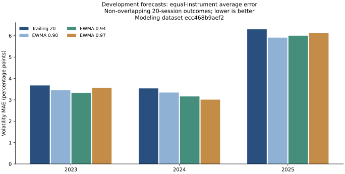
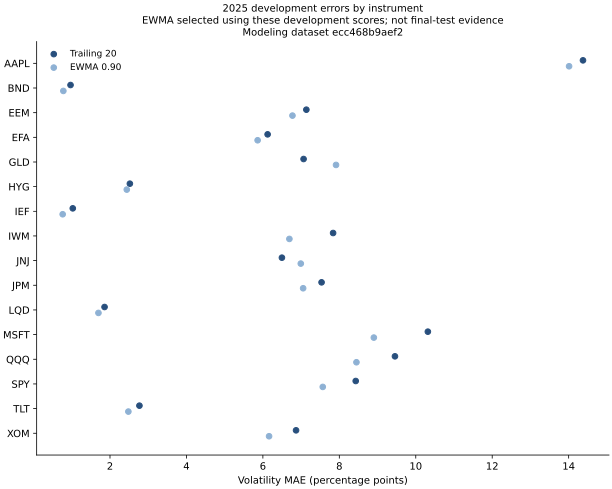

# Historical forecast baseline comparison

Updated November 4, 2026. Four fixed-form forecast candidates are evaluated on development years only. No machine-learning model or final-test scores are produced.

## Executive result

The EWMA candidate selected by the declared 2025 primary MAE rule is **ewma_0.90**. All three decays and the fixed trailing-20 benchmark are reported below. In 2025, selected EWMA has volatility MAE **5.9087 percentage points**, compared with **6.2989** for trailing variance. However, trailing variance has lower QLIKE in 2025. The best EWMA decay by MAE differs in the earlier development years. This is development selection evidence, not an unbiased final-test comparison or proof of future superiority.

| Development year | Evaluation grid | Method | Matched forecast/target pairs | Volatility MAE, percentage points | Variance QLIKE | Prediction floors |
| --- | --- | --- | ---: | ---: | ---: | ---: |
| 2023 | daily | ewma_0.90 | 3680 | 3.4910 | -2.7549 | 0 |
| 2023 | daily | ewma_0.94 | 3680 | 3.3250 | -2.7806 | 0 |
| 2023 | daily | ewma_0.97 | 3680 | 3.4451 | -2.7947 | 0 |
| 2023 | daily | trailing_20 | 3680 | 3.5594 | -2.7481 | 0 |
| 2023 | primary | ewma_0.90 | 192 | 3.4451 | -2.7095 | 0 |
| 2023 | primary | ewma_0.94 | 192 | 3.3304 | -2.7428 | 0 |
| 2023 | primary | ewma_0.97 | 192 | 3.5656 | -2.7663 | 0 |
| 2023 | primary | trailing_20 | 192 | 3.6729 | -2.7034 | 0 |
| 2024 | daily | ewma_0.90 | 3712 | 3.7112 | -2.9511 | 0 |
| 2024 | daily | ewma_0.94 | 3712 | 3.4171 | -2.9929 | 0 |
| 2024 | daily | ewma_0.97 | 3712 | 3.1523 | -3.0210 | 0 |
| 2024 | daily | trailing_20 | 3712 | 3.8051 | -2.9336 | 0 |
| 2024 | primary | ewma_0.90 | 192 | 3.3408 | -3.0098 | 0 |
| 2024 | primary | ewma_0.94 | 192 | 3.1588 | -3.0393 | 0 |
| 2024 | primary | ewma_0.97 | 192 | 3.0096 | -3.0537 | 0 |
| 2024 | primary | trailing_20 | 192 | 3.5342 | -2.9918 | 0 |
| 2025 | daily | ewma_0.90 | 3680 | 6.1788 | -2.6882 | 0 |
| 2025 | daily | ewma_0.94 | 3680 | 6.2674 | -2.7061 | 0 |
| 2025 | daily | ewma_0.97 | 3680 | 6.4769 | -2.6857 | 0 |
| 2025 | daily | trailing_20 | 3680 | 6.2256 | -2.6979 | 0 |
| 2025 | primary | ewma_0.90 | 192 | 5.9087 | -2.6349 | 0 |
| 2025 | primary | ewma_0.94 | 192 | 5.9992 | -2.6798 | 0 |
| 2025 | primary | ewma_0.97 | 192 | 6.1309 | -2.6732 | 0 |
| 2025 | primary | trailing_20 | 192 | 6.2989 | -2.6866 | 0 |

Scores first average errors within each instrument and then weight instruments equally. The primary grid is anchored to each year's first feature-ready origin before availability/boundary filtering and advances every twenty sessions. Target windows do not overlap within an instrument; instruments still share market events. Daily overlapping results are secondary and dependent. QLIKE may be negative under `log(predicted_variance) + realized_variance/predicted_variance`; lower remains better on the same outcomes.





## 2025 primary errors by exposure group

| Exposure group | Method | Instruments | Volatility MAE, percentage points | Variance QLIKE |
| --- | --- | ---: | ---: | ---: |
| bond_etf | ewma_0.90 | 5 | 1.6319 | -4.4047 |
| equity_etf | ewma_0.90 | 5 | 7.0689 | -2.0823 |
| gold_trust | ewma_0.90 | 1 | 7.9138 | -1.9420 |
| stock | ewma_0.90 | 5 | 8.6243 | -1.5562 |
| bond_etf | trailing_20 | 5 | 1.8283 | -4.4151 |
| equity_etf | trailing_20 | 5 | 7.7966 | -2.1540 |
| gold_trust | trailing_20 | 1 | 7.0649 | -1.9862 |
| stock | trailing_20 | 5 | 9.1186 | -1.6309 |

These categories follow the predeclared research-universe classification. This is instrument-level analysis, not ETF holdings look-through or evidence of a model for portfolio-level risk. The selected EWMA does not improve every group or metric.

## Forecast definitions and validation

- Trailing 20: forecast next-20-session average annualized variance using `252 × mean(r²)` over the latest twenty returns, including the origin return.
- EWMA candidates: `v[t] = lambda × v[t-1] + (1-lambda) × 252 × r[t]²`, with lambda 0.90, 0.94, or 0.97. Initialize at the first valid annualized squared return and reset after missing data. Forecast the twenty-session average by assuming the current variance level persists; this is not a future-volatility guarantee.
- All forecasts require the modeling layer's 252-return readiness. EWMA recursion is reconciled with pandas `ewm(adjust=False)`; a fixed-cutoff future perturbation leaves earlier forecasts exactly unchanged.
- Predicted variance must be finite/nonnegative, and outcomes finite/nonnegative. A missing forecast blocks scoring rather than shrinking the comparison sample. QLIKE uses a 1e-12 prediction floor with counts reported; volatility MAE uses the raw nonnegative prediction.
- Selection uses equal-instrument primary volatility MAE in 2025, with ascending method ID as a deterministic tie-break. Earlier years provide development context. No 2026 forecast, target, or score is computed.

## Reproducible experiment record

- Experiment: `09c9fd883372638995cad3d5ee586d7ef8b9915ae4aa331e75d2bff41422f29b`.
- Modeling dataset: `ecc468b9aef284824e22c7c1cb47f0f89517ff583061cc72ef0eff4d37d23d83`.
- Baseline specification: [BL-001](../config/forecast_baselines.json).
- Existing modeling manifest, database, and export hashes are verified before use. All candidates, forecasts, matched origins, per-origin errors, per-instrument/group metrics, code/configuration hashes, and package versions remain in local versioned experiment artifacts. This is file-based tracking; MLflow is not installed or claimed here.

```bash
.venv/bin/python -m scripts.evaluate_baselines --modeling-dataset data/modeling/ecc468b9aef284824e22c7c1cb47f0f89517ff583061cc72ef0eff4d37d23d83
.venv/bin/python -m unittest discover -s tests -v
```

The [method walkthrough](07_FORECAST_BASELINES_WALKTHROUGH.md) explains interpretation and checks. The original market histories and modeling rows remain outside Git; public outputs contain aggregate metrics and figures. Revised histories, current-survivor selection, limited non-overlapping origins, and correlated instruments limit conclusions. Next: train and evaluate one documented model using the same development samples and benchmark definitions, then freeze the full recipe before any final 2026 evaluation.
