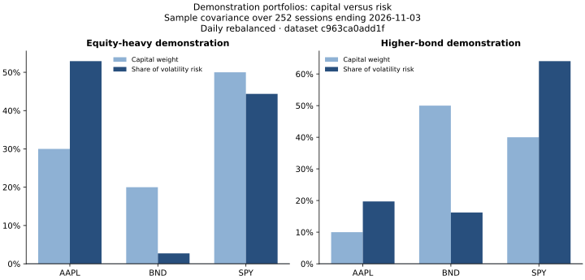
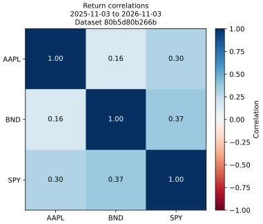

# Demonstration portfolio baseline

## Executive summary

This report compares declared portfolios using accepted historical market data. The allocations are illustrative inputs, not the author’s actual holdings or recommended allocations. Risk estimates use a common 252-session window; drawdowns use the common historical replay period. These are historical measurements, not trained forecasts.

## Results and periods

- Holdings snapshot: **2026-11-03**, currency **USD**.
- Covariance, volatility, correlation, and risk contributions: **2025-11-03 through 2026-11-03**, 252 daily returns; sample covariance with denominator N−1, annualized by 252.
- Drawdown replay: **2020-01-02 through 2026-11-03**, 1,719 closing sessions and 1,718 one-session returns.
- Convention: **fixed weights, rebalanced daily**, using adjusted-price return proxies; no trading costs, slippage, or taxes. This is not the portfolios' actual investment performance.

| Portfolio | Annualized sample volatility | Maximum historical drawdown | Peak date | Trough date | Recovery date |
| --- | ---: | ---: | --- | --- | --- |
| Equity-heavy demonstration | 11.29% | -26.94% | 2020-02-12 | 2020-03-23 | 2020-06-08 |
| Higher-bond demonstration | 7.24% | -19.46% | 2021-12-27 | 2022-10-14 | 2024-02-09 |

## Capital and risk contributions



| Portfolio | Instrument | Capital weight | Contribution to annualized volatility, percentage points | Share of volatility risk |
| --- | --- | ---: | ---: | ---: |
| Equity-heavy demonstration | AAPL | 30.00% | 5.98 | 52.91% |
| Equity-heavy demonstration | BND | 20.00% | 0.31 | 2.72% |
| Equity-heavy demonstration | SPY | 50.00% | 5.01 | 44.37% |
| Higher-bond demonstration | AAPL | 10.00% | 1.43 | 19.71% |
| Higher-bond demonstration | BND | 50.00% | 1.18 | 16.23% |
| Higher-bond demonstration | SPY | 40.00% | 4.64 | 64.06% |

Contribution is `w_i × (Σw)_i / σ_portfolio`; contributions sum to portfolio volatility before display rounding. Risk share divides that contribution by portfolio volatility. A diversifying holding can have a negative contribution; values are not clipped. Risk shares are undefined when portfolio volatility is zero. These are instrument-level contributions; ETFs may hold overlapping underlying securities.

## Correlations



## Composition, validation, and limitations

The calculation reads only accepted stock/ETF prices and calendar-aligned returns from DuckDB. A single common history is used across compared portfolios; missing internal sessions, unsupported instruments, and insufficient estimation history fail explicitly. Leading history excluded before the common start: `{'AAPL': 0, 'BND': 0, 'SPY': 0}`.

SQL weighted-return aggregation is reconciled against NumPy. SQL sample covariance is reconciled against NumPy covariance. Portfolio volatility is reconciled against the weighted return series' sample standard deviation. Contributions are checked to sum to volatility, and maximum drawdown is checked with a separate scalar replay that includes the initial portfolio value.

This sample-covariance estimator is demeaned and uses N−1. It differs from the squared-return/RMS convention used for the existing 20-session realized-volatility input and planned forward target; the definitions must not be treated as interchangeable.

The three FRED/Yahoo index discrepancies remain quarantined and are not inputs here. Adjusted history is a revised return proxy rather than exact brokerage cash flows or point-in-time archival data. Results depend on the chosen window and scenario assumptions and do not establish future risk or performance.

Quantity inputs are valued using provider Close, not dividend-adjusted historical prices, and are supported only at the latest common close. Historical share/split reconstruction, cash positions, leverage, and currency conversion are not implemented. Weights must be positive and sum to one without automatic rescaling. Personal configurations default to ignored private report folders; public output requires an explicitly labeled demo and `--publish-demo`.

## Provenance and reproduction

- Dataset: `80b5d80b266b0255f7c8de0310569de02f63a5ee0ff2a54e707ddfa2cd114166`.
- Report: `45fbbde78e430222f65667cec2ec6acc2cc02a23545a7fbc8eb25069744b8358`.
- Detailed metrics, recipe hashes, and replay series are saved locally; downloaded histories and personal inputs remain outside Git.

```bash
.venv/bin/python -m scripts.portfolio_baseline --input config/demo_portfolios.json --publish-demo
.venv/bin/python -m unittest discover -s tests -v
```

The portfolio input and the database must be available locally. Subsequent fresh database versions create distinct report identities. Source-policy and warehouse documentation explain upstream acceptance controls.
