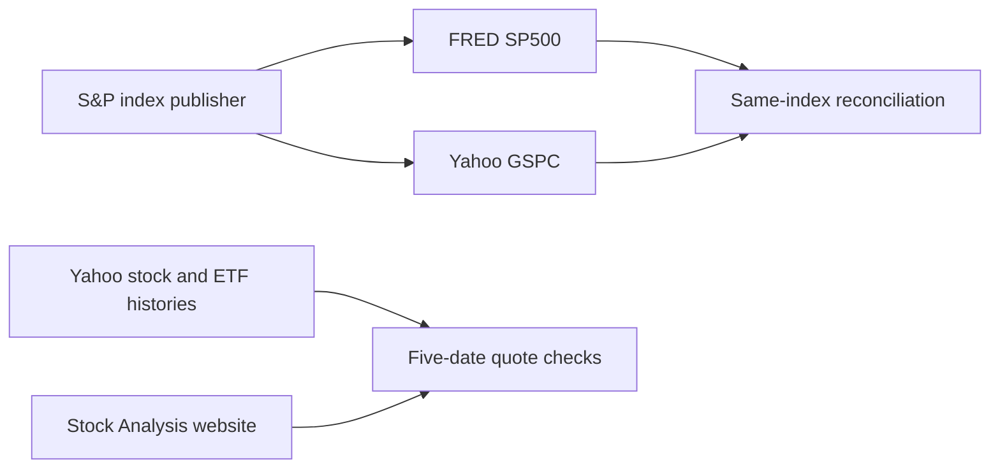

# Cross-source validation

Updated November 4, 2026. At least one comparison failed or was unavailable; see local evidence before accepting the source.

## Scope and source lineage

- **Yahoo Finance via yfinance:** the original AAPL, SPY, and BND acquisition; baseline run `20261104T170702705356Z`.
- **Stock Analysis:** a separate website used to spot-check the daily Close for the last five completed sessions in each baseline series. Comparisons use the same dates, USD, and price field. Intraday observations on November 4 are excluded. The website's upstream vendor independence is not established.
- **FRED:** its SP500 series is compared with Yahoo's **^GSPC**, which represents the same S&P 500 closing price index. FRED SP500 is **not** compared directly with SPY's dollar price, and does not validate individual AAPL, SPY, or BND quotes.
- **Apple:** an issuer announcement cross-checks a split and dividend amount in the [primary data audit](DATA_AUDIT.md).

## Observed comparisons

| Series | Dates compared / required | Mismatches beyond tolerance | Maximum absolute difference | Result |
| --- | ---: | ---: | ---: | --- |
| AAPL | 5 / 5 | 0 | 0.00 | Pass |
| SPY | 5 / 5 | 0 | 0.00 | Pass |
| BND | 5 / 5 | 0 | 0.00 | Pass |
| S&P 500 benchmark | 1719 / 1719 | 3 | 5.29 | Mismatch |

Stock/ETF quote differences are in USD; tolerance is **$0.01**. Index differences are in index points; tolerance is **0.02 index points**. Values are compared at the reference tables' published two-decimal precision. Native floating-point differences are also preserved in local evidence: a 0.02 difference can otherwise appear as 0.020078 after float storage and trigger a spurious boundary flag. The tolerance is unchanged. Missing dates fail a comparison rather than being forward-filled. Website checks cover five dates per instrument; the FRED comparison covers the requested benchmark history.


## Benchmark exceptions

| Date | Absolute difference in index points | Disposition |
| --- | ---: | --- |
| 2020-05-11 | 0.13 | Unresolved; original observations retained |
| 2020-10-05 | 0.03 | Unresolved; original observations retained |
| 2021-08-11 | 5.29 | Unresolved; original observations retained |

A separate Yahoo request for August 10–12, 2021 reproduced the original Yahoo values, including the largest discrepancy on August 11. This rules out a one-off full-window response difference in this capture; the discrepancy's cause remains unresolved. The recheck and its hash are retained locally.


No exception is automatically repaired or accepted. Keep Yahoo ^GSPC out of model features and benchmark calculations until a documented source-selection or reconciliation decision is made. These benchmark exceptions do not establish that the three stock/ETF histories are erroneous; those series have separate, limited spot checks.

The [source policy](DATA_SOURCE_POLICY.md) selects a preferred context source and quarantines the discrepant comparator. It does not resolve the underlying price disagreement or change this validator's outcome.



## Evidence and reproduction

- External capture: `20261104T171500906975Z`; requested window: 2020-01-01 inclusive to 2026-11-04 exclusive.
- Local `data/validation/20261104T171500906975Z/` contains website HTML, FRED CSV, benchmark history, HTTP/retrieval metadata, hashes, and detailed comparison JSON. These downloaded sources are excluded from Git.
- The baseline manifest, downloaded file hashes, and package versions are verified before comparison.

```bash
.venv/bin/python -m scripts.cross_validate_sources --snapshot data/audit/20261104T170702705356Z
# Reuse this external capture without downloading again:
.venv/bin/python -m scripts.cross_validate_sources --snapshot data/audit/20261104T170702705356Z --external-snapshot data/validation/20261104T171500906975Z
```

## Interpretation and limitations

Agreement between websites checks acquisition, date alignment, field interpretation, and selected quote consistency. It does not establish independent price discovery or prove the full history is error-free. Both FRED and Yahoo distribute the S&P 500 index from its originating publisher; their delivery paths differ, but underlying index lineage is shared.

FRED SP500 is a price index without dividends, not a total-return series. Its values must not be substituted for an ETF's adjusted prices. FRED's notes describe history limits, revisions, and source-specific reuse restrictions; downloaded observations are retained locally. The public report presents comparison statistics rather than republishing the series.

Direct Yahoo Finance history pages returned HTTP 429 during the initial web check, so a direct-page validation is not claimed. Stock Analysis supplies the separate website spot check instead. No access warning or rate limit was bypassed.

Sources: [FRED series and notes](https://fred.stlouisfed.org/series/SP500), [AAPL history](https://stockanalysis.com/stocks/aapl/history/), [SPY history](https://stockanalysis.com/etf/spy/history/), [BND history](https://stockanalysis.com/etf/bnd/history/).
