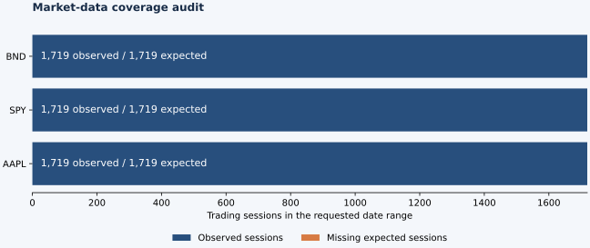

# Market-data audit

## Executive finding

The sample passes the implemented structural checks. It is suitable for the next prototype stage, subject to the adjustment review and limitations below.

This report is generated from saved provider-library output. It records data availability and internal consistency, not an independent certification of price accuracy. No model has been trained.

External source agreement is assessed separately in [cross-source validation](CROSS_SOURCE_VALIDATION.md). A structural pass here does not close discrepancies in that report or authorize automatic correction of source values.

## Run and source

- Run: `20261104T170702705356Z`.
- Retrieval time: `2026-11-04T17:07:02.705657+00:00`.
- Requested dates: **2020-01-01 inclusive to 2026-11-04 exclusive**.
- Source: Yahoo Finance through yfinance 1.8.0.
- Environment: Python 3.13.7; pandas 3.1.1; exchange-calendars 4.13.2.
- Snapshot settings: daily, corporate actions enabled, automatic/back adjustment disabled, repair disabled, missing rows retained, no rounding.
- Code provenance: the manifest records the download script hash when available; detailed audit JSON records the current audit script hash. Replay checks package versions and saved file hashes.
- Evidence: local `data/audit/20261104T170702705356Z/`, including manifest, CSV hashes, metadata, and detailed audit JSON. These files are excluded from version control.

## Coverage and structural checks



| Instrument | Rows | Expected sessions | Missing sessions | Duplicate dates | Nonpositive price cells | Dividend events | Split events | Structural result |
| --- | ---: | ---: | ---: | ---: | ---: | ---: | ---: | --- |
| AAPL | 1,719 | 1719 | 0 | 0 | 0 | 27 | 1 | Pass |
| SPY | 1,719 | 1719 | 0 | 0 | 0 | 27 | 0 | Pass |
| BND | 1,719 | 1719 | 0 | 0 | 0 | 80 | 0 | Pass |

### AAPL

- Observed range: 2020-01-02 to 2026-11-03.
- Reference calendar: `XNAS`; provider exchange: `NMS`.
- Currency: `USD`.
- Non-finite numeric cells: 0; inconsistent OHLC rows: 0.
- Errors: None detected.
- Review flags: None raised by the implemented thresholds.

### SPY

- Observed range: 2020-01-02 to 2026-11-03.
- Reference calendar: `XNYS`; provider exchange: `PCX`.
- Currency: `USD`.
- Non-finite numeric cells: 0; inconsistent OHLC rows: 0.
- Errors: None detected.
- Review flags: None raised by the implemented thresholds.

### BND

- Observed range: 2020-01-02 to 2026-11-03.
- Reference calendar: `XNAS`; provider exchange: `NGM`.
- Currency: `USD`.
- Non-finite numeric cells: 0; inconsistent OHLC rows: 0.
- Errors: None detected.
- Review flags: None raised by the implemented thresholds.

## Adjustment diagnostics

The local audit JSON records every returned dividend and split event with surrounding close/adjusted-close returns. Dividend checks compare changes in the adjusted-close/close factor with the convention `1 / (1 - dividend / previous_close)`. Deviations above five basis points are review flags, not automatic price corrections. This checks consistency with a convention; it is not an independent reconstruction of total returns.

The provider's Close field must not be assumed to be an original, split-unadjusted quote. Split-event diagnostics also calculate the hypothetical return produced by applying the reported split ratio again. A large artificial move in that diagnostic is evidence against double-adjusting the returned series. A split on the first observed session cannot be reconciled without an earlier observation.

### Selected issuer cross-check

Apple's issuer announcement specifies a four-for-one split with split-adjusted trading beginning August 31, 2020; this matches the provider event. The observed provider-close return around that event is 3.39%. Applying the split ratio again would instead produce 313.56%, demonstrating the double-adjustment error. The announcement also specifies a pre-split dividend of $0.82; the provider reports $0.205 on August 7, consistent with $0.82 divided by four. This cross-check covers the split date/ratio and dividend amount basis, not an independently verified ex-dividend date or all ETF distributions. [Apple issuer announcement](https://www.apple.com/newsroom/2020/07/apple-reports-third-quarter-results/).

Adjusted-return moves above 20% are flagged for investigation. The script does not fill missing sessions, repair outliers, or remove duplicates. One-session return diagnostics use the full expected session index, so a gap cannot silently become a multi-session return.

## Limitations and next decision

- A single source can be internally consistent and still contain errors. Independent checks around selected corporate actions remain necessary before treating adjustments as verified.
- `XNAS` and `XNYS` are configured daily-session references. SPY uses XNYS as a U.S. equity-calendar reference rather than a venue-specific NYSE Arca calendar. Exchange-calendar definitions can change and are versioned with this run.
- Saved CSVs preserve yfinance's output, not the original HTTP response. The library may process observations before returning them even with the explicit settings above.
- Today's adjusted histories can be revised and do not establish what was known at every historical forecast date. A fresh download need not match an earlier snapshot; offline replay verifies and reuses saved evidence.
- This audit does not establish production availability, redistribution rights, full instrument-universe suitability, or model accuracy. Downloaded prices remain local; the public report contains summary counts and methods.
- Next: resolve any failures/review flags, independently inspect selected actions, then freeze the first usable dataset and build the SQL ingestion layer.

## Reproduction

```bash
python3 -m venv .venv
.venv/bin/python -m pip install -r requirements.txt
.venv/bin/python scripts/audit_market_data.py --start 2020-01-01 --end 2026-11-04
# Re-audit the original local snapshot without downloading again:
.venv/bin/python scripts/audit_market_data.py --snapshot data/audit/20261104T170702705356Z
```

Source references: [yfinance](https://github.com/ranaroussi/yfinance), [exchange_calendars](https://github.com/gerrymanoim/exchange_calendars).
