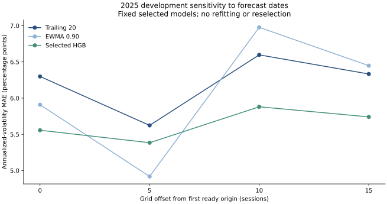

# Development robustness review

Updated November 4, 2026. RB-001 examines the existing saved forecasts after ML-001 development selection. It does not refit models, add candidates, change the primary grid, or open 2026 outcomes. Results are diagnostic development evidence.

In 2025, the fixed selected model has lower volatility MAE than selected EWMA in **3 of four phases**, and lower MAE than trailing variance in **4 of four phases**. The model-versus-EWMA ranking therefore depends on forecast dates. These counts are descriptive and dependent, not a probability of future superiority. Keep the original primary result and this sensitivity evidence together.

## Why forecast dates matter

The declared primary grid samples every twenty sessions. Four phase offsets (0, 5, 10, 15) test whether a different starting date changes the observed comparison. Each phase has non-overlapping target windows within an instrument. Phases overlap one another and share market events; they are not independent replications, confidence intervals, or a basis for selecting a more favorable test grid.

Offset zero exactly reproduces the original primary predictions, targets, and errors. The same fixed models and EWMA decay selected using 2025 remain in every comparison. All seven original candidates remain in the local record; the public table focuses on the selected model and two benchmark families.



| Year | Offset, sessions | Method | Pairs | Volatility MAE, pp | QLIKE |
| --- | ---: | --- | ---: | ---: | ---: |
| 2023 | 0 | ewma_0.90 | 192 | 3.4451 | -2.7095 |
| 2023 | 0 | hgb_7 | 192 | 4.0285 | -2.7371 |
| 2023 | 0 | trailing_20 | 192 | 3.6729 | -2.7034 |
| 2023 | 5 | ewma_0.90 | 192 | 3.4910 | -2.7751 |
| 2023 | 5 | hgb_7 | 192 | 3.8871 | -2.7767 |
| 2023 | 5 | trailing_20 | 192 | 3.5017 | -2.7563 |
| 2023 | 10 | ewma_0.90 | 176 | 3.5597 | -2.7635 |
| 2023 | 10 | hgb_7 | 176 | 3.6897 | -2.7686 |
| 2023 | 10 | trailing_20 | 176 | 3.5686 | -2.7496 |
| 2023 | 15 | ewma_0.90 | 176 | 3.5728 | -2.7355 |
| 2023 | 15 | hgb_7 | 176 | 3.8921 | -2.7698 |
| 2023 | 15 | trailing_20 | 176 | 3.6917 | -2.7395 |
| 2024 | 0 | ewma_0.90 | 192 | 3.3408 | -3.0098 |
| 2024 | 0 | hgb_7 | 192 | 3.0294 | -3.0409 |
| 2024 | 0 | trailing_20 | 192 | 3.5342 | -2.9918 |
| 2024 | 5 | ewma_0.90 | 192 | 3.3227 | -2.9503 |
| 2024 | 5 | hgb_7 | 192 | 3.0711 | -3.0114 |
| 2024 | 5 | trailing_20 | 192 | 3.5186 | -2.9419 |
| 2024 | 10 | ewma_0.90 | 192 | 3.9116 | -2.9213 |
| 2024 | 10 | hgb_7 | 192 | 3.3006 | -3.0078 |
| 2024 | 10 | trailing_20 | 192 | 3.9619 | -2.9117 |
| 2024 | 15 | ewma_0.90 | 176 | 4.0814 | -2.9616 |
| 2024 | 15 | hgb_7 | 176 | 3.3542 | -2.9958 |
| 2024 | 15 | trailing_20 | 176 | 4.0279 | -2.9254 |
| 2025 | 0 | ewma_0.90 | 192 | 5.9087 | -2.6349 |
| 2025 | 0 | hgb_7 | 192 | 5.5566 | -2.7404 |
| 2025 | 0 | trailing_20 | 192 | 6.2989 | -2.6866 |
| 2025 | 5 | ewma_0.90 | 192 | 4.9183 | -2.8281 |
| 2025 | 5 | hgb_7 | 192 | 5.3842 | -2.8195 |
| 2025 | 5 | trailing_20 | 192 | 5.6234 | -2.7736 |
| 2025 | 10 | ewma_0.90 | 176 | 6.9768 | -2.6209 |
| 2025 | 10 | hgb_7 | 176 | 5.8804 | -2.6997 |
| 2025 | 10 | trailing_20 | 176 | 6.5971 | -2.6206 |
| 2025 | 15 | ewma_0.90 | 176 | 6.4479 | -2.6424 |
| 2025 | 15 | hgb_7 | 176 | 5.7408 | -2.6964 |
| 2025 | 15 | trailing_20 | 176 | 6.3328 | -2.6953 |

## Sensitivity to instrument aggregation

Leave-one-instrument-out results remove an asset only from score aggregation. They do not retrain a model without it and do not estimate generalization to an unseen company. The universe and all fitted models remain unchanged. Ranges below are descriptive minima/maxima across sixteen omissions, not uncertainty intervals.

| Year | Method | Lowest omission MAE, pp | Highest omission MAE, pp |
| --- | --- | ---: | ---: |
| 2023 | ewma_0.90 | 3.2465 | 3.5857 |
| 2023 | hgb_7 | 3.8232 | 4.2135 |
| 2023 | trailing_20 | 3.4256 | 3.8331 |
| 2024 | ewma_0.90 | 3.0095 | 3.5165 |
| 2024 | hgb_7 | 2.8083 | 3.1381 |
| 2024 | trailing_20 | 3.2507 | 3.7061 |
| 2025 | ewma_0.90 | 5.3685 | 6.2518 |
| 2025 | hgb_7 | 5.1557 | 5.8608 |
| 2025 | trailing_20 | 5.7605 | 6.6543 |

## Evidence and reproduction

- Robustness run: `a706be01213bc4bff55ed871777eec73783cfdcd4ab2cf532699d2b6f3a7a602`.
- Training experiment: `46c0c08c13e6d559a8c80f59b930758a038fdd2579119d5ee19a20937a73c64d`.
- [RB-001 configuration](../config/development_robustness.json); [trained-model report](MODEL_DEVELOPMENT_REPORT.md).
- Source experiment identity/hashes and all original saved scores pass the independent verifier before use. Model and data identity are matched. Missing phase forecasts block comparison. All scores average instruments equally.

```bash
.venv/bin/python -m scripts.evaluate_development_robustness --experiment data/experiments/trained_models/46c0c08c13e6d559a8c80f59b930758a038fdd2579119d5ee19a20937a73c64d --modeling-dataset data/modeling/ecc468b9aef284824e22c7c1cb47f0f89517ff583061cc72ef0eff4d37d23d83
```

Do not change selection or the final-test grid after observing these diagnostics. A robust conclusion must account for changes across years, metrics, assets, and phases. This remains a small revised-history research dataset; no final-test or live performance claim is established.
