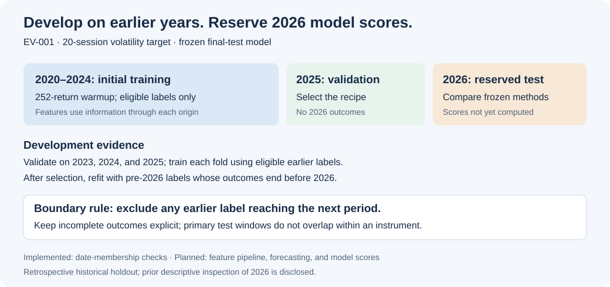

# Evaluation protocol and testing plan

Protocol **EV-001**, established November 4, 2026, before any model has been trained or scored. The user requested extensive testing and a reserved 2026 historical test. [Machine-readable contract](../config/evaluation_protocol.json).

## Research question

Can a pooled model improve next-20-session realized-volatility estimates relative to trailing-20-session and exponentially weighted variance forecasts? A reproducible comparison is the success criterion; superior machine learning performance is not assumed.

## Dates and model selection



| Stage | Forecast-origin dates | Rule |
| --- | --- | --- |
| Initial training | 2020–2024 | Require complete feature history and a target ending before 2025 |
| Main validation | 2025 | Choose features, settings, and methods; targets must end before 2026 |
| Earlier development folds | Validate on 2023 and 2024 | Train on eligible earlier origins; remove labels reaching the validation year |
| Final refit | Eligible pre-2026 origins | Refit the selected recipe using only labels ending before 2026 |
| Reserved historical test | 2026 | Frozen model; rolling historical inputs allowed; no fitting or tuning on 2026 outcomes |

The 2025 fold is the main validation year, not an additional independent holdout after selection. Development years may inform model choices; their scores will be reported as development evidence. Preprocessing is fitted within each training partition. All instruments use the same date boundaries; random row splitting is prohibited.

The reference dataset starts in 2020. A maximum 252-return feature window consumes its first 252 origins as warmup. Thus the nominal 2020–2024 training period does not provide eligible forecasts throughout the 2020 market shock. Extending pre-2020 context would require a versioned data/protocol review before model selection, rather than a performance-driven change after testing.

We have already inspected 2026 for data quality and descriptive portfolio risk. This is a **retrospective model holdout**, not a blinded or prospective experiment. The 2026 results are recorded under EV-002. A later forward-recorded experiment will preserve forecasts before their outcomes occur. [Holdout results](FINAL_EVALUATION_REPORT.md)

## Targets and leakage controls

For a prediction made after the close at origin t:

```text
return[t] = adjusted_close[t] / adjusted_close[t-1] - 1
target_variance[t] = (252/20) × sum(return[t+i]^2, i=1..20)
target_volatility[t] = sqrt(target_variance[t])
```

Twenty means exchange sessions, not calendar days or twenty nonmissing rows. Targets whose end date reaches the next partition are excluded from the earlier partition. Targets not yet fully observed remain explicitly incomplete. 2026 origins whose outcomes extend into 2027 are excluded from this calendar-year test even once those outcomes become available.

The implemented [date-membership builder](../scripts/evaluation_splits.py) enforces warmup, session integrity, fold boundaries, future-label availability, and a stable non-overlapping primary test grid. It calculates dates and counts only. It does not compute test outcome values or model scores, or confer source acceptance on additional instruments. [Observed membership counts](EVALUATION_SPLITS.md).

The [modeling layer](MODELING_DATASET.md) now passes future-value perturbation tests: altering observations after t leaves earlier features unchanged. It stores features, development labels, and membership separately and computes no numerical final-test outcomes. New feature versions must pass the same controls. Revised adjusted histories remain a limitation: those tests establish transformation causality, not historical vendor availability or point-in-time archival accuracy.

## Comparisons fixed before opening the final test

- Primary: mean absolute error of annualized volatility, reported in percentage points. Calculate per-instrument MAE on identical eligible origins, then average instruments equally. Also show each instrument and exposure group.
- Secondary: variance QLIKE, `log(predicted_variance) + realized_variance / predicted_variance`. Use a declared lower bound of `1e-12` on predicted annual variance for numerical evaluation, report floor counts, and separately reject nonfinite or negative forecasts. Zero realized variance is permitted by this score.
- Compare the trained model, trailing-20-session variance, and exponentially weighted variance on the same observations. Decay parameters and all model choices are selected using development data only.
- Primary test origins are every twentieth session, anchored to the first eligible 2026 origin. Retain that grid as data is appended; do not move it to improve results. Daily overlapping results are secondary and identified as dependent.
- Keep every attempted development recipe and its scores, seeds, parameters, dataset identity, and failures in experiment records. Do not repeatedly inspect final-test scores while modifying the model.

At the November 3 snapshot cutoff, each instrument has ten completed primary test windows. Sixteen instruments do not create 160 independent market episodes; they share dates and exposures. Report paired errors by origin and instrument, avoid precise significance claims from this small sample, and extend evidence through earlier validation years and later forward observations. Any resampling must preserve dependence across instruments and sessions rather than treating rows as independent.

## Testing layers and implementation status

| Layer | Checks and purpose | State |
| --- | --- | --- |
| Source integrity | Hashes, exchange sessions, duplicates, currencies, OHLC, actions, and missing values | Implemented; expanded sample passes structural checks |
| Source acceptance | Selected independent quote/action checks, source policy, and discrepancy quarantine | Implemented for sixteen instruments with limited quote/action evidence; comparator quarantined |
| Storage and recovery | Repeated loads, transaction rollback, explicit versions, export corruption | Implemented for expanded warehouse; every SQL return and complete risk window reconciled |
| Date membership | Warmup, fold purging, horizon completeness, year-end exclusions, stable primary grid | Implemented and regression-tested |
| Feature/target correctness | SQL versus NumPy, complete session endpoints, future-price perturbation, and split/year-boundary examples | Implemented for twelve price features and pre-2026 targets; final-test values withheld |
| Forecast baselines | Known recurrence/metric fixtures, nonnegative forecasts with explicit QLIKE flooring, and common origins | Implemented; trailing twenty sessions and three EWMA candidates evaluated on development years |
| Model evaluation | Rolling development years, per-instrument/group errors, fixed final test, reproducible seeds | Development evaluation and retrospective EV-002 holdout complete |
| Robustness | Predeclared development slices and sensitivity | Exposure-group, realized-regime, EWMA-decay, fixed-grid-phase and omission-aggregation diagnostics implemented; feature-window sensitivity remains planned |
| Portfolio forecasts | Evaluate portfolio predictions separately, including co-movement estimation | PF-001 evaluates two demos on matched 2023–2025 dates |
| Operation | Failed requests, stale data, interrupted jobs, and forward-recorded predictions | Acquisition controls and local application validation/stale-result handling implemented; automated refresh and forward recording planned |

Stress slices and sensitivity experiments use development data to guide decisions. Test-period breakdowns are descriptive reporting after the recipe is frozen. No test-year slice may be used to choose a replacement model without retiring the holdout and labeling subsequent results exploratory.

## Conditions for final scoring

Before opening 2026 model scores, freeze source acceptance, dataset, features, splits, baseline definitions, preprocessing, model settings, seeds, metrics, and primary origins. Complete feature/target reconciliation and leakage tests. Record the final procedure and code commit, then explicitly version the protocol to allow final scoring. The current configuration rejects an opened-test flag; it is a workflow guard, not a security barrier around historical data.

## Reproduction and references

```bash
.venv/bin/python -m scripts.evaluation_splits --snapshot data/audit/<expanded-run-id>
.venv/bin/python -m unittest discover -s tests -v
```

Generated membership CSVs and full manifests remain local. Identical evidence, code, calendar version, and protocol reproduce the same manifest identity. The public report contains eligibility counts rather than prices or forecast scores.

Chronological evaluation follows [scikit-learn's time-series split guidance](https://scikit-learn.org/stable/modules/generated/sklearn.model_selection.TimeSeriesSplit.html) and [Forecasting: Principles and Practice on time-series cross-validation](https://otexts.com/fpp3/tscv.html). The custom session/end-date rules address this project's overlapping 20-session labels; a generic chronological split alone does not establish those rules.

## Implemented benchmark experiment BL-001

[BL-001](../config/forecast_baselines.json) evaluates trailing-20-session variance and EWMA decays 0.90/0.94/0.97 on the existing development folds. The primary development grid anchors at each year's first feature-ready origin before eligibility filtering, then advances every twenty sessions. All methods share complete target dates. The current sample has twelve primary origins per instrument/year. Daily overlapping comparisons are secondary.

EWMA decay selection uses equal-instrument primary 2025 volatility MAE, with ascending method ID as a deterministic tie-break. All candidates remain reported; selection-year scores are development evidence. QLIKE uses the already specified prediction floor and does not replace the primary selection metric. The [benchmark report](BASELINE_FORECAST_REPORT.md) documents tradeoffs and experiment identity. No 2026 forecast, numeric outcome, or model score is computed.

## Implemented ML-001 development experiment

[ML-001](../config/model_training.json) declares three pooled histogram gradient-boosting candidates before their first real-data fit. All use positive Poisson log-link outputs, the twelve-column feature whitelist, training-only equal-instrument weights, no fitted preprocessing, and explicitly disabled random internal early stopping. Each model stays fixed within its validation year; targets crossing the year's start are excluded from training.

Selection uses 2025 primary volatility MAE, ties ascending method ID. All candidates, years, daily/primary scores, per-instrument/group metrics, and outcome-based regime diagnostics are preserved. The selected seven-leaf model improves 2025 MAE and QLIKE but has worse 2023 MAE than both selected historical benchmarks. Development selection is not final-test proof. All nine fitted candidate/fold combinations reproduce predictions exactly in the same environment and after persistence. The independent verifier reconciles 81,536 per-origin errors and 42 aggregate scores. Final refitting and all numeric 2026 evaluation remain reserved. See [the report](MODEL_DEVELOPMENT_REPORT.md).

## RB-001 sensitivity review

Four declared grid offsets (0/5/10/15 sessions) reuse saved development forecasts without refitting or changing selection. Offset zero exactly matches primary predictions/targets/errors. Models share identical outcomes within each phase; phases overlap one another. Omission diagnostics remove one instrument only from metric aggregation, not model training. The selected model/EWMA ranking changes across phases; see [the review](DEVELOPMENT_ROBUSTNESS.md). No 2026 values are opened.

## Proposed inference and user-measurement extension

The [measurement plan](METRICS_AND_EXPERIMENTS.md) defines future paired forecast-loss inference that preserves shared date shocks and serial dependence; it does not claim significance from ticker-row counts or selection-year scores. Freeze the complete inference procedure before final 2026 scoring. A separate participant-randomized plain-report/dashboard comparison concerns user understanding, with real participants, declared outcomes/power/stopping rules and guardrails. No participant data or causal/significance results exist yet. Broader U.S. application discovery does not alter RU-001, DS-002, model selection, primary origins, or the reserved test.

## Portfolio development evaluation

PF-001 compares direct trailing portfolio variance with fixed EWMA and trained marginal forecasts combined using a 60-session co-movement estimate. It uses two fixed demo allocations and 36 common development dates. Paired date-block resampling quantifies exploratory uncertainty and accounts for the two portfolios' shared dates. The later EV-002 protocol freezes the holdout procedure and reports results separately. [Portfolio forecast evaluation](PORTFOLIO_FORECAST_DEVELOPMENT.md)

## Completed retrospective holdout

EV-002 was committed before the test outcomes and scores were computed. The frozen evaluator refits the selected model on eligible pre-2026 labels and reports the 2026 test results for all 16 instruments and the two demo portfolios. The nominal portfolio intervals include zero, so the model stays in research under the frozen decision rule. [Frozen protocol](FINAL_EVALUATION_PROTOCOL.md) · [Holdout report](FINAL_EVALUATION_REPORT.md)
