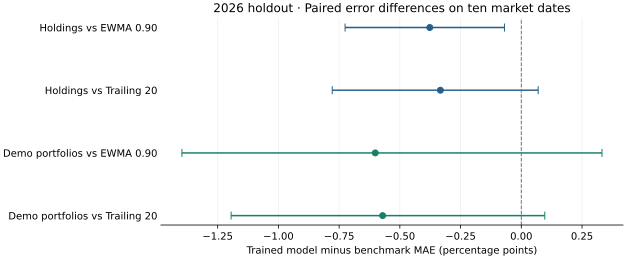

# 2026 volatility forecast holdout

Evaluated November 5, 2026, on the DS-002 snapshot through November 3. The model had the lowest mean absolute error on the ten primary test dates, both across the 16 instruments and across the two demo portfolios. The portfolio improvement was **0.60 percentage points versus EWMA** and **0.57 versus trailing 20**. Both paired uncertainty intervals include zero, so the portfolio forecast stays in research under the frozen decision rule.

## Test design

The [frozen EV-002 protocol](FINAL_EVALUATION_PROTOCOL.md) was committed as `68ccd74252a9076400a876911aac5093e1250d8c` before computing outcomes and scores. The selected seven-leaf gradient boosting model used 19,776 eligible pre-2026 training rows. Its latest training outcome ended December 31, 2025. The evaluator fit the estimator twice and obtained identical forecasts. Test-period inputs use returns through the forecast date, and all realized targets use the following 20 trading sessions. The two portfolios retain the fixed demonstration weights and use the 60-session co-movement method evaluated during development.

The primary test uses ten non-overlapping market windows from January 2 through October 20, 2026. The 16 instruments and two demo portfolios share those dates. Daily results use 191 overlapping origins and serve as a diagnostic. Each forecast is evaluated on the same origin/end pairs.

## Forecast errors

MAE is measured in percentage points of annualized volatility. Lower MAE and QLIKE indicate smaller error on the same outcomes.

| Sample | Scope | Method | Pairs | MAE | QLIKE |
| --- | --- | --- | --- | --- | --- |
| Primary | Holdings | EWMA 0.90 | 160 | 4.803 | -2.6430 |
| Primary | Holdings | Trained model | 160 | 4.426 | -2.7830 |
| Primary | Holdings | Trailing 20 | 160 | 4.759 | -2.6485 |
| Primary | Demo portfolios | EWMA 0.90 | 20 | 2.231 | -3.6194 |
| Primary | Demo portfolios | Trained model | 20 | 1.630 | -3.7217 |
| Primary | Demo portfolios | Trailing 20 | 20 | 2.201 | -3.6090 |
| Daily | Holdings | EWMA 0.90 | 3056 | 4.670 | -2.6921 |
| Daily | Holdings | Trained model | 3056 | 4.254 | -2.7810 |
| Daily | Holdings | Trailing 20 | 3056 | 4.802 | -2.6787 |
| Daily | Demo portfolios | EWMA 0.90 | 382 | 2.225 | -3.5987 |
| Daily | Demo portfolios | Trained model | 382 | 1.804 | -3.6890 |
| Daily | Demo portfolios | Trailing 20 | 382 | 2.376 | -3.5517 |

The equity-heavy demo had MAE of 1.67 points for the trained model, 2.70 for EWMA, and 2.55 for trailing 20. The higher-bond demo had errors of 1.59, 1.76, and 1.85, respectively.

<details>
<summary>Primary MAE by instrument and demo portfolio</summary>

| Instrument or demo | Trained model | EWMA 0.90 | Trailing 20 |
| --- | --- | --- | --- |
| AAPL | 6.993 | 6.230 | 7.054 |
| BND | 1.175 | 0.944 | 0.959 |
| EEM | 5.769 | 5.760 | 6.219 |
| EFA | 2.848 | 2.990 | 3.245 |
| GLD | 9.624 | 10.399 | 8.941 |
| HYG | 1.897 | 1.412 | 1.441 |
| IEF | 0.894 | 1.086 | 1.051 |
| IWM | 3.866 | 4.716 | 4.863 |
| JNJ | 4.161 | 5.022 | 4.091 |
| JPM | 3.630 | 4.692 | 3.207 |
| LQD | 1.437 | 1.466 | 1.558 |
| MSFT | 12.556 | 15.384 | 17.437 |
| QQQ | 3.769 | 4.707 | 4.385 |
| SPY | 3.185 | 3.726 | 3.546 |
| TLT | 2.017 | 2.748 | 2.789 |
| XOM | 6.992 | 5.561 | 5.358 |
| equity_heavy | 1.672 | 2.701 | 2.554 |
| higher_bond | 1.588 | 1.761 | 1.847 |

</details>

## Paired uncertainty



The evaluator averages paired absolute-error differences across entities on each market date before resampling dates. Negative differences favor the model. The two-date intervals are primary. One- and five-date intervals show sensitivity to the dependence assumption.

| Scope | Baseline | Block length | MAE difference | Nominal 95% interval |
| --- | --- | --- | --- | --- |
| Holdings | EWMA 0.90 | 2 | -0.377 | -0.725 to -0.069 |
| Holdings | EWMA 0.90 | 1 | -0.377 | -0.976 to +0.192 |
| Holdings | EWMA 0.90 | 5 | -0.377 | -0.640 to -0.114 |
| Holdings | Trailing 20 | 2 | -0.333 | -0.778 to +0.069 |
| Holdings | Trailing 20 | 1 | -0.333 | -0.849 to +0.123 |
| Holdings | Trailing 20 | 5 | -0.333 | -0.597 to -0.070 |
| Demo portfolios | EWMA 0.90 | 2 | -0.601 | -1.397 to +0.332 |
| Demo portfolios | EWMA 0.90 | 1 | -0.601 | -1.491 to +0.293 |
| Demo portfolios | EWMA 0.90 | 5 | -0.601 | -1.287 to +0.084 |
| Demo portfolios | Trailing 20 | 2 | -0.571 | -1.195 to +0.097 |
| Demo portfolios | Trailing 20 | 1 | -0.571 | -1.348 to +0.144 |
| Demo portfolios | Trailing 20 | 5 | -0.571 | -1.140 to -0.002 |

The primary holding comparison against EWMA has a two-date interval below zero, while the one-date sensitivity interval crosses zero. The primary portfolio comparisons both cross zero, even though the point estimates exceed the 0.50-point threshold. Ten dates limit interval reliability. Prior descriptive inspection, revised adjusted prices, shared exposures, and a fixed 16-instrument universe limit generalization. The result is retrospective evidence for a later forward evaluation.

## Verification and reproduction

All **3,438 realized entity-origin outcomes** reconcile between SQL and NumPy. A separate SQL check reconciles all **10,854 score rows** and 12 aggregate scores. The row count includes both primary and daily reporting, so the primary rows appear twice. Identical reruns reproduce the forecast, score, and summary hashes. The saved market warehouse retains its pinned hash.

```bash
.venv/bin/python -m scripts.evaluate_final --freeze-commit 68ccd74252a9076400a876911aac5093e1250d8c --score
```

The command expects the saved warehouse, modeling dataset, and trained development experiment. To replay after changing evaluation code or its frozen inputs, use a checkout of the freeze commit with the same local data artifacts and package versions. Local evidence lives under `data/experiments/final_evaluation/68ccd74252a9076400a876911aac5093e1250d8c/`.
