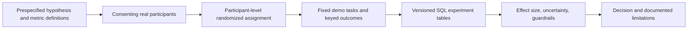

# Measurement and experimentation plan

Updated November 4, 2026. This document distinguishes implemented analytical metrics from proposed user-outcome measurement and statistical inference. No user experiment, telemetry collection, or statistical-significance result is claimed.

## The decisions measurement should support

1. Can users correctly understand the risk of a portfolio they enter?
2. Does the trained forecasting method improve risk estimates relative to the declared benchmark?
3. Can the product produce a complete, explainable report reliably for requested instruments?

These questions require different evidence. Portfolio volatility describes a portfolio; forecast MAE measures estimation error; user-task success measures whether the product helps someone. The software regression suite verifies implementation and does not establish statistical significance or user benefit.

## Measurement scorecard

| Layer | Metric and definition | Current evidence |
| --- | --- | --- |
| Portfolio description | Annualized sample volatility; full-history/window-specific drawdown; holding risk shares | Implemented and reconciled; not measures of product adoption or model accuracy |
| Forecast accuracy: primary | Mean absolute annualized-volatility error, first within instruments and then equally across instruments | Implemented on chronological development folds |
| Forecast accuracy: secondary | Variance QLIKE on identical forecast origins; prediction-floor counts | Implemented; development results and tradeoffs published |
| Model improvement | Absolute and relative error change versus the frozen selected benchmark | Development comparison available; confirmatory uncertainty/significance not established |
| User outcome: proposed primary | Percentage of assigned participants answering all three predefined risk questions correctly after using their assigned report | Not collected; requires real participants and predefined answer keys |
| User outcome: diagnostic | Task completion time, individual-question accuracy, and explanation clarity | Not collected; completion time must be considered with accuracy and abandonment |
| Product guardrails | Task abandonment; critical misunderstandings; failed analyses; unavailable histories; response latency | Error/loading states implemented; a systematic measurement dataset is not yet implemented |
| Coverage and source quality | Valid requested instruments successfully audited; missing-session counts; adjustment-review blocks; source freshness and verification tier | Structural audits and status evidence implemented; directory membership is not price availability |

Do not substitute page views, button clicks, or time spent for successful risk understanding. A shorter session can reflect either efficiency or abandonment. Metric denominators, timing rules, missingness, and exclusions must be documented before comparison.

## Proposed user experiment: does the presentation improve understanding?

**Question:** Does the interactive dashboard help a person interpret the same risk information more accurately than a basic numerical report?

- **Control:** a plain report containing the same underlying numerical facts and assumptions.
- **Treatment:** the interactive dashboard presenting those facts with its charts and explanations.
- **Randomization unit:** participant. Assign each participant to one version for the primary comparison; repeated questions are not independent participants.
- **Task materials:** fixed demonstration portfolios, not personal holdings. Use the same task difficulty and answer keys in both groups.
- **Primary outcome:** participant answers all three predefined risk questions correctly. Example tasks identify the largest volatility contributor, determine whether the reported volatility exceeds a stated reference, and distinguish volatility from a guaranteed maximum loss. Final wording and scoring must be frozen after a separate usability pilot.
- **Null hypothesis:** treatment does not improve the population success rate relative to control. The directional alternative is an improvement. Fix the direction before collecting the confirmatory sample.
- **Guardrails:** abandonment and critical misunderstandings must not worsen beyond predefined acceptable margins. Time-to-completion is secondary; do not exclude failed participants to make the interface appear faster.

Using identical facts isolates a presentation/interaction effect more closely than comparing a holdings-only screen against a report containing extra risk information. A holdings-only comparison could answer a broader product-package question, but would not isolate chart design.

Before a confirmatory test, define one primary comparison, significance level (proposed 0.05), desired power (proposed 80%), practically meaningful improvement, baseline-rate estimate, recruitment population, sample size, duration, exclusion rules, missing-response handling, and stopping rule. Use a separate pilot to refine tasks and estimate design inputs. Do not use an observed treatment effect to retrospectively justify the sample size. A small pilot is usability evidence, not a statistically conclusive A/B test.

Report each group's denominators, success rates, the absolute percentage-point difference, an appropriate confidence interval, the prespecified hypothesis-test result, and guardrails. Use a method suitable for the actual binary counts, including small-sample behavior. A p-value below 0.05 is not a measure of effect size, practical value, or the probability that the null hypothesis is true. An inconclusive result should be reported as inconclusive. Adjust for multiplicity if making confirmatory claims about several outcomes or variants; label exploratory subgroup results accordingly.

## Proposed forecast-comparison inference

**Question:** Does the frozen trained procedure reduce average volatility-forecast error relative to the frozen selected EWMA benchmark?

For each common forecast date, calculate the paired error difference between model and benchmark and aggregate instruments with the declared equal weights. A negative difference favors the model. Declare the population/time setting and practical improvement threshold before confirmatory evaluation.

Ticker rows share market shocks and adjacent periods can remain dependent. A naive independent-row t-test would overstate effective sample size. Investigate date-block paired resampling or an appropriately justified forecast-comparison test that accounts for temporal dependence, retaining the whole cross-instrument vector for each date. Prespecify block choices and sensitivity, report sample limitations, and do not present a fragile small-sample p-value as decisive evidence.

The 2025 model and EWMA settings were selected using that year's scores. Its apparent improvement is development evidence and does not provide an unbiased confirmatory test of the selected winner. Existing grid-phase and omission diagnostics are not independent trials. Freeze the complete model, comparator, metric, inference procedure, and evaluation sample before opening final 2026 outcomes. The currently available final-test grid has only ten completed market windows per instrument; adding tickers does not create independent market periods. Forward-recorded forecasts can later extend evidence.

## Proposed data collection and SQL composition

Planned tables: `experiment_definitions` for frozen hypotheses/metrics; `assignments` for anonymous participant ID and assigned variant; `task_events` for versioned task outcomes/timings; and `experiment_results` for sample counts, exclusions, effects, intervals, and test settings. Do not collect names, contact details, personal holdings, or portfolio values for the fixed-demo experiment. Participation and measurement should be explicit; no hidden tracking is added by this plan.

The next measurement milestone is a working protocol and task prototype followed by real usability observations. Recruitment and a powered confirmatory study remain future work. Do not create simulated users or invented significance results to fill the report.

Method references: [Microsoft's pre-experiment guidance](https://www.microsoft.com/en-us/research/articles/patterns-of-trustworthy-experimentation-pre-experiment-stage/), [properties of useful experimentation metrics](https://www.microsoft.com/en-us/research/articles/stedii-properties-of-a-good-metric/), and [Diebold and Mariano's forecast-accuracy comparison paper](https://www.nber.org/system/files/working_papers/t0169/t0169.pdf). These references motivate the proposed design; no external company's practices or project-specific causal results are inferred from them.
