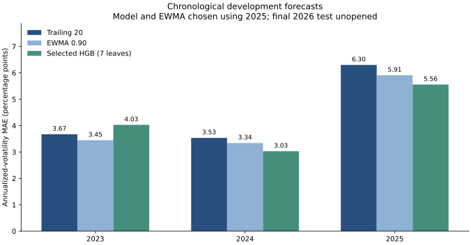
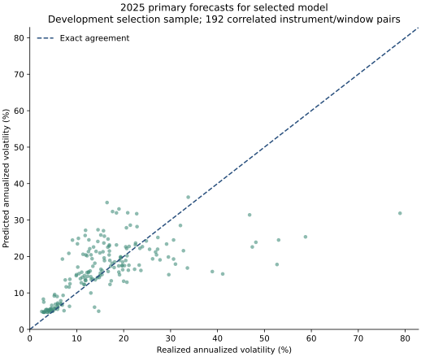

# Trained risk-model development experiment

Updated November 4, 2026. ML-001 trains pooled histogram gradient-boosted trees on earlier years and evaluates fixed development folds. No final refitting or 2026 predictions, outcomes, or scores are produced.

## Executive result

The selected trained candidate is **hgb_7**, chosen by primary 2025 equal-instrument volatility MAE. Its 2025 error is **5.5566 percentage points**, compared with **6.2989** for trailing variance and **5.9087** for selected **ewma_0.90**. Its variance QLIKE is **-2.7404**, versus **-2.6866** and **-2.6349**, respectively. Lower is better on these same outcomes. These are development-selection results, not independent final-test evidence or a deployment recommendation.

| Year | Method | Pairs | Volatility MAE, pp | Variance QLIKE |
| --- | --- | ---: | ---: | ---: |
| 2023 | ewma_0.90 | 192 | 3.4451 | -2.7095 |
| 2023 | ewma_0.94 | 192 | 3.3304 | -2.7428 |
| 2023 | ewma_0.97 | 192 | 3.5656 | -2.7663 |
| 2023 | hgb_15 | 192 | 4.0018 | -2.7312 |
| 2023 | hgb_31 | 192 | 3.9801 | -2.7304 |
| 2023 | hgb_7 | 192 | 4.0285 | -2.7371 |
| 2023 | trailing_20 | 192 | 3.6729 | -2.7034 |
| 2024 | ewma_0.90 | 192 | 3.3408 | -3.0098 |
| 2024 | ewma_0.94 | 192 | 3.1588 | -3.0393 |
| 2024 | ewma_0.97 | 192 | 3.0096 | -3.0537 |
| 2024 | hgb_15 | 192 | 3.0623 | -3.0412 |
| 2024 | hgb_31 | 192 | 3.1840 | -3.0318 |
| 2024 | hgb_7 | 192 | 3.0294 | -3.0409 |
| 2024 | trailing_20 | 192 | 3.5342 | -2.9918 |
| 2025 | ewma_0.90 | 192 | 5.9087 | -2.6349 |
| 2025 | ewma_0.94 | 192 | 5.9992 | -2.6798 |
| 2025 | ewma_0.97 | 192 | 6.1309 | -2.6732 |
| 2025 | hgb_15 | 192 | 5.5777 | -2.7488 |
| 2025 | hgb_31 | 192 | 5.5862 | -2.7548 |
| 2025 | hgb_7 | 192 | 5.5566 | -2.7404 |
| 2025 | trailing_20 | 192 | 6.2989 | -2.6866 |

Every method uses the same twelve primary windows per instrument/year (192 pairs across sixteen instruments). Daily overlapping scores are secondary and retained in the local summary. Methods first average within instruments, then weight instruments equally. All candidate settings remain visible; choosing by 2025 makes that year's selected score optimistic. Earlier-year differences and secondary metrics must be considered before claiming improvement. Instrument pairs share market events and cannot be treated as independent observations.



### Secondary daily comparisons

| Year | Method | Daily pairs | Volatility MAE, pp | QLIKE |
| --- | --- | ---: | ---: | ---: |
| 2023 | ewma_0.90 | 3680 | 3.4910 | -2.7549 |
| 2023 | hgb_7 | 3680 | 3.8294 | -2.7696 |
| 2023 | trailing_20 | 3680 | 3.5594 | -2.7481 |
| 2024 | ewma_0.90 | 3712 | 3.7112 | -2.9511 |
| 2024 | hgb_7 | 3712 | 3.2378 | -3.0086 |
| 2024 | trailing_20 | 3712 | 3.8051 | -2.9336 |
| 2025 | ewma_0.90 | 3680 | 6.1788 | -2.6882 |
| 2025 | hgb_7 | 3680 | 5.6474 | -2.7416 |
| 2025 | trailing_20 | 3680 | 6.2256 | -2.6979 |

These daily target windows overlap. They provide a sensitivity view and must not replace the declared primary grid after observing the results. The selected candidate and EWMA decay are fixed by the 2025 primary rule when shown in earlier years.

## Training contract

| Validation year | Training rows | Latest training target | Validation rows |
| --- | ---: | --- | ---: |
| 2023 | 7744 | 2022-12-30 | 3680 |
| 2024 | 11744 | 2023-12-29 | 3712 |
| 2025 | 15776 | 2024-12-31 | 3680 |

One model pools the sixteen instruments using the explicit twelve-column price-feature whitelist. Instrument IDs, dates, eligibility flags, target endpoints, and labels are excluded from predictors. Each fold fits only earlier target windows that finish before its validation year. Equal total training weight is assigned to each instrument, with mean row weight one. No scaling, imputation, feature selection, or target transformation is fitted; finite, ready feature rows are required.

Three fixed candidates differ only in maximum leaves (7, 15, 31). All use 150 boosting iterations, learning rate 0.05, minimum 100 observations per leaf, L2 regularization 1, seed 42, and one computational thread. Poisson deviance with a log link gives positive variance estimates for a nonnegative continuous target; it does not assert that volatility is a Poisson count. Random-split early stopping is explicitly disabled. The objective fits variance, while selection measures volatility MAE, so the optimization and reporting metrics differ.

The model is frozen within each validation year. Inputs update after each close without fitting on validation outcomes. Training uses overlapping daily labels, so training-row counts overstate independent market episodes. Repeat fitting of all nine candidate/fold combinations produces identical predictions. This is same-environment determinism, not proof of generalization or cross-platform bitwise equivalence.

## Where predictions fail



The diagonal indicates exact agreement; points below it underestimate realized risk. This plot uses the same 2025 development sample that influenced selection and is not a calibration guarantee. The following slices classify realized outcomes using each instrument's training-only median target volatility. Realized regime is known afterward and is never a model input. A slice can omit an instrument if it has no qualifying outcomes; compare only the same slice across methods.

| Realized regime | Method | Instruments | Pairs | MAE, pp | QLIKE |
| --- | --- | ---: | ---: | ---: | ---: |
| above_training_median | ewma_0.90 | 16 | 54 | 11.6742 | -0.2887 |
| at_or_below_training_median | ewma_0.90 | 16 | 138 | 4.0446 | -3.2734 |
| above_training_median | hgb_7 | 16 | 54 | 9.8660 | -0.8604 |
| at_or_below_training_median | hgb_7 | 16 | 138 | 4.6112 | -3.2556 |
| above_training_median | trailing_20 | 16 | 54 | 12.2040 | -0.6343 |
| at_or_below_training_median | trailing_20 | 16 | 138 | 4.1098 | -3.2678 |

### 2025 primary errors by instrument

| Instrument | Model MAE, pp | EWMA MAE, pp | Trailing MAE, pp |
| --- | ---: | ---: | ---: |
| AAPL | 11.5701 | 14.0112 | 14.3750 |
| BND | 1.2761 | 0.7796 | 0.9676 |
| EEM | 7.3066 | 6.7738 | 7.1374 |
| EFA | 6.3483 | 5.8625 | 6.1240 |
| GLD | 7.0985 | 7.9138 | 7.0649 |
| HYG | 2.8421 | 2.4395 | 2.5199 |
| IEF | 0.9933 | 0.7621 | 1.0264 |
| IWM | 6.2829 | 6.6935 | 7.8372 |
| JNJ | 5.2883 | 6.9920 | 6.4981 |
| JPM | 7.0786 | 7.0533 | 7.5356 |
| LQD | 1.9035 | 1.6978 | 1.8577 |
| MSFT | 6.9553 | 8.9032 | 10.3164 |
| QQQ | 7.6518 | 8.4479 | 9.4555 |
| SPY | 7.9484 | 7.5667 | 8.4290 |
| TLT | 3.4505 | 2.4804 | 2.7700 |
| XOM | 4.9107 | 6.1620 | 6.8678 |

Each instrument has only twelve primary outcomes. A favorable aggregate can coexist with substantial errors or deterioration for particular assets. This table describes the declared universe and does not justify adding or removing assets after seeing their results.

## Reproduction and limitations

- Experiment: `46c0c08c13e6d559a8c80f59b930758a038fdd2579119d5ee19a20937a73c64d`.
- Modeling dataset: `ecc468b9aef284824e22c7c1cb47f0f89517ff583061cc72ef0eff4d37d23d83`.
- Baseline experiment: `09c9fd883372638995cad3d5ee586d7ef8b9915ae4aa331e75d2bff41422f29b`.
- [ML-001 recipe](../config/model_training.json); [evaluation contract](EVALUATION_PROTOCOL.md).
- Saved artifacts include every candidate/fold model, parameters, training dates, feature order, package/code/data versions, all forecasts, matched origins, errors, exposure-group/regime metrics, and hashes. An append-only local attempt log records starts, completions, and failures. This is file-based tracking; MLflow remains uninstalled.

```bash
.venv/bin/python -m scripts.train_risk_model --modeling-dataset data/modeling/ecc468b9aef284824e22c7c1cb47f0f89517ff583061cc72ef0eff4d37d23d83
.venv/bin/python -m unittest discover -s tests -v
```

Model files stay local. Only models generated in the current run are reloaded for verification; arbitrary downloaded pickle/joblib files are not accepted. The source data contain revised adjusted histories and a small current-survivor universe. Development tuning, correlated assets, limited non-overlapping windows, and absent transaction costs limit conclusions. This experiment forecasts instrument variance, not portfolio covariance or expected investment returns. Portfolio-level forecasting requires a separate correlation estimator and evaluation. News, personal risk preferences, portfolio suggestions, final refitting, and final testing remain subsequent work.

Method references: [scikit-learn estimator documentation](https://scikit-learn.org/stable/modules/generated/sklearn.ensemble.HistGradientBoostingRegressor.html) and [model persistence documentation](https://scikit-learn.org/stable/model_persistence.html). Numerical results are generated from this project's saved experiment.
