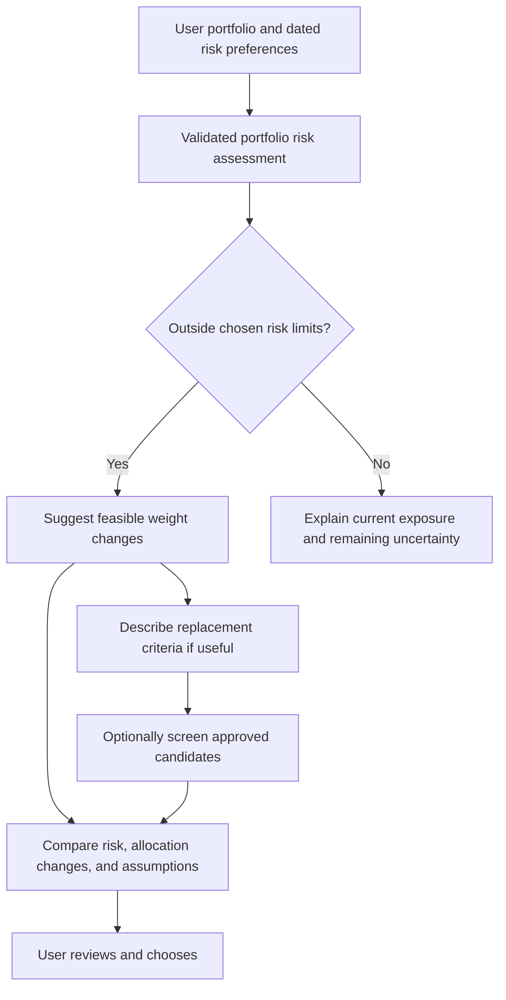

# Portfolio adjustment suggestions — later phase

Recorded November 4, 2026. **Status: requested future functionality; not implemented.** The current priority remains validated risk measurement and forecasting. This roadmap does not prescribe actual trades or allocations.

## Executive summary

When a user-defined portfolio exceeds the user's chosen risk tolerance, propose explainable alternatives. Begin with changing the weights of existing holdings. Later, describe useful replacement characteristics and optionally screen an approved instrument universe. Present risk estimates, assumptions, and tradeoffs for the user to review.

The intended question is: **What feasible changes could bring my portfolio closer to my chosen risk limits while respecting the holdings and constraints I care about?**

## Proposed progression

| Stage | Suggested output | Additional requirement |
| --- | --- | --- |
| 1. Reweight current holdings | Alternative weights for A, B, and C, with before/after risk and concentration | User risk target, holding bounds, protected positions, and a limit on allocation changes |
| 2. Describe replacement criteria | Characteristics that could improve the portfolio, for the user to research | Portfolio-relative correlation and risk contribution, volatility, liquidity, usable history, and desired exposures |
| 3. Screen replacement candidates | Named candidates from an explicitly defined, accepted universe, with supporting metrics | Audited candidate data, dated universe, consistent comparisons, and a documented ranking procedure |

All three stages are planned. A low-volatility instrument is not automatically a good replacement: its co-movement with the remaining holdings matters. Company mentions or sentiment do not establish investment suitability. Sector, fundamental, liquidity, or ETF look-through claims require their own appropriately dated data.

The diagram describes the proposed workflow. The suggestion engine and preference assessment are not implemented.

## Inputs and decision rules

Record the risk measure, units, estimation window or forecast horizon, as-of date, and user-selected threshold. Annualized volatility and historical drawdown are distinct measures; a threshold on one is not a guaranteed bound on the other. Investment horizon, need for funds, concentration preferences, protected holdings, permitted assets, and maximum allocation changes influence the alternatives shown.

Start with a transparent constrained search: seek a small change from current weights while satisfying a declared estimated-volatility limit and position bounds. Preserve the initial long-only, fully invested scope unless the user later chooses to add other asset types or cash. Do not silently concentrate everything in the least volatile holding. A minimum-risk alternative can be a separate comparison rather than the default recommendation.

If the current holdings cannot meet the requested threshold under the stated constraints, report that no feasible reweighting was found. Show the constraint that binds and the best feasible estimate; do not fabricate weights or suggest that the target has been achieved. Replacement criteria can then explain what an additional exposure would need to contribute.

The first version should not maximize expected returns or promise preserved returns: no expected-return forecasting capability is currently implemented. The output describes estimated risk and tradeoffs under declared assumptions. Forecast uncertainty and changing correlations remain visible.

## Proposed report

For each alternative, show current versus proposed weights, estimated portfolio volatility, instrument risk contributions, concentration, allocation turnover, and historical scenario results where supported. Use the same source version, estimation dates, and portfolio convention for all alternatives. Explain why the change affects the portfolio and distinguish improvement in an estimated risk measure from investment performance.

Provide several useful alternatives, such as a small-change option and a lower-estimated-risk option, rather than claiming one universally best portfolio. Trading costs and tax consequences must not be silently treated as zero: a cost-aware extension needs explicit inputs and separate implementation; earlier hypothetical comparisons should identify excluded effects.

A future language-model explanation must use validated calculation outputs and source-linked candidate facts. It must not invent numbers, criteria, or securities. Portfolio entry and reports remain private by default. The user retains the decision; automated trading remains outside scope.

## Evaluation before release

- Verify constraints, weight sums, holding bounds, protected positions, and infeasible targets using known fixtures and independent calculations.
- Reconcile every suggested portfolio with the existing risk engine and check stability across reasonable historical windows and small input changes.
- Compare with unchanged weights and simple reweighting rules using chronological, available-at-origin data. Report allocation turnover and cost assumptions alongside estimated and subsequently observed risk.
- Separate risk-forecast evaluation from evaluation of the allocation policy. Optimizing on a risk estimate does not establish that future losses will stay below a target.
- Audit candidate-universe coverage and survivorship limits. Select rules using development data and follow the reserved-test protocol; do not tune replacement choices on opened 2026 scores.
- Check that explanations reproduce calculated facts and that users can understand the tradeoffs and rejected alternatives.

## Dependencies and references

Implement after the core risk engine, personal preference inputs, portfolio forecast evaluation, and usable comparison interface. News can provide later context, but is not a prerequisite or a sole basis for suggestions. No optimization library or recommendation model has been installed or selected for this phase.

Method references: [PyPortfolioOpt objectives and constraints](https://pyportfolioopt.readthedocs.io/en/latest/MeanVariance.html), [Cvxportfolio holding and turnover constraints](https://www.cvxportfolio.com/en/stable/constraints.html), and [Investor.gov on asset allocation, diversification, and rebalancing](https://www.investor.gov/introduction-investing/getting-started/asset-allocation). These are references for future design, not executed implementations or evidence of achieved risk reduction.

## Preference-reflection foundation now available

RQ-001 now elicits self-reported preferences and access needs, and the interface supports one portfolio with an optional manually edited alternative. This does not implement the adjustment engine or establish validated constraints: no volatility target, feasible weight suggestion, replacement criteria, candidate recommendation, or full financial-capacity assessment is inferred. Read [RISK_PREFERENCES.md](RISK_PREFERENCES.md). The three suggestion stages above remain planned.
