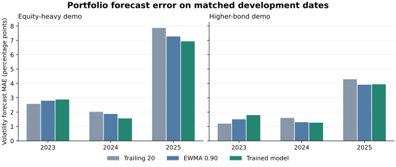

# Portfolio volatility forecast development

Updated November 4, 2026. PF-001 tests whether the trained holding forecasts improve estimates for complete portfolios. It uses the two existing demonstration allocations and accepted DS-002 market history. The allocations represent a fixed mix rebalanced daily before costs and taxes.

Across both demos and 36 matched forecast dates from 2023 through 2025, the trained model had mean absolute volatility error of **3.06 percentage points**. The exponentially weighted benchmark had **3.11**, and the direct trailing benchmark had **3.26**. The trained model's advantage over the exponentially weighted benchmark was small, and the exploratory resampling intervals span zero.

## Methods

At each forecast date, the target is the annualized mean of squared weighted daily returns over the next 20 sessions. The forecast is converted to annualized volatility by taking the square root. This follows the modeling target's root-mean-square convention. The historical dashboard uses demeaned sample covariance for its descriptive estimates.

| Method | Portfolio variance forecast |
| --- | --- |
| Trailing 20 | Annualized mean of the portfolio's squared daily returns over the latest 20 sessions through the forecast date |
| EWMA 0.90 | Saved holding variances from the selected exponentially weighted benchmark combined using a 60-session co-movement matrix |
| Trained model | Saved holding variances from the selected seven-leaf gradient boosting model combined using the same 60-session matrix |

The matrix uses the dot product of pairs of return series divided by their Euclidean norms. Its diagonal is one, and it is positive semidefinite because it is a Gram matrix of normalized return columns. The predicted holding volatilities scale the matrix on both sides to produce a forecast of second moments. The portfolio variance is the resulting quadratic form in portfolio weights. This is a simple co-movement estimator, motivated by the common decomposition into marginal risk and co-movement. [Engle's covariance decomposition](https://doi.org/10.1198/073500102288618487)

The evaluator matches the same dates and endpoints across all methods. Each development year has 12 non-overlapping target windows per portfolio. It clips warehouse reads to dates before 2026. It verifies saved experiment hashes and matches the modeling manifest to the active market dataset. Every recomputed holding target and trailing holding forecast reconciles with the saved instrument data.

## Observed results



| Year | Demo | Trailing 20 MAE | EWMA MAE | Trained MAE |
| --- | --- | ---: | ---: | ---: |
| 2023 | Equity-heavy | 2.58 | 2.80 | 2.88 |
| 2023 | Higher-bond | 1.20 | 1.50 | 1.79 |
| 2024 | Equity-heavy | 2.02 | 1.87 | 1.56 |
| 2024 | Higher-bond | 1.60 | 1.30 | 1.27 |
| 2025 | Equity-heavy | 7.87 | 7.27 | 6.93 |
| 2025 | Higher-bond | 4.29 | 3.91 | 3.94 |
| Pooled | Both | 3.26 | 3.11 | 3.06 |

MAE is measured in percentage points of annualized volatility. The pooled mean gives both demo portfolios equal weight on each date. For the secondary variance loss, QLIKE, the trailing baseline scores −3.3912, the trained model scores −3.3887, and EWMA scores −3.3290. Lower values indicate smaller loss on the same outcomes.

## Paired comparison and decision

On each forecast date, compute the trained model's absolute error minus EWMA's absolute error, then average the two portfolio differences. Both portfolios hold the same instruments, so the date is the unit of resampling. Sample contiguous blocks of dates within each year, wrapping around within that year, and keep all three years equally weighted. The primary descriptive interval uses three-date blocks and 20,000 replicates with seed 42. Two- and four-date blocks show sensitivity. Forecast-loss comparisons must account for shared exposures and time dependence. [Diebold and Mariano on comparing predictive accuracy](https://www.nber.org/papers/t0169)

| Block length in dates | Mean MAE difference | Exploratory 95% interval |
| ---: | ---: | ---: |
| 2 | −0.045 pp | −0.567 to +0.467 pp |
| 3 | −0.045 pp | −0.490 to +0.360 pp |
| 4 | −0.045 pp | −0.479 to +0.355 pp |

Only 36 market dates and two overlapping allocations inform these estimates. The resampling assumes that nearby dates within a year are informative about its variation and does not account for selecting the model and EWMA with the 2025 instrument scores. The 60-session matrix is a design assumption. The comparison therefore supports keeping the trained forecast in research while evaluating a frozen procedure before use in the dashboard.

## Verification and reproduction

An independent SQL calculation reconciled the realized variance and both error measures for all **216 score rows**, plus all 72 direct trailing forecasts. A regression test changes a future return and checks that the forecast at the earlier date is unchanged while its measured outcome moves.

```bash
.venv/bin/python -m scripts.evaluate_portfolio_forecasts \
  --experiment data/experiments/trained_models/46c0c08c13e6d559a8c80f59b930758a038fdd2579119d5ee19a20937a73c64d \
  --modeling data/modeling/ecc468b9aef284824e22c7c1cb47f0f89517ff583061cc72ef0eff4d37d23d83
```

The saved run is `da59ccb252b822192bd5f090397e4b12bc29400fe6f62a77cd01ea1e5f613396` under `data/experiments/portfolio_forecasts/`. The folder contains matched scores, the recipe and metrics, and output hashes. The warehouse connection is read-only. This development run leaves final refitting and 2026 model evaluation pending.
