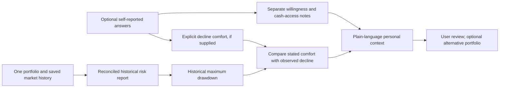

# Personal risk-preference guide and optional comparison

Updated November 4, 2026. The application starts with one portfolio. An optional five-question guide helps users describe risk preferences without choosing an annualized-volatility percentage. A second portfolio is available only when comparison is enabled.

## Default personal workflow

1. Enter and name one portfolio. Its allocation percentages must total 100%.
2. Optionally answer the risk-preference questions; skipped and uncertain answers are permitted.
3. Assess historical volatility, drawdown, holding risk contributions, and fixed stress windows.
4. Enable “Compare an alternative portfolio” when exploring a change. The alternative initially copies current weights. Its edits remain independent, and it is excluded from requests and validation while comparison is off.

The report adapts its cards, chart series, risk-share table, and stress table to the number of submitted portfolios. Hidden alternative weights cannot prevent a valid single-portfolio analysis. Turning comparison off preserves the alternative in browser memory. No suggested allocation or automated portfolio adjustment is generated.

## RQ-001 questions and interpretation

| Topic | What the answer contributes |
| --- | --- |
| When some money may be needed | A description of investment horizon and possible near-term access needs |
| Ability to cover an unexpected expense elsewhere | A self-reported indication of cash-access flexibility |
| Preference for stability versus growth | A plain-language statement of the user's expressed priority |
| Expected response to a hypothetical 20% decline | A self-reported reaction, not a prediction of actual behavior |
| Decline that starts feeling hard to tolerate | An explicitly selected loss-comfort value, or an unspecified value if uncertain |

Questions and choices are versioned in [RQ-001](../config/risk_questionnaire.json). Their wording and interpretation are original to this project. [FINRA's investor-profiling discussion](https://www.finra.org/sites/default/files/digital-investment-advice-report.pdf) distinguishes willingness to accept risk from financial ability to absorb losses; [Investor.gov](https://www.investor.gov/introduction-investing/getting-started/asset-allocation) discusses time horizon and risk tolerance. Those principles inform the separation of questions, but neither organization validates this questionnaire or its outputs.

The guide does **not** assign a numerical risk score, certify an investment category, infer a volatility target, or recommend securities or weights. It is a self-reflection prototype. Five broad questions do not establish a complete financial-capacity assessment; debts, expenses, taxes, and other circumstances are not measured.

The interpretation preserves willingness statements separately from access/capacity notes. A stated growth preference combined with possible near-term cash needs produces a review note explaining the tension; it is not collapsed into an overall score. Partial answers are labeled by completion count. “Not sure” remains uncertain rather than becoming a conservative or aggressive default.

## How the guide connects to real portfolio history

If a user explicitly selects a 20% decline as difficult to tolerate and the scenario's maximum historical drawdown is 26.94%, the report says the observed decline exceeded the stated level. It does not infer that the portfolio will lose 26.94%, that 20% is a safe limit, or that any allocation is suitable. A historical decline below a selected level is not evidence of future safety.

When no loss-comfort value is selected, the guide supplies no numerical threshold. It can illustrate the observed drawdown using a hypothetical $1,000 balance at a historical peak. A 25% peak-to-trough drawdown would reduce that peak balance to $750. This rescales the historical drawdown; it is not an initial-investment return or forecast.

Volatility is a dispersion estimate; drawdown is a cumulative peak-to-trough decline. The app does not convert one into the other. An optional manual annualized-volatility reference remains under Advanced for users who deliberately choose it. Questionnaire answers do not replace, modify, or populate that field.

## Implementation, privacy, and evidence

The local API accepts an optional `risk_preferences` object with RQ-001 identity and allowlisted answers. Interpretation is deterministic and preserves the questionnaire and code hashes. The underlying risk calculations, source policies, fixed model universe, and reserved 2026 model test are unchanged. Single-portfolio requests return one scenario; comparison requests return two.

Answers remain in browser/server memory and appear only in a user-triggered JSON export. They are not sent to market-data providers, automatically stored, or logged as study telemetry. Market-data requests send the selected ticker only. No personal income, balances, names, or account details are requested by the guide.

Ten added tests cover answer validation, uncertainty, partial completion, separate willingness/capacity notes, explicit decline comparison, zero-loss comfort, absent profiles, unchanged risk calculations/manual references, and one-versus-two-scenario consistency. The full suite has **146 passing software tests**. Browser checks verify one report by default, optional copied weights, comparison error handling, hidden-alternative exclusion, five-question interpretation, and table/chart adaptation. A real-data demonstration preserves the warehouse hash and reproduces the original portfolio metrics. Public screenshots contain demonstration holdings and unanswered questions, not personal responses.

This guide is separate from the proposed [user-comprehension experiment](METRICS_AND_EXPERIMENTS.md). Preferences have no objectively correct quiz answer. The future study measures whether people understand portfolio facts; it has not validated RQ-001, collected participant outcomes, or established statistical significance.
