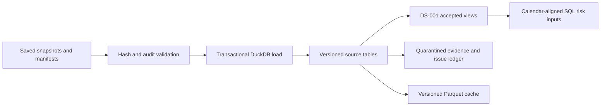

# SQL ingestion milestone

Updated November 4, 2026. Built from verified local snapshots without new market-data downloads.

## Observed result

- Dataset: `c963ca0add1f4b279911d2b4cbc66dc5208fef37873306e5651159ae7cbf0fcc`; DuckDB 2.0.0.
- Retained price observations across source captures: **10,314**.
- Accepted observations in the selected three-instrument dataset: **5,157**.
- Accepted FRED index-context observations: **1,719**.
- Yahoo index observations retained in quarantine: **1,719**.
- Active quality issues: **3**, with original source values and evidence references retained.
- Parquet exports: **5** versioned tables; detailed hashes and counts remain local.

| Instrument | Expected sessions | Valid daily returns | Complete 20-return windows |
| --- | ---: | ---: | ---: |
| AAPL | 1,719 | 1,718 | 1,699 |
| BND | 1,719 | 1,718 | 1,699 |
| SPY | 1,719 | 1,718 | 1,699 |

The first session has no previous close and therefore no daily return. A trailing volatility estimate requires 20 valid one-session returns. The SQL uses `sqrt(252 * mean(return²))`, consistent with the project's squared-return convention; it is a historical input, not a trained forecast or portfolio risk report.

## Composition and data grain

| Table | Grain and purpose |
| --- | --- |
| ingestion_runs | One source capture, identified by source and capture ID, with manifest hash and settings |
| instruments | One instrument identity and calendar |
| prices_daily | One instrument/session/capture; earlier versions are retained |
| corporate_actions | One instrument/session/action type/capture |
| benchmark_observations | One series/date/capture, retaining FRED's null holiday rows |
| dataset_versions and dataset_runs | An explicit recipe and its source captures |
| source_rules | Versioned DS-001 rules for that dataset |
| expected_sessions | Instrument/session calendar alignment for a dataset |
| data_quality_issues | One discrepancy rule/date/dataset with source values, tolerance, and disposition |
| active_dataset | The explicitly selected dataset; no automatic latest-date selection |



## Guarantees and limits

- Inputs are hash-checked and re-audited before loading. A failed acceptance check prevents activation.
- Primary keys and conflict handling make identical loads idempotent. Different captures retain distinct records.
- Inserts and active-dataset selection use one database transaction. A database error rolls back that load.
- Parquet publication is a separate, recoverable cache step after database commit. Files are staged and published as a complete directory; existing files are hash-checked and compared with SQL rows on rerun. This is not a distributed transaction across the database and filesystem.
- Accepted risk prices, accepted FRED context, and quarantined Yahoo index observations have separate views. Context is not automatically approved as a predictive feature. The three discrepancies remain unresolved.
- The current scope is three instruments and explicit saved captures. General incremental provider ingestion, universe expansion, portfolio calculations, and model training remain subsequent work.

## Reproduction and inspection

```bash
.venv/bin/python -m scripts.build_warehouse --snapshot data/audit/20261104T170702705356Z --historical-snapshot data/audit/20261104T170309697872Z --external-snapshot data/validation/20261104T171500906975Z
# Run the same command again to verify duplicate-free loading and cached exports.
.venv/bin/python -m unittest discover -s tests -v
```

The database is local at `data/warehouse/portfolio-risk.duckdb`. Parquet tables and a manifest are under `data/normalized/<dataset-id>/`. Counts and provenance are saved in `data/warehouse/build-summary.json`. These artifacts are ignored by Git. Query examples are in [sql/diagnostics.sql](../sql/diagnostics.sql); the schema and view definitions are also plain SQL in that folder.

Read the [SQL walkthrough](03_SQL_WALKTHROUGH.md) and [source policy](DATA_SOURCE_POLICY.md) for interpretation. No source discrepancy has been silently corrected.
