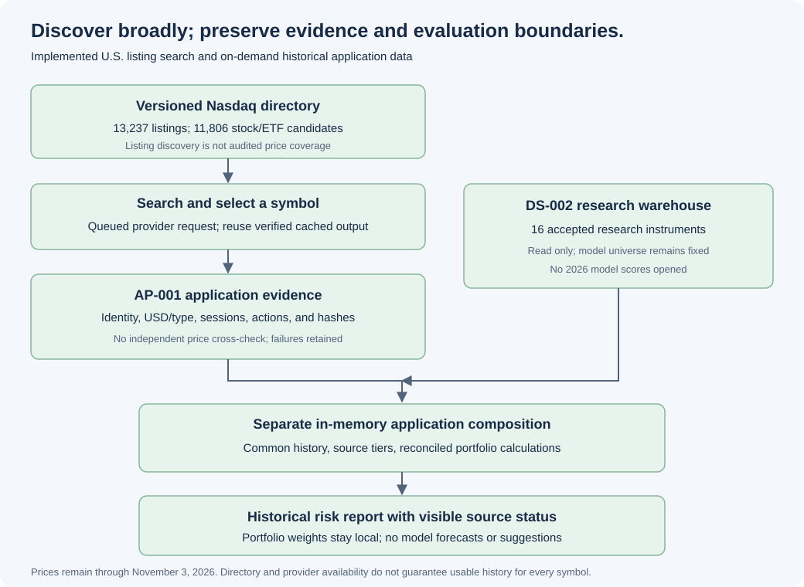

# U.S. listing search and on-demand application history

Updated November 4, 2026. The application can search a versioned U.S. listing directory and request additional stock/ETF histories. The original sixteen-instrument research warehouse and model evaluation universe remain fixed.

## Scope and observed coverage

The saved Nasdaq Trader directory contains **13,237 active, non-test listings**, including **5,775 ETF-flagged listings**. It covers more security types than common stocks and ETFs. The selector retains **11,806 candidates** after excluding identifiable warrants, preferreds, rights, notes, units, and unsupported symbol formats. Classification uses directory fields and security-name rules; it is not a complete security master. Provider type/identity is checked separately on load. Some candidates may still be unavailable or outside supported scope.

Directory membership does not establish price availability, complete history, or independent verification. A request can fail because of provider access, instrument identity/type, missing sessions, adjustment behavior, or insufficient history for a selected risk window. The application reports that failure instead of inventing prices or silently substituting an instrument. Currently listed securities do not constitute a historical point-in-time universe and must not replace the model sample without a separate versioned evaluation decision.

## Search, load, audit, analyze



1. Search locally by ticker or company name using SQL over a hashed Parquet directory. Exact symbols rank first. Search does not download thousands of price histories.
2. Press Add for a selected candidate. A single-worker queue loads its daily history or replays an existing verified cache. Local job polling does not repeat provider requests.
3. Validate the provider symbol, USD currency, EQUITY/ETF type, New York exchange timezone, and complete expected sessions. Historical settings retain dividends/splits and disable automatic adjustment, repair, and filling.
4. Block structural failures and adjusted-price deviations over the existing five-basis-point review threshold. Preserve large real price moves as visible warnings rather than repairing them. IPO-era coverage uses the provider's first-trade metadata explicitly; this is not independent verification of the IPO date.
5. Preserve CSV library output, metadata, audit, recipe, timestamps, and hashes under AP-001. A ready capture is published atomically; failures are retained separately. Replays verify evidence hashes and rerun the audit.
6. For a portfolio containing additional symbols, compose a separate in-memory analytical dataset with the accepted base history. Reuse the SQL/NumPy reconciled portfolio engine. Do not write additional assets into the frozen research warehouse or feed them into model evaluation.

The browser supports up to 100 positions per portfolio, subject to data availability. Allocation percentages must sum to 100% independently for Portfolios A and B. The initial AAPL/SPY/BND holdings are a demonstration, not the instrument-coverage limit. New symbols initially receive zero weight until the user supplies allocations.

## Source tiers and the saved cutoff

| Tier | Evidence | Application treatment |
| --- | --- | --- |
| DS-002 research instruments | Structural audits plus limited selected website/issuer checks | Existing accepted research history |
| AP-001 additional instruments | Provider identity/type/currency/timezone and structural/adjustment checks; no independent price cross-check | Explicit source-status notice and retained warnings |

Both tiers use the saved analysis cutoff of **November 3, 2026** in this application version. This is a historical research snapshot, not live pricing. An instrument listing after that cutoff cannot yet have usable history in the saved interval. No request silently mixes newly downloaded later sessions with the older base snapshot. Refreshing the base cutoff is a separate ingestion task.

The directory source timestamp is preserved verbatim (`File Creation Time: 1104202621:33`); its timezone is not inferred. Raw directory bytes and retrieval metadata remain local. Prices are provided through the unofficial yfinance interface, so saved files contain library output, not original HTTP payloads.

## Real-data checks and limitations

Three additional examples passed AP-001 checks: **META**, **VOO**, and **BRK.B** (mapped explicitly to provider symbol BRK-B). Each has **1,719 sessions** from January 2, 2020 through November 3, 2026. META has four extreme-adjusted-move warnings; those prices are retained without repair. These examples are software/data checks, not investment recommendations. No independent price cross-check is claimed for them.

A mixed META/AAPL demonstration passes the existing SQL/NumPy reconciliations through the HTTP API. Loading and analyzing it leaves the research database's file hash unchanged. Automated tests cover directory parsing, test/security-type exclusions, class-share mapping, exact/company search, SQL parameterization, immutable replay, evidence tampering, identity/type/currency/timezone failures, missing sessions, adjustment blocks, large-move warnings, failed captures, and separate analytical composition.

Weights and portfolio amounts remain in memory and are not sent externally. Loading a new symbol necessarily requests that symbol's market data from the provider; the privacy text makes that distinction visible. Source evidence is cached locally. Failed jobs are not automatically retried in the same service session; inspect the retained failure before a deliberate retry. No bulk all-market price ingestion, global coverage, delisted-universe reconstruction, live-price feed, or universal history guarantee is implemented.

## Reproduce

```bash
# Download a new directory snapshot, or use --source <saved-nasdaqtraded.txt> offline.
.venv/bin/python -m scripts.market_catalog
.venv/bin/python -m scripts.serve_portfolio_app
.venv/bin/python -m unittest discover -s tests -v
```

The source policy is [AP-001](../config/application_source_policy.json). Market data and catalog snapshots remain outside Git. The discovery directory is separate from [RU-001](REFERENCE_UNIVERSE.md), the fixed modeling/evaluation scope.

Primary sources: [Nasdaq symbol directory](https://www.nasdaqtrader.com/dynamic/SymDir/nasdaqtraded.txt) and [Nasdaq directory field definitions](https://www.nasdaqtrader.com/Trader.aspx?id=SymbolDirDefs). Counts above come from the preserved project snapshot and are not a claim about all future listings.
