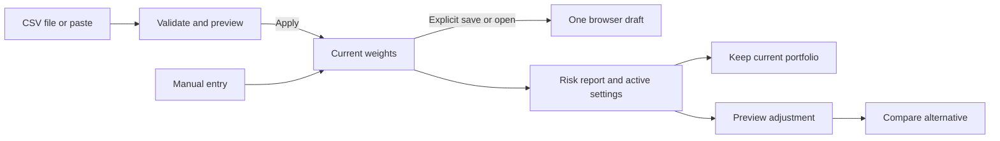
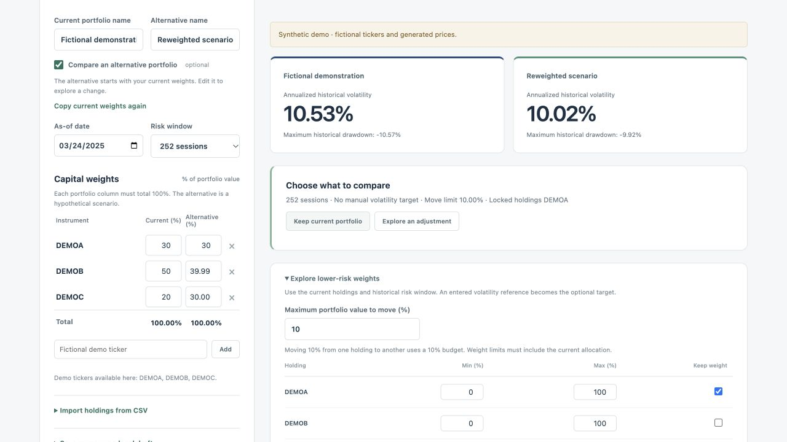

# Version 2 guided portfolio workflow

Checkpoint 2 · November 5, 2026

## Enter and save holdings

Start with one portfolio. Enter weights manually, choose a CSV file, or paste CSV text. Both supported headers are case-sensitive. Tickers are normalized to uppercase.

| Header | Required values | What the preview shows |
| --- | --- | --- |
| `ticker,weight` | Positive percentage points, such as 30 for 30%. Weights must total 100% within a floating-point tolerance of 0.00000001 percentage points. | The supplied weights. |
| `ticker,market_value` | Positive USD values without currency signs or thousands separators. | Each value divided by the total value, expressed as a percentage. |

Use one row per ticker, up to 100 holdings and 64 KiB. The parser accepts a UTF-8 byte order mark, blank lines, common line endings, and quotes around individual fields. Extra columns, duplicates, invalid amounts, and tickers without history loaded in the session block the entire preview. Use the manual **Add** control to load an eligible ticker before retrying. Preview and cancel leave the portfolio intact. Apply changes the current weights and preserves any prepared alternative.

Example for the standalone demo:

```csv
ticker,weight
DEMOA,40
DEMOB,35
DEMOC,25
```

**Save weights** writes one draft to browser storage for the current local address. It contains current tickers and weights. Save again to replace it. Open restores those weights into the current form, and delete removes the draft from this browser. The draft excludes uploaded files, market values, alternative weights, account details, names, dates, targets, and questionnaire answers. Reloading starts with the demonstration. Open is explicit, and tickers admitted on demand may need to be added again first.

## Review the decision

The report displays the selected window and its actual session dates. The default is 252 sessions. Use the existing 63- or 126-session controls to review a shorter estimate. The decision panel keeps the numerical target source, move limit, and locked holdings visible. Weight changes use percentage points, so a move from 30% to 25% is a decrease of 5 percentage points.

Choose **Keep current portfolio** to close the adjustment and return to the current allocation. Choose **Explore an adjustment** to preview a constrained reweighting or review replacement criteria. Loading an alternative leaves the current weights in place. Replacement results distinguish a manually entered target from the current portfolio estimate and show the move limit and locks used. The market-data screen qualifies candidates on historical volatility. Checkpoint 3 adds exposure eligibility and side-by-side window sensitivity. [Risk and replacement evidence](V2_RISK_EVIDENCE.md)





## Run and verify

From a Version 2 checkout with Python 3.13 available, run `./scripts/run_demo.sh`. Open [the local synthetic demo](http://127.0.0.1:8766/). Set the `PORT` environment variable to choose another port. The launcher installs pinned dependencies. A temporary DuckDB contains 320 generated weekday prices for each of three fictional tickers. The demo uses the same portfolio analysis and reweighting engine as the market-data application. The demo enables comparison and replacement criteria. Market search, screened replacements, named market stress windows, and study recording require the market-data workflow. [Market-data reproduction](REPRODUCE.md)

- **Software tests.** All 161 passed locally. The new API checks cover source labels, a locked holding, comparison against the preview estimate, read-only data, and rejection of real tickers and market-only routes in demo mode.
- **Market-data regression.** Replayed all 30 archived case paths against Version 2 using the preserved DS-002 warehouse. Statuses matched and numeric results reconciled within absolute tolerance `1e-12`. The warehouse checksum matched before and after. [Version 1 reference](V1_SCRIPTED_REHEARSAL.md)
- **Browser checks.** Verified CSV file selection with a UTF-8 byte order mark and CRLF line endings, pasted values, duplicate and unavailable tickers, invalid totals, cancellation, draft recovery after reload, draft deletion, and the keep-current and locked reweighting paths. Keyboard activation moved focus to the preview action. The 390-pixel viewport showed no horizontal page overflow.

The checks establish technical behavior. Participant completion, time, and comprehension remain unmeasured.
