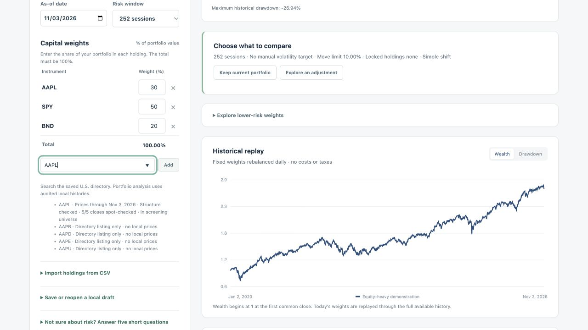

# riskitnot Version 2 technical preview

Version 2 makes it easier to bring in a portfolio, understand what the saved data support, and compare an adjustment under explicit constraints. The preview has technical evidence from scripted cases and a local browser. Participant outcomes and prospective forecast performance remain pending.

## What changed from Version 1

| Decision case | Version 1 rehearsal | Version 2 behavior verified |
| --- | --- | --- |
| Keep a holding at its current allocation | Omitting the lock allowed AAPL to fall from 30.00% to 26.14% while the result met the target. | The decision panel shows which holdings are locked. The user can keep the current allocation or choose a constrained adjustment. |
| Preserve the requested exposure | The 9.59% IEF result met the selected volatility target while changing the intended equity exposure. | The equity ETF filter excludes IEF with an explicit reason. QQQ and IWM pass the equity role and fee filters in the demo, with estimates sensitive to the risk setting. |
| Understand the limits of a volatility target | Sample covariance admitted 13, 9, and 6 candidates across the three windows. | The same counts reproduce. A candidate must pass all six window and estimator combinations to load through the replacement screen. |
| Know which symbols have usable evidence | Discovery and price checks were separate but the summary could be read as a coverage count. | The dashboard separates 11,806 searchable directory candidates from 16 with accepted prices and 16 in the screen universe. It shows the cutoff, price history status, selected evidence, and scope. |

The original 30 cases remain a reproducible technical comparison. Version 2 reproduces their numerical outcomes with the legacy request shapes. The updated interface exposes the omitted settings and differences that those cases uncovered. These are observed system behaviors. No participant completion rates, timing comparisons, or comprehension effects were measured. [Version 1 cases](V1_SCRIPTED_REHEARSAL.md) · [Guided entry](V2_GUIDED_WORKFLOW.md) · [Risk and cost results](V2_RISK_EVIDENCE.md)

## Release checks

- **Price provenance.** Verified 80 selected closing-price comparisons and four issuer checks against the saved validation capture. The dashboard displays dates, check counts, capture identities, gaps, and unknown upstream independence. An unavailable ticker remains searchable with its price status shown.
- **Refresh preview.** Staged the archived DS-002 capture on a disposable copy. An identical replay reported no changes and preserved three active quarantines. Staging the expansion on the prior DS-001 snapshot reported review required, with 13 new instruments and adjusted-close revisions in the three overlapping instruments. The earlier incompatible validation capture was blocked. The active database checksum matched before and after. [Dry run instructions](REPRODUCE.md)
- **Independent setup.** Tested the synthetic launcher from a fresh clone with pinned dependencies and no research data. The full suite passes 173 tests. Public inventory and local archive requirements are recorded. [Release manifest](V2_DATA_AND_RELEASE_MANIFEST.md)
- **Research enrollment.** Froze the prospective schedule, comparators, minimum worthwhile gain, and decision rule. The recorder produced 12 predictions in a historical rehearsal. A live record requires an eligible audited capture, an open forecast window, and independent timestamp evidence for admission. [Prospective protocol](PROSPECTIVE_FORECAST_PROTOCOL.md)

Broader market coverage, current prices, fund overlap, hosting with personal inputs, and evidence of user benefit remain open. The repository exposes the technical preview and reproduction instructions.
