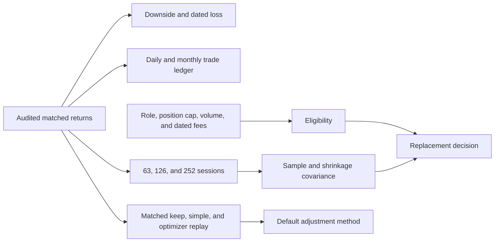
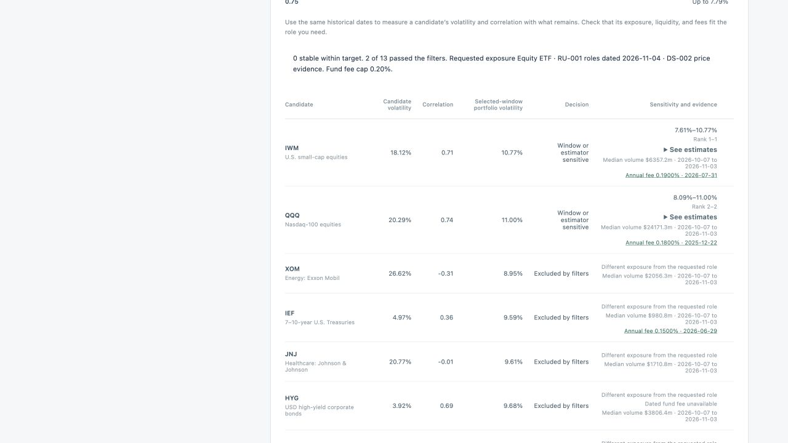

# Version 2 historical risk and replacement evidence

Checkpoint 3 · November 5, 2026

The dashboard now compares historical downside, trading costs, and the consistency of a replacement across risk settings. The results below use the saved 16-instrument DS-002 snapshot through November 3, 2026. The rule and decision threshold were specified before running the evaluation. [Evaluation protocol](V2_RISK_PROTOCOL.md)



## Downside, costs, and exposures

Downside deviation uses returns below zero, with all sessions in the denominator. The equity-heavy example had **7.59%** annualized downside deviation over its last 252 sessions. Its worst observed session in the full replay was **−9.12% on March 16, 2020**. The two figures answer different historical questions. Neither estimates a future probability of loss.

The cost ledger rebalances to target weights after paying for buy and sell notional. Monthly trades occur at completed month-end closes within the sample. The final close has no trade. Dollar exposures use adjusted returns. Fees below are simulated per dollar traded, and taxes, liquidation, fixed charges, and market impact are outside the calculation.

| Schedule | Gross terminal return | Net at 5 bp | Net at 25 bp | Trades |
| --- | ---: | ---: | ---: | ---: |
| Daily | 168.68% | 167.50% | 162.81% | 5,151 |
| Monthly | 164.51% | 164.25% | 163.23% | 246 |

The zero-cost daily ledger reproduces the original historical replay to absolute tolerance `1e-12`. The results show that the assumed charge can change which schedule finishes higher in this example.

The exposure panel sums direct portfolio weights by instrument category. One dated BND issuer breakdown shows selected fund-level exposures. Its date and the source are displayed. Shared underlying issuer exposure remains unknown because the project lacks a matched, complete holdings set. [BND issuer fact sheet, June 30, 2025 edition](https://institutional.vanguard.com/assets/corp/fund_communications/pdf_publish/us-products/fact-sheet/F0928.pdf)

## Replacement screen

The screen retains the audited research universe and existing lock, minimum weight, and move-budget checks. The user can request an instrument role, a maximum resulting position, a minimum 20-session median of close multiplied by reported volume, and a maximum annual fund operating expense. Dollar volume is a liquidity proxy. The source audit did not independently verify volume. Annual fee evidence is date-limited, currently covers five funds, and is never used before its document date or more than 366 days afterward. Missing required evidence blocks eligibility. The role labels describe the dated research registry. They do not reconstruct historical holdings or fund overlap. [Fund evidence registry](../config/fund_evidence.json)

With a 10% AAPL swap and a 10% volatility ceiling, sample covariance qualified **13 of 13** candidates at 63 sessions, **9 of 13** at 126, and **6 of 13** at 252. Comparing both sample and Ledoit–Wolf covariance at all three windows gives six stable and seven sensitive results before filters. The screen shows six estimates, rank ranges, exclusion reasons, and a nominal paired block interval when at least 126 matched sessions support it. Only stable candidates that pass the filters can populate an alternative through this screen. [Ledoit–Wolf estimator](https://scikit-learn.org/stable/modules/generated/sklearn.covariance.LedoitWolf.html)

Requesting an equity ETF and a maximum annual fund fee of 0.20% leaves QQQ and IWM through the exposure and fee filters. Both are sensitive. IEF met the selected-window volatility target at 9.59%, but its Treasury exposure excludes it from this screen. [IEF prospectus](https://www.sec.gov/Archives/edgar/data/1100663/000119312526287945/d127751d497k.htm) · [QQQ prospectus](https://www.sec.gov/Archives/edgar/data/1067839/000110465925123275/tm2529177d5_497k.htm) · [IWM prospectus](https://www.sec.gov/Archives/edgar/data/1100663/000119312526327900/d25568d497k.htm)



## Allocation policy replay

All **432 policy cases** met the matched constraints across four example portfolios and **36 shared origins** from 2023 to 2025. These are 36 market dates. Portfolios on the same date share market conditions. Planned turnover is half the sum of the absolute weight changes before fees. The ledger separately charges executed buy and sell notional after accounting for the reduction in wealth due to costs.

| Policy | Mean annualized realized downside | Mean 20-session net return, 5 bp | Mean 20-session net return, 25 bp | Mean planned turnover |
| --- | ---: | ---: | ---: | ---: |
| Keep current | 6.625% | 1.530% | 1.530% | 0.00% |
| Simple shift | 5.886% | 1.348% | 1.308% | 9.79% |
| Constrained optimizer | 5.851% | 1.341% | 1.301% | 10.00% |

The optimizer lowered mean downside by **0.034 percentage points** versus the simple shift and had lower downside on **21 of 36** shared dates. The nominal paired 95% interval for optimizer minus simple was **−0.074 to +0.003 percentage points**. The reduction fell short of the predeclared 0.25-point minimum, so the dashboard defaults to the simple shift. The optimizer remains selectable. These four retrospective examples used current survivors.

## Reproduce

Run the policy experiment in the Version 2 checkout with its pinned environment and the archived warehouse.

```bash
.venv/bin/python -m scripts.evaluate_v2_allocation --database /path/to/portfolio-risk.duckdb
```

The script verifies the warehouse checksum and reports the protocol hash, aggregate metrics, and per-case outputs. The standalone synthetic demo supports downside, cost replay, and both reweighting rules. The audited replacement screen requires the saved market warehouse. All 169 tests passed locally. The 30 archived Version 1 decisions reproduced through the existing API request shapes within `1e-12`. Browser checks exercised both reweighting modes, an excluded candidate, a stable candidate loaded into the comparison, and the keep-current action. Participant outcomes remain pending. [Market-data reproduction](REPRODUCE.md)
